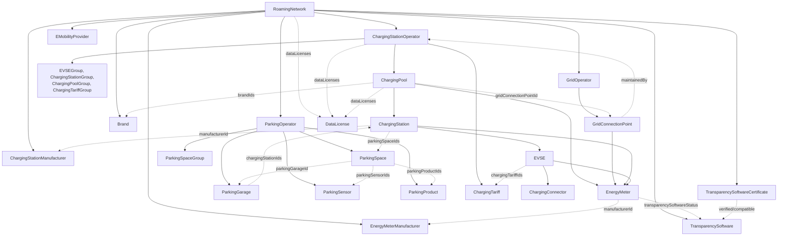

# WWCP POI

WWCP/POI is the *"git of EV infrastructure information sharing"*. It synchronizes points of interest data within
e-mobility as immutable, versioned data sets between servers and servers and (smartphone) clients.

- **Static data is immutable.** A roaming network with everything it embeds is one version,
  named by its ETags. A change set leads from one version to the next; nothing is changed in place.
- **Dynamic data is kept strictly apart.** Admin status, status and energy status are
  not content: they have no ETags, change without a new version and are shared by all versions
  of their entity.
- **Signed by the owners.** Every change set is signed by the owners of what it changes, with keys the
  data names: a charging station operator changes only its own data. Everyone can check every commit.
- **No leader.** Every server commits; the history is a graph of commits, and tips that do not conflict
  are merged deterministically, so that all servers make the same merge commits.
- **WebSocket first.** Peers subscribe to commits and status updates over one WebSocket and push
  their own commits, for fast, low-latency sync; HTTP serves the same reads.
- **JSON and CBOR.** Every representation exists in both, with the same keys and values;
  ETags exist for canonical JSON and canonical CBOR.

## Data



Solid lines embed completely (`chargingStationOperators`, `chargingStationManufacturers`, `eMobilityProviders`,
`gridOperators`, `parkingOperators`, `brands`, `energyMeterManufacturers`, `transparencySoftware`, `transparencySoftwareCertificates`, `chargingTariffs`,
`EVSEGroups`, `chargingStationGroups`, `chargingPoolGroups`, `chargingTariffGroups`, `chargingPools`, `chargingStations`,
`EVSEs`, `chargingConnectors`, `energyMeters`, `gridConnectionPoints`, `parkingGarages`, `parkingSpaces`, `parkingSensors`,
`parkingSpaceGroups`, `parkingProducts`), each 0..n
in the order of their ids; a grid connection point and an EVSE each have 0..1 `energyMeter`.
Dotted lines are references, which must exist in the network.
A pool, station, EVSE, tariff or group belongs to the operator its id names; ids are unique within the operator.
Energy meter, grid connection point, parking garage, space, sensor, space group and product ids are unique within the network;
parking product ids compare case-sensitively.

- **Content:** everything in the JSON and CBOR representations, completely, in a fixed order:
  children and licenses embedded, `created`, `lastChange` and `customData` included,
  timestamps to the millisecond. CBOR uses the keys and values of JSON.
- **Charging pool:** `address`, `geoLocation`, `timeZone` (e.g. `Europe/Berlin`), `parkingType`, `accessibility`,
  `entranceAddress`/`entranceLocation`, `exitAddress`/`exitLocation`, `arrivalInstructions`, `chargingWhenClosed`,
  `facilities`, `paymentOptions`, `uiFeatures`, `features` and `parkingRestrictions` (sets of names, in their order),
  `locationLanguages` (in their given order), `relatedLocations` (`{geoLocation, name?}`, in their given order) and
  `authenticationModes` (`{type, cardTypes?, brandIds?, number?, stationCode?}` with the types of WWCP, e.g. `RFID`,
  `CreditCard`, `SMS`; a type only once, in the order of the types). RFID may name card types and brands
  of the network; SMS and PhoneCall need their `number`.
- **Charging station:** `address` and `geoLocation` when they differ from its pool's, `accessibility`, `vehicleTypes`
  and `features` (sets of names), `calibrationInfo`/`certificationInfo` (URLs), `maxPower` (W) it delivers at once, at most that of its EVSEs together,
  `manufacturerId`/`modelId`, and the `parkingSpaceIds` of the network it charges at.
- **EVSE:** `currentTypes`, `chargingModes` (arrays of names), `maxVoltage` (V), `maxCurrent` (A),
  `maxPower` (W), `geoLocation` when it differs from its station's, `maxReservationDuration` (s),
  `physicalReference` and `chargingConnectors` (`{@id, type, lockable?}`).
- **Grid connection point:** a description without status, embedded in its grid operator; pools name it by
  `gridConnectionPointId`: `voltageLevel`, `connectionType`,
  `nominalVoltage` (V), `nominalFrequency` (Hz), `contractedImport/ExportPower` (W),
  `contractedImport/ExportApparentPower` (VA), `connectionAgreementId`, `networkLocationId`,
  `marketLocationIds`, `meteringLocationIds`, and `maintainedBy` (`{entityType, entityId}`, a charging station
  operator or parking operator; absent: the grid operator). Missing values are unknown; active power must not
  exceed apparent power.
- **Energy meter:** `role` (e.g. `grid`, `pv`, `battery`), `manufacturerId`, `modelId`, `modelURL`,
  `serialNumber`, `hardwareVersion`, `firmwareVersion`; with admin status and status.
  Its manufacturer is an energy meter manufacturer of the network (`name`, `description`, `address`,
  `homepage`, `hotline`, timestamps, without status).
- **Parking:** a parking operator owns its garages, spaces and sensors directly. A space may name a
  `parkingGarageId` and `parkingSensorIds` of the same operator; garages, spaces and sensors may name
  `chargingStationIds` of the network. All have admin status and status. Parking products (`minDuration`,
  `stopParkingAfterTime` in s, without status and timestamps) are named by `parkingProductIds` of garages,
  spaces and space groups of the same operator; they offer, they do not calculate prices.
- **Charging tariff:** as in OCPI: `currency` (ISO 4217), `tariffType` (`AD_HOC_PAYMENT`, `PROFILE_CHEAP`,
  `PROFILE_FAST`, `PROFILE_GREEN`, `REGULAR`), `tariffURL`, `minPrice`/`maxPrice` (`{excludingVAT, includingVAT?}`)
  and `elements`, each with
  `priceComponents` (`{type, price, vat?, stepSize}`, `type` one of `ENERGY`, `FLAT`, `MAX_CURRENT`,
  `MIN_CURRENT`, `PARKING_TIME`, `TIME`; `stepSize` in Wh, A or s, positive, for every type but `FLAT`,
  which has none) and optional `restrictions` (`startTime`/`endTime` as `HH:mm`, `startDate`/`endDate` as `yyyy-MM-dd`, `min/maxEnergy` (Wh),
  `min/maxCurrent` (A), `min/maxPower` (W), `min/maxDuration` (s), `daysOfWeek`). EVSEs name
  `chargingTariffIds` of their operator.
- **Brands:** embedded in the network, so that operators can share them, without status and timestamps:
  `name`, `description`, `logo`, `homepage`. Charging pools, stations and EVSEs name `brandIds`.
- **Opening times:** `openingTimes` of charging pools, charging stations and parking garages, as Styx's
  `OpeningTimes` write them: `24/7`, `regularOpenings` (`[{ "monday": [{ "begin": "07:00", "end": "21:00" }] }]`),
  `exceptionalOpenings`/`exceptionalClosings` (`["begin -> end"]`), `freeText`. Without regular openings it is 24/7.
- **Energy mix:** `energyMix` of charging pools and charging tariffs: `energySources` and `environmentalImpacts`
  (`[]` means unknown), `supplierName`, `productName`, `additionalRemarks`.
- **Images:** `images` of charging pools, stations, EVSEs and parking garages, in their given order:
  `url`, `category` (e.g. `LOCATION`, `CHARGER`), `type`, `width`, `height`, `thumbnail`; a URL only once.
- **Groups:** EVSE, charging station, charging pool and charging tariff groups name members of their
  operator (`EVSEIds`, `chargingStationIds`, `chargingPoolIds`, `chargingTariffIds`), the first three
  optionally a `chargingTariffId`; parking space groups name `parkingSpaceIds`. Groups may overlap and
  have admin status and status.
- **Transparency software:** releases (`TransparencySoftware`, one per version) and their certificates
  are embedded in the network, without status and timestamps. A certificate names the releases it
  verifies or finds compatible, and optionally a manufacturer. An energy meter's `transparencySoftwareStatus`
  assigns releases with their `legalStatus`, at most one entry per release; a given `certificateId` must cover it.
- **ETags:** SHA-256, SHA-384 or SHA-512 over canonical JSON or canonical CBOR.
  They identify a version; `CalcETags()` and `ValidateETags(…)`. Which bytes are hashed and signed
  is specified, with examples, in [SPECIFICATION.md](SPECIFICATION.md).
- **Runtime:** admin status and status are not content and have no ETags. Each entity keeps them
  typed in its status schedules (history and planned status), shared by all its versions:
  a change set takes them along, with the internal data. New entities are operational and
  available since their creation.
- **Energy status:** EVSEs and charging stations also have an energy status, `{used, available, storedEnergy?}`
  in W, W and Wh, for EVSEs also `currentVoltage?` in V and `remainingChargingTime?` in s, kept the same way;
  there is none until one is reported. Its schedule keeps the last ten.
- **Keys:** the roaming network (for its operator, the RNO), charging station operators, e-mobility providers,
  grid operators and parking operators each name 1..n `signingKeys` (a grid operator not taking part none at all), short keys signing their change sets
  (e.g. secp256r1), and 1..n `identityKeys`, long-term keys signing changes of their identity keys (e.g. secp521r1):
  `{@id, key, notBefore?, notAfter?}`, the public COSE key as Base64 of its deterministic CBOR, identified by its
  SHA-256 COSE key thumbprint [RFC 9679] in lowercase hex. A key is not both.

### Entities

Every entity derives from `AImmutableEMobilityEntity`: an identification, a name, a description, a data source,
timestamps and custom data as content, and an admin status and a status as runtime status, shared by all its
versions. [docs/](docs/README.md) explains this base class and documents every entity with all the properties
a change set can manage:

| Entity | Description |
|---|---|
| [RoamingNetwork](docs/RoamingNetwork.md) | The root: one version of a roaming network with everything it embeds, its keys and its ETags. |
| [ChargingStationOperator](docs/ChargingStationOperator.md) | A charge point operator with its charging pools, tariffs and groups. |
| [ChargingPool](docs/ChargingPool.md) | A charging location: address, opening times, facilities, grid connection point and charging stations. |
| [ChargingStation](docs/ChargingStation.md) | A charger with its EVSEs, manufacturer and model, energy meters and energy status. |
| [EVSE](docs/EVSE.md) | One charging point: power, voltage, current, connectors, tariffs and energy status. |
| [ChargingTariff](docs/ChargingTariff.md) | A price as in OCPI: currency, elements with price components and restrictions. |
| [EVSEGroup](docs/EVSEGroup.md) | EVSEs of one operator, optionally with a common tariff. |
| [ChargingStationGroup](docs/ChargingStationGroup.md) | Charging stations of one operator, optionally with a common tariff. |
| [ChargingPoolGroup](docs/ChargingPoolGroup.md) | Charging pools of one operator, optionally with a common tariff. |
| [ChargingTariffGroup](docs/ChargingTariffGroup.md) | Charging tariffs of one operator. |
| [EnergyMeter](docs/EnergyMeter.md) | A meter of a pool, grid connection point, station or EVSE, with its transparency software. |
| [ChargingStationManufacturer](docs/ChargingStationManufacturer.md) | A maker of charging stations, named by the stations it built. |
| [EMobilityProvider](docs/EMobilityProvider.md) | An e-mobility service provider with its keys. |
| [GridOperator](docs/GridOperator.md) | A distribution system operator with its grid connection points, each signed by its maintainer. |
| [ParkingOperator](docs/ParkingOperator.md) | Runs parking garages, spaces and sensors and offers parking products. |
| [ParkingGarage](docs/ParkingGarage.md) | A car park with opening times, images and parking products. |
| [ParkingSpace](docs/ParkingSpace.md) | One parking space, possibly in a garage, with its sensors and charging stations. |
| [ParkingSensor](docs/ParkingSensor.md) | A sensor detecting whether parking spaces are occupied, named by the spaces it watches. |
| [ParkingSpaceGroup](docs/ParkingSpaceGroup.md) | Parking spaces of one operator, e.g. a level or a zone. |

## Change sets

A change set is an ordered list of changes against one version, named by its before ETags,
leading to the version named by its after ETags.

```csharp
// The public halves of the private keys of the parties.
var gef = new ChargingStationOperator(ChargingStationOperator_Id.Parse("DE*GEF"),
                                      I18NString.Create(Languages.en, "GraphDefined"),
                                      SigningKeys:   [ POIPublicKey.From(gefSigningKey)  ],   // e.g. secp256r1
                                      IdentityKeys:  [ POIPublicKey.From(gefIdentityKey) ]);  // e.g. secp521r1

var rn1 = new RoamingNetwork(RoamingNetwork_Id.Parse("rn1"),
                             DataSource:                "v1",
                             ChargingStationOperators:  [ gef ],
                             SigningKeys:               [ POIPublicKey.From(rnoSigningKey)  ],
                             IdentityKeys:              [ POIPublicKey.From(rnoIdentityKey) ]);

var newOperator = new ChargingStationOperator(ChargingStationOperator_Id.Parse("DE*NEW"),
                                              SigningKeys:   [ POIPublicKey.From(newSigningKey)  ],
                                              IdentityKeys:  [ POIPublicKey.From(newIdentityKey) ]);

var cs  = rn1.CreateChangeSet([
              RoamingNetworkChange.UpdateProperty(rn1, "dataSource", null, "v2"),             // the network
              RoamingNetworkChange.Add           (newOperator),                               // a new operator
              RoamingNetworkChange.UpdateProperty(gef, "telephone",  null, "+49 30 7654321")  // the operator DE*GEF
          ]).
          Sign(rnoSigningKey, POIPublicKey.From(rnoSigningKey).Id, COSEAlgorithm.ES256).      // owns the network and adds operators
          Sign(gefSigningKey, POIPublicKey.From(gefSigningKey).Id, COSEAlgorithm.ES256);      // owns DE*GEF

var rn2 = rn1.ApplyChangeSet(cs);   // rn1 stays as it was
```

- **Changes:** `UpdateProperty`/`RemoveProperty` of every entity's own properties, not of its children;
  `Add`/`Remove` of operators, manufacturers, energy meter manufacturers, e-mobility providers, grid operators, parking operators, brands,
  transparency software releases and certificates, pools, tariffs, groups, stations (`Add(station, poolId)`),
  EVSEs (`Add(evse, stationId)`), parking garages, spaces, sensors and space groups
  (`Add(space, parkingOperatorId)`) and grid connection points (`Add(point, gridOperatorId)`). Energy meters
  are properties of what embeds them (`energyMeters`, `energyMeter`).
  Every reference must exist; a referenced entity can not be removed. The overload by the entity's
  type names it: a change is data, `{entityType, entityId, propertyName, oldValue, newValue}`, applied
  to the entity with that id in the version it is applied to.
- **Old values:** `CreateChangeSet` gives every change the value it finds; JSON `null` means
  "expected absent". A change finding another value conflicts.
- **Timestamps:** a change set sets `lastChange` to its `CreatedAt`, so its after ETags are deterministic:
  of the roaming network always, of an entity when it is added or its own properties change, not when only what
  it embeds changes. Whether anything below an entity changed shows its ETag, what changed the history.
- **Owners:** every change set must be signed by the owner of every change it makes, with a key the owner has
  in the version it is applied to, valid at its `createdAt` (`TryCheckOwnership`); every signature must be one of
  a key of a party. Nobody else's signature counts, there is no external trust configuration.
  - The **RNO** owns the roaming network itself, brands, manufacturers, energy meter manufacturers and
    transparency software, and adds and removes parties: with their keys (a grid operator not taking part
    without, then the RNO signs in its place until it gives it keys), without their children. The RNO decides
    who is a member: removing a party removes all its data with it, without the party's signature; the history
    keeps the versions before.
  - A **charging station operator** owns its properties, pools, stations, EVSEs, tariffs and groups,
    named by their ids; a **parking operator** its parking data; e-mobility providers and grid operators their properties.
  - A **grid connection point** is owned by its maintainer: its grid operator, or the charging station operator
    or parking operator its `maintainedBy` names, e.g. while the grid operator does not take part. The grid
    operator takes it over or hands it on by changing `maintainedBy`; the maintainer can hand it on; an identity
    key of the RNO reassigns it.
  - Data is signed with a signing key. The `signingKeys` of a party are rotated with one of its current signing
    keys or, when none of them can sign any more, one of its identity keys; its `identityKeys` only with one of
    its identity keys. For recovery, an identity key of the RNO changes both kinds of keys of every other party.
    A party keeps at least one key of each kind.
  - The RNO's identity keys are the root of trust: nobody can replace them once they are lost or expired.
    An RNO should therefore name at least two identity keys with different `notAfter`, one of them kept
    offline, and replace an identity key well before it expires.
- **Rebase:** `rn2.TryRebase(cs, …)` prepares a change set of an older version again, unless it conflicts;
  the rebased change set is unsigned, its owners sign it again.
- **Signatures:** `Sign(…)` and `VerifySignature(…)` over canonical JSON (COSE algorithms of Styx);
  an optional `VerifyChangeSetSignature` checks them in addition.
- **Wire:** JSON and CBOR; `RoamingNetworkChangeSetLimits` bound bytes, depth, changes and signatures.

## History and sync

There is no leader: every server commits change sets signed by their owners, takes the commits
of the others, and merges the tips that do not conflict, deterministically, so that all servers
make the same merge commits.

```csharp
var server1 = RoamingNetworkHistory.Start(rn1);
RoamingNetworkHistory.TryFromSnapshot(server1.ToSnapshotJSON(), out var server2, out _);

var result  = server1.Commit(cs);                         // Committed, AlreadyCommitted, Refused

server1.TryGetMissingCommits(server2!.HaveIds(), out var commits, out _);
server2.TryAppend(commits!, out _, out _);                // and merged with the tips of server 2
```

- **Commits:** a change set, its `parentIds`, its revision and the ETags of the result.
  The id is the SHA-256 of the commit's canonical JSON without signatures; it is checked when read.
  The revision is one more than the highest one of the parents.
- **Commit:** `Commit(cs)` commits a change set to the version it was made for, named by its before
  ETags: the head, another tip, or an older commit, which then starts a branch. Signed change sets
  are not rebased: they are committed where they fit, and merged.
- **Tips and merges:** the tips are the commits no other one follows, ordered by revision, then by id;
  the head is the first one, its version is `Head.RoamingNetwork`. The first two tips that do not
  conflict are merged into a merge commit with both as `parentIds`: a three-way merge with their best
  common ancestor, entity by entity and property by property, written as an unsigned change set from
  the first one; everyone can calculate it, and `TryAppend` checks it. Conflicting tips stay, with their
  `Conflicts` (`{kind, entityType, entityId, propertyName?, base, left, right}`), until the owner commits
  a change set to one of them that resolves the conflict, e.g. taking the value of the other one.
- **Several best common ancestors**, e.g. after a conflict was resolved on two servers, are merged into
  a virtual merge base, as git's recursive strategy does. Where they conflict, it has a conflict marker
  (`{"@conflict": {base, left, right}}`, also the `base` of a conflict there): the tips merge if they
  resolved it alike, and conflict otherwise.
- **Exchange:** `HaveIds()` names the tips and a sample of older commits, `TryGetMissingCommits(have)`
  returns what is missing there, parents first, and `TryAppend(commits)` takes them and merges afterwards.
- **Commit signatures:** several parties sign a commit, each on its own and in any order, with a `role`
  (`leader`, `roamingNetworkOperator`, `chargingStationOperator`, …), an optional `signer` and `signedAt`:
  a server through `Start(network, Signers: […])` or `history.Signers`, a roaming network operator that
  checked the data of a charging station operator later through `commit.CreateSignature(…)` and
  `TryAddSignatures(…)`. A signature covers the commit and the signatures of its change set; adding one
  does not change the commit id. `TryAppend` verifies every signature (`VerifyCommitSignature`) and
  may require roles (`RequiredSignatureRoles`); `OnCommitSignatures` tells of new ones.
- **Appending:** a commit's parents must be known; one with one parent must be signed by its owners and
  lead to its ETags, a merge commit must be the merge of its parents.
- **Snapshot:** now and complete, for the first sync: `{timestamp, commit, roamingNetwork, runtimeStatus}`.
  `TryFromSnapshot` checks the commit id, recomputes the ETags of the network and takes the runtime status
  as the server's; changes follow as commits since. `runtimeStatus=false` leaves the status out.
- **Announcements:** `OnCommitAnnouncement` tells of every commit a history takes, in order:
  timestamp, commit id, parent ids, revision, description.
- **Runtime status:** `history.RuntimeStatus` sets and reads the status of the head's entities by name,
  `TryUpdate(kind, entityType, entityId, value, timestamp, …)`: an older timestamp is `Outdated`,
  the same value `Unchanged`, a later one than now `Scheduled`. `OnStatusUpdate` tells of every change,
  also of one set at the entity, and of a planned status when it is due. A status update of another server,
  `TryUpdate(statusUpdate, …)`, is taken with its timestamp.
- **Group status:** the status of a group is set manually, or calculated by a delegate from the status of its
  members, e.g. `history.RuntimeStatus.CalculateStatus(groupId, POIGroupStatus.OfEVSEs)`; then the delegate has
  the say, and every other status of the group is refused. See [docs/](docs/README.md#calculated-status-of-groups).

### Persistence and retention

A history keeps itself in a store, an `IRoamingNetworkHistoryStore`, and is loaded from it after a restart:

```csharp
using var store = new RoamingNetworkHistoryFileStore("data/rn1");      // one directory per roaming network

var history = RoamingNetworkHistory.TryLoad(store, out var loaded, out _)
                  ? loaded!
                  : RoamingNetworkHistory.Start(rn1, Store: store,
                                                Retention: new RoamingNetworkHistoryRetention { RetainCommits = 1000 });
```

- **Content:** a base, the snapshot of the root with its runtime status, and a log since, one entry per line:
  every commit, signatures added later, and every change of the runtime status. Commits and signatures
  are written, and synced to the disk, before the history shows them: a store failing refuses the commit.
  Status updates are synced in batches (`StatusFlushInterval`, 1 s).
- **Files:** `CURRENT` names a generation `gen-NNNNNN` with `base.json` and `log.jsonl`. A last line written
  only partly by a crash is dropped when loading; compacting writes a new generation completely before
  `CURRENT` names it. The file `LOCK` keeps a second store from the directory.
- **Numbers:** written as canonical JSON, as the API's responses and the WebSocket messages are, so every
  number is read back as it was: a decimal with exactly its decimal places (`150000`, not `150000.0`, which
  canonical JSON and CBOR, and so the ETags, would tell apart) and a coordinate as the double it was.
- **Loading:** `TryLoad` checks every commit again (owners' signatures, merges calculated again, ETags) and
  merges the tips afterwards, e.g. when a crash came before a merge commit was written.
- **Retention:** a history keeps the versions of its root, its tips, every `VersionCheckpointInterval`-th
  revision and its `RecentVersions` latest commits, and calculates others again when needed.
  `Compact()`, or the history itself once the log has `CompactAfterLogEntries` entries, drops the commits
  before a new root, the latest commit all tips follow at least `RetainCommits` revisions behind the head,
  and folds the runtime status into the new base. A server knowing only older commits starts from a
  snapshot then, and a branch older than the root can no longer be appended.
- **Peers** keep a history started from a snapshot in `RoamingNetworkPeerOptions.Store`, with its `Retention`.
  `RoamingNetworkHistoryMemoryStore` keeps the same content in memory, e.g. for tests.

`POI_API` serves a history in JSON, or in CBOR for `Accept: application/cbor` (also as request body):

| Request | Returns |
|---|---|
| `GET ~/RNs/{id}/history/head` | metadata of the head commit |
| `GET ~/RNs/{id}/history/tips` | metadata of the head and all tips, and the conflicts keeping them apart |
| `GET ~/RNs/{id}/history/haveIds` | the tips and a sample of older commits held here |
| `GET ~/RNs/{id}/history/snapshot?runtimeStatus=false` | head commit, complete network and its runtime status |
| `GET ~/RNs/{id}/history/commitInfos?since={commitId}&max={n}` | metadata of the commits since |
| `GET ~/RNs/{id}/history/commits?since={commitId}&max={n}` | complete commits since |
| `GET ~/RNs/{id}/history/commits?have={commitId,…}&max={n}` | complete commits missing at who holds these, parents first |
| `POST ~/RNs/{id}/history/commits` `{commits: […]}` | 200 appended (how many, head, tips, conflicts), 422 one refused, 403 |
| `GET ~/RNs/{id}/history/commits/{commitId}` | one commit |
| `COMMIT ~/RNs/{id}/history/changeSets` | 201 committed, 200 already committed (the commit, the `head`, the `conflicts` left), 422 refused |
| `POST ~/RNs/{id}/history/commits/{commitId}/signatures` `{signatures: […]}` | 201 added, 200 known, 403, 404, 422 invalid |

It also serves the roaming networks and their entities, readable from every origin (CORS `*`), each in canonical
JSON or CBOR with the POI ETag of its representation as HTTP `ETag` (e.g. `"json:sha256:hex:…"`); a known
`If-None-Match` is answered with 304. HEAD and OPTIONS are answered for every one:

| Request | Returns |
|---|---|
| `GET ~/RNs` | the roaming networks, as `{@id, name, description}` |
| `GET ~/RNs/{RN_Id}` | the roaming network, the head of its history |
| `GET ~/RNs/{RN_Id}/{CSOs\|GOs\|EMPs\|CSMs\|POs}` | its charging station operators, grid operators, e-mobility providers, charging station manufacturers or parking operators, as `{@id, name, description}` |
| `GET ~/RNs/{RN_Id}/CSOs/{CSO_Id}[/CPs/{CP_Id}[/CSs/{CS_Id}[/EVSEs/{EVSE_Id}]]]` | an operator, pool, station or EVSE as its parent embeds it; a pool with `?expand=gridConnectionPoint` |
| `GET ~/RNs/{RN_Id}/GOs/{GO_Id}[/GCPs/{GCP_Id}]` | a grid operator, or one of its grid connection points |
| `GET ~/RNs/{RN_Id}/{EMPs\|CSMs\|POs}/{Id}` | an e-mobility provider, charging station manufacturer or parking operator |

Versions are immutable and their runtime status is no part of these representations, so each one is calculated
once per version and format and kept as long as the version is referenced; an entity a commit does not change is
the same object in the new version and keeps its representations. A 304 costs a lookup. Only an expanded view is
calculated for every request.

### Query

The lists are the QUERY interface, beside the synchronization above: `GET ~/RNs/{RN_Id}/CPs` lists the charging
pools of all charging station operators of a roaming network, each as its operator embeds it, with
`chargingStationOperator: {@id, name}`; `GET ~/RNs/{RN_Id}/CSOs/{CSO_Id}?without=chargingPools` is the operator
without them, so that a large one is not read whole to show what it says of itself. Every list, `~/RNs` and
`~/RNs/{RN_Id}/{CSOs|GOs|EMPs|CSMs|POs}` as well, takes:

| Parameter | |
|---|---|
| `match` | words separated by spaces, each contained in a text of an entry, case-insensitively; a word starting with `!` must not be |
| `operatorId` | `CPs` only: the charging pools of one charging station operator |
| `offset`, `limit` | the part of the matching entries; all of them without `limit` |

Entries are in the ordinal order of their identifications. `X-Total-Count` says how many entries the list has,
`X-Filtered-Count` how many match, and `Link` names the `next` and the `prev` page; the `ETag` is the one of the
returned content. A list without any of them is kept with its version, as above.

`new POI_API(HTTPServer, RootPath: "/poi", HTMLView: …)` serves all of it below a path of its own, e.g. beside a web
interface. With an `HTMLView`, a request for a list or an entity that prefers `text/html` to JSON and CBOR - a browser opening
its URL - is answered by it, e.g. with the page of a web frontend that asks the same URL for the data; every other
request, also one without an `Accept` header field or with `*/*`, gets JSON or CBOR. The RoamingHub serves its
roaming networks so, below `/poi`.

Submitting is refused unless `AuthorizeChangeSetSubmission` decides who may submit;
what a change set may change, its owners' signatures decide. Pushing commits is refused unless
`AuthorizeCommitPush` decides who may push, e.g. other servers; they are checked as every commit.
Adding commit signatures needs
`AuthorizeCommitSignature` (e.g. whether the sender has the role it signs in) and `VerifyCommitSignature`.

### WebSocket

`GET ~/RNs/{id}/history/ws` upgrades to a WebSocket with OCPP-J frames,
JSON in text frames, CBOR in binary frames; every request is answered in its own format.

```
[2, "42", "commitInfos", { "since": "9f3c…", "max": 10 }]    request
[3, "42", { "commitInfos": [ … ] }]                          response
[4, "42", "NotFound", "The commit … is unknown here!", {}]   request error
```

- **Actions:** `head`, `tips`, `haveIds`, `snapshot`, `commitInfos`, `commits {since? | have?, max?}`, `commit {commitId}`,
  `pushCommits {commits}` → `{appended, head, tips, conflicts?, description?}`, `pushStatusUpdates` (below),
  `commitChangeSet {changeSet}` → `{status, …, head, conflicts?}`, `runtimeStatus`,
  `signCommit {commitId, signatures}` → `{commitId, signatures, added}`.
- **Subscriptions:** `topics` lists them, `subscribe`/`unsubscribe {topics: […]}` change them:
  `commitAnnouncements`, `commits` (complete; above `MaxPushedCommitSize` only announced),
  `commitSignatures` (`{commitId, signatures}` added later), `adminStatusUpdates`,
  `statusUpdates`, `energyStatusUpdates`. Pushes are sends, `[6, "p1", action, payload]`,
  in the format of the last `subscribe`. They end with the connection; a client that falls more than
  `MaxQueuedPushes` pushes or `MaxQueuedPushBytes` behind is disconnected and catches up after reconnecting.
- **Async:** requests are processed concurrently, up to `MaxConcurrentRequests` per connection;
  answers come when ready and are matched by their id. A connection's requests are cancelled when it closes.
- **setStatus** `{kind, entityType, entityId, value, timestamp?, dataSource?}` → `{result, description?, current?}`,
  allowed as `AuthorizeStatusUpdate` decides (refused without it).
  `kind` is `adminStatus`, `status` or `energyStatus`, whose `value` is an object `{used, available, storedEnergy?, currentVoltage?, remainingChargingTime?}`.
  Status updates come often, e.g. within a minute as the AFIR asks: send them as one batch.
- **pushStatusUpdates** `{statusUpdates: […]}` → `{results: [{result, description?}, …]}`: status updates of
  another server, as the topics push them, up to `MaxBatchSize`, each allowed as `AuthorizeStatusPush` decides
  (refused without it), e.g. only for the operators that server hosts. They are taken with their timestamps:
  the latest status of an entity wins, wherever it was set.
- **Batches:** messages of the same action aggregate. A request `{batch: [p1, p2, …]}` runs per payload,
  in order, and is answered with `{batch: [r1, {error: {code, description, details}}, …]}`, up to `MaxBatchSize`.
  Pushes of the same action that wait together go out as one `{batch: […]}`, up to the `maxBatchSize`
  of `subscribe` (1 turns it off); `PushCoalescingDelay` lets more gather.
- **Errors:** the codes of OCPP-J plus `NotFound`; an unreadable frame is answered on id `"-1"`.
- **Access:** open like the HTTP reads, unless `AuthenticateWebSocketClient` is set;
  `commitChangeSet` asks `AuthorizeChangeSetSubmission` with the upgrade request.

### Peer

`RoamingNetworkPeer` keeps a history in sync with another server over its WebSocket. There is no leader:
both commit, push their commits to each other, and merge alike.

```csharp
await using var peer = new RoamingNetworkPeer(new Uri("wss://server1/RNs/rn1/history/ws"),
                                              Options: new RoamingNetworkPeerOptions {
                                                           TrustedRoamingNetworkOperatorKeyIds = [ rnoIdentityKeyId ]
                                                       });
await peer.StartAsync();                          // returns once caught up for the first time

var current = peer.History!.Head.RoamingNetwork;  // the current version

peer.History.Commit(current.CreateChangeSet([      // committed here, pushed to server 1, merged there
              RoamingNetworkChange.UpdateProperty(current, "dataSource", null, "v3")
          ]).Sign(rnoSigningKey, rnoSigningKeyId, COSEAlgorithm.ES256));
```

- **Sync:** subscribe first, then a snapshot (when it has no history yet), the commits it misses, naming
  those it holds (`have`), the runtime status, and then it pushes the commits the other server misses.
  Pushed commits whose parents it holds are appended, others make it fetch; new commits of its own
  history, made here or taken from elsewhere, are pushed as they come (`PushCommits`).
- **Status:** the status of the other server is taken (`FollowStatus`); the status set here, e.g. by an
  operator's backend, or taken from elsewhere, goes there (`PushStatus`, `pushStatusUpdates`): after connecting
  the status it has differently, e.g. set while not connected, then every change, in order with the commits,
  so that a new EVSE arrives before its status. Nothing that came from the other server goes back.
- **Trust:** `TrustedRoamingNetworkOperatorKeyIds` names keys of the roaming network operator a snapshot
  must have; afterwards, every change set is checked by the keys in the data.
- **Reconnect:** a broken connection is opened again with growing delays, and it catches up.
  None of its commits known there starts it again from a snapshot (`OnHistoryReplaced`).
- **Options:** complete commits or announcements, following status or not, pushing commits and status or not, credentials via
  `ConfigureWebSocket`, an additional verifier of change set signatures, a verifier of commit signatures,
  the roles every commit must be signed in, limits.
- **Signing:** `SignCommitAsync(commitId, signatures)` sends the signatures of, e.g., a roaming network
  operator to the other server; every peer takes them from the `commitSignatures` topic.

## Submodules

| Directory | What it is |
|---|---|
| `WWCP_POI2` | Shared lower layer: identifications, status values, predefined strings, energy information, transparency software |
| `WWCP_POI3` | Roaming networks with their operators, pools, stations, EVSEs, tariffs, groups, manufacturers, e-mobility providers, grid operators, energy meters, transparency software and parking; change sets, history, sync |
| `old` | The earlier implementation, for reference only; not developed further |


## Open

- Finer subscription filters
- Further entities: as the use cases need them

## Tests

```bash
dotnet test WWCP_POI3_Tests/WWCP_POI3_Tests.csproj
```

## Use of generative AI

*Why this section exists: [RATIONALE.md](RATIONALE.md).*

POI3 is built by one maintainer working with an AI coding agent, Claude Code
(model Claude Opus 5.5), since 2026-10-10. Every commit the agent wrote part of
names it in a `Co-Authored-By` trailer.

**The maintainer decides what is built and how.** The requirements come from
the maintainer's work on e-mobility roaming: which data a roaming network
needs, which standards it has to map to (OCPI, DATEX II under AFIR, the
OCPP-J framing of the WebSocket API), and which parties own which data.
Where several designs would work, the agent lays out the alternatives and
what each would break, and the maintainer chooses. The choices so far are
listed below.

**The agent writes most of the text.** From these decisions, the agent
implements POI3 in short iterations: entities, change sets, signatures,
history, sync, the HTTP and WebSocket APIs, their tests, `docs/` and
`SPECIFICATION.md`. Each iteration ends with a commit the maintainer
reviews and pushes.

**Tests and the specification are the check, not the agent's word.**
Behaviour is pinned by the tests in `WWCP_POI3_Tests` and by
`SPECIFICATION.md`, and the adapters to OCPI 2.3.0 and DATEX II 3.7 have
their own tests in both directions.

**Without AI:** the data structures of `WWCP_POI2` were carried over from
[WWCP_Core](https://github.com/OpenChargingCloud/WWCP_Core), where they were
written over many years. *[Confirm: written without AI tools?]*

### Decisions

Decisions taken by the maintainer between alternatives the agent laid out:

- **2026-10-13 – POI3 has no leader.** Every server commits; the history is a
  graph of commits with deterministic merges, instead of one server ordering
  every commit (built first, in `5bfd15c`). *[Grounds needed, see "The one
  rule for every why" in RATIONALE.md]*
- **2026-10-13 – Owners sign their own data.** A change set is valid only
  when signed by the owner of everything it changes, with the owners' keys in
  the network data itself, not in an external trust configuration.
- **2026-10-14 – Grid connection points have exactly one maintainer,** not
  shared ownership. Distribution system operators are the actual source of
  contracted grid capacity and MaLo/MeLo identifiers, but few will take part
  at first, so charging station operators must keep publishing these data.
- **2026-10-14 – DATEX II: the existing model migrated to 3.7,** not a second
  model next to it, because AFIR requires DATEX II from 2026-04-14 and the
  German NAP takes the Mobilithek profile 01-00-00 only as JSON.
- **2026-10-16 – Tariff price limits as net price plus optional gross price,**
  so that OCPI's price limits are taken without rounding.

### Rejected suggestions

- *[to be filled in: what the agent suggested, why it was rejected, what
  that rests on]*

## License

Affero GPL 3.0, see `LICENSE`. Contributions under the `Contributor License Agreement.txt`.

## Funding

This Open Source project is partially funded by the [NGI Zero Commons Fund](https://nlnet.nl/commonsfund/) as part of our [EVQI project](https://nlnet.nl/project/EVQI/).

We also appreciate any additional funding and long-term support for the Chargy family, for example via [GitHub Sponsors](https://github.com/sponsors/GraphDefined), as it helps us keep the project sustainable, independent and useful for the entire e-mobility community.

<center>
  
</center>
