# WWCP POI

WWCP/POI is the *"Git of EV charging related information sharing"*.

It provides a decentralized, cryptographically verifiable approach to synchronizing EV charging infrastructure information between different actors, including Charging Station Operators (CSOs/CPOs), E-Mobility Providers (EMPs), Grid Operators (GOs), roaming platforms, and ultimately EV drivers using their smartphones.

These datasets include physical infrastructure information, such as charging pools, charging stations, EVSEs, connectors and energy meters, as well as logical information, such as charging tariffs, grid connection points, cryptographic identities, trust anchors for legally relevant measurements and commercial offers.

Inspired by Git and Merkle-tree-based distributed systems, WWCP/POI introduces a fundamentally new approach to EV charging infrastructure information sharing, making it possible to answer several critical questions that traditional EV roaming protocols have left unresolved:

1. ***"Are the 10,000,000 charging stations on this server really identical to those on another server?"*** Traditional EV roaming protocols, such as OICP, OCHP and OCPI, largely follow a SQL database-oriented synchronization model: exchange objects, use (additional) identifiers and modification timestamps, and hope that every participant eventually arrives at the same state. WWCP/POI in contrast provides immutable snapshots and changesets and calculates a hirachical hash value of the entire roaming network. By this participants now can compare a single digest, instead of comparing millions of database records. If the hashes differ, the hierarchical structure helps to identify the affected subtrees. Missing commits and changesets can then be exchanged without retransmitting the entire network over and over again.

2. ***"Who is allowed to change charging infrastructure information, and can anyone verify it?"*** In conventional roaming architectures, a receiving platform must largely trust that its upstream data provider was authorized to publish or modify the information it forwarded. This becomes especially problematic with roaming hubs, aggregators and other intermediaries *(men-in-the-middle)*. Data may pass through several independent organizations before it reaches an EMP or an EV driver. Transport channel authentication like *Transport Layer Security (TLS)* alone does not establish who originally authorized a particular data modification. WWCP/POI therefore uses digitally signed changesets with explicit ownership rules.

3. ***"Is this charging station information and charging tariff authentic, up-to-date and still verifiable months later?"*** Today, EV drivers often have little reliable evidence that the charging station information and tariffs displayed by their navigation system or charging application genuinely originated from the responsible operator. Even worse, when a charging invoice arrives weeks later, how can a driver establish which tariff had actually been published when charging began? An EV driver normally wants to know only a few things: *"Is this the correct charging station? Does it support my vehicle? What will charging cost? Can I trust the information being presented to me?"* Therefore there is no reason for a smartphone to download millions of unrelated charging station records just to answer those few questions, but on the other hand a screenshot of the charging station display or app is hardly a satisfactory solution to **digital consumer protection**. WWCP/POI enables cryptographically verifiable chain of trust and hierarchical inclusion proofs before, during and after a charging session.

4. ***"Why Germany's digital metrology failed to deliver trustworthy measurement data?"*** The famous *German Calibration Law (Eichrecht)* is a well-known example how well-intentioned approaches fail in practice. Digital signatures on calibrated measurement data alone do not provide additional security, when the public keys to validate the measurements are sent along the measurement data, as every internal attacker can easily modify the measurements, replace the public keys and recalculate the signatures. WWCP/POI therefore also acts as *domain-specific public key infrastructure* providing trustworthy cryptographic anchors for validating metrological measurements.

5. ***Why are slowly changing infrastructure data and rapidly changing operational data still mixed together?*** Traditional EV roaming protocols like OICP, OCHP and OCPI often use substantially similar REST-based communication patterns for two fundamentally different categories of information: **Slowly changing data** includes charging station locations, connector types, installed hardware, infrastructure ownership, general charging tariffs and cryptographic trust anchors and therefore requires *reproducible consistency*. **Fast-changing data** includes EVSE availability, operational status, reservations, live energy information and dynamic tariffs and therefore requires *low latency*. These categories have different requirements for caching, synchronization, consistency, latency and historical retention and should not be forced into the same synchronization model with the poor result that most dynamic status and tariff information today is often much older than the exspected 1 minute dead-line defined by the *Alternative Fuels Infrastructure Regulation (AFIR)*. WWCP/POI builds upon the EVQI overlay communication protocol stack allowing to use HTTP/1.1 WebSockets and multiple concurrent data streams of HTTP/2 and HTTP/3.

7. ***"How can we enable future use cases and services without breaking compatibility with older hard- and software?"*** One major design flaw of traditional EV charging protocols are overly strict message schema restrictions and ignoring that true *interoperability* also means to be interoperable with their past and future protocol versions. WWCP/POI makes *vendor extensions* a first-class use case allowing everyone to extend messages and data structures in a controlled way. For serialization WWCP/POI uses canonical JSON and CBOR with metrological and linked data extensions.

8. ***"Can existing EV roaming systems benefit without being fully replaced?"*** WWCP/POI as a *GNU-inspired* Open Source project is not intended to require the immediate replacement of OICP, OCHP, OCPI or the European DATEX II ecosystem. Existing systems can import data into the WWCP/POI domain model or expose synchronized information through established interfaces, including OCPI and DATEX II. WWCP/POI enables practical uses beyond conventional roaming, such as independently verifiable AFIR open-data publications, historical infrastructure audits, synchronization diagnostics and consumer-facing tariff transparency.

9. ***"Is WWCP/POI yet-another-centralized-infrastructure?"*** Just like within Git in WWCP/POI there is no leader! Every server commits; the history is a graph of commits, and tips that do not conflict are merged deterministically, so that all servers make the same merge commits.


## The Domain Model

```mermaid
flowchart TD
    RoamingNetwork --> ChargingStationOperator
    RoamingNetwork --> ChargingStationManufacturer
    RoamingNetwork --> EMobilityProvider
    RoamingNetwork --> GridOperator
    RoamingNetwork --> ParkingOperator
    RoamingNetwork --> TransparencySoftware
    RoamingNetwork --> TransparencySoftwareCertificate
    RoamingNetwork --> EnergyMeterManufacturer
    ParkingOperator --> ParkingGarage
    ParkingOperator --> ParkingSpace
    ParkingOperator --> ParkingSensor
    ParkingOperator --> ParkingTemplatesGroups["ParkingSpaceTemplate,<br/>ParkingSpaceGroup"]
    ParkingOperator --> ParkingProduct
    ChargingStationOperator --> ChargingTariff
    ChargingStationOperator --> Templates["EVSETemplate, ChargingStationTemplate,<br/>ChargingPoolTemplate, ChargingTariffTemplate"]
    ChargingStationOperator --> Groups["EVSEGroup, ChargingStationGroup,<br/>ChargingPoolGroup"]
    ChargingStationOperator --> ChargingTariffGroup
    ChargingStationOperator --> ChargingTariffOffer
    ChargingStationOperator --> MeterTemplatesGroups["EnergyMeterTemplate,<br/>EnergyMeterGroup"]
    GridOperator --> MeterTemplatesGroups
    EMobilityProvider --> Groups
    EMobilityProvider --> ChargingTariffOffer
    ChargingStationOperator --> ChargingPool
    ChargingStationOperator --> Brand
    ChargingPool --> Brand
    ChargingStation --> Brand
    EVSE --> Brand
    ChargingPool --> ChargingStation
    GridOperator --> GridConnectionPoint
    ChargingStation --> EVSE
    EVSE --> ChargingConnector
    ChargingPool --> EnergyMeter
    GridConnectionPoint --> EnergyMeter
    ChargingStation --> EnergyMeter
    EVSE --> EnergyMeter
    ChargingStation -. manufacturerId .-> ChargingStationManufacturer
    ChargingPool -. gridConnectionPointId .-> GridConnectionPoint
    GridConnectionPoint -. maintainedBy .-> ChargingStationOperator
    ParkingSpace -. parkingGarageId .-> ParkingGarage
    ParkingSpace -. parkingSensorIds .-> ParkingSensor
    ParkingGarage -. chargingStationIds .-> ChargingStation
    ParkingSpace -. parkingProductIds .-> ParkingProduct
    ChargingStation -. parkingSpaceIds .-> ParkingSpace
    EVSE -. chargingTariffIds .-> ChargingTariff
    EVSE -. templateIds .-> Templates
    ChargingTariffOffer -. groupIds .-> Groups
    EnergyMeter -. manufacturerId .-> EnergyMeterManufacturer
    EnergyMeter -. transparencySoftwareStatus .-> TransparencySoftware
    TransparencySoftwareCertificate -. verified/compatible .-> TransparencySoftware
    RoamingNetwork -. dataLicenses .-> DataLicense
    ChargingStationOperator -. dataLicenses .-> DataLicense
    ChargingPool -. dataLicenses .-> DataLicense
```



Solid lines embed completely (`chargingStationOperators`, `chargingStationManufacturers`, `eMobilityProviders`,
`gridOperators`, `parkingOperators`, `energyMeterManufacturers`, `transparencySoftware`, `transparencySoftwareCertificates`, `chargingTariffs`,
`EVSETemplates`, `chargingStationTemplates`, `chargingPoolTemplates`, `chargingTariffTemplates`, `energyMeterTemplates`,
`EVSEGroups`, `chargingStationGroups`, `chargingPoolGroups`, `chargingTariffGroups`, `energyMeterGroups`, `chargingTariffOffers`,
`chargingPools`, `chargingStations`, `EVSEs`, `chargingConnectors`, `energyMeters`, `gridConnectionPoints`, `parkingGarages`,
`parkingSpaces`, `parkingSensors`, `parkingSpaceTemplates`, `parkingSpaceGroups`, `parkingProducts`, `brands`), each 0..n
in the order of their ids; a grid connection point and an EVSE each have 0..1 `energyMeter`.
Dotted lines are references, which must exist in the network.
A pool, station, EVSE, tariff or template belongs to the operator its id names; ids are unique within the operator.
Groups and charging tariff offers belong to the party embedding them, a group's id naming that party; their ids are
unique within the network, as those of energy meter templates and groups, of a charging station operator or of a grid operator.
Energy meter, grid connection point, parking garage, space, sensor, space template, space group and product ids are unique within the network;
parking product ids compare case-sensitively.

- **Content:** everything in the JSON and CBOR representations, completely, in a fixed order:
  children and licenses embedded, `created`, `lastChange` and `customData` included,
  timestamps to the millisecond. CBOR uses the keys and values of JSON.
- **Charging pool:** `address`, `geoLocation`, `timeZone` (e.g. `Europe/Berlin`), `parkingType`, `accessibility`,
  `entranceAddress`/`entranceLocation`, `exitAddress`/`exitLocation`, `arrivalInstructions`, `chargingWhenClosed`,
  `facilities`, `paymentOptions`, `uiFeatures`, `features` and `parkingRestrictions` (sets of names, in their order),
  `locationLanguages` (in their given order), `relatedLocations` (`{geoLocation, name?}`, in their given order) and
  `authenticationModes` (`{type, cardTypes?, brands?, number?, stationCode?}` with the types of WWCP, e.g. `RFID`,
  `CreditCard`, `SMS`; a type only once, in the order of the types). RFID may name card types and embed the
  brands whose cards it takes; SMS and PhoneCall need their `number`. Their accessibility, as the OCPI
  Accessibility Extension: `services` (e.g. `ACCESSIBLE_CHARGING`, `ASSISTANCE`) and `standards` (e.g.
  `PAS 1899:2022`), sets of names, and `assistanceServiceDetails`. The NUTS regions it is in: `nutsCodes`, e.g. `DEG`.
- **Charging station:** `address` and `geoLocation` when they differ from its pool's, `accessibility`, `vehicleTypes`,
  `euVehicleCategories` (e.g. `M1`) and `features` (sets of names), `calibrationInfo`/`certificationInfo` (URLs), `maxPower` (W) it delivers at once, at most that of its EVSEs together,
  `manufacturerId`/`modelId`, and the `parkingSpaceIds` of the network it charges at.
- **EVSE:** `currentTypes`, `chargingModes` (arrays of names), `maxVoltage` (V), `maxCurrent` (A),
  `maxPower` (W), `geoLocation` when it differs from its station's, `maxReservationDuration` (s),
  `physicalReference` and `chargingConnectors` (`{@id, type, lockable?, format?, cableLength?, cableWeight?,
  cableManagementSystem?, standards?, images?}`, `format` `SOCKET` or `CABLE`, a cable in m and kg, none for a
  socket). Their accessibility: `reachDistance` (m), `operationTimeout` (s), `extendedOperationTimeout` and
  `standards`.
- **Grid connection point:** a description without status, embedded in its grid operator; pools name it by
  `gridConnectionPointId`: `voltageLevel`, `connectionType`,
  `nominalVoltage` (V), `nominalFrequency` (Hz), `contractedImport/ExportPower` (W),
  `contractedImport/ExportApparentPower` (VA), `connectionAgreementId`, `networkLocationId`,
  `marketLocationIds`, `meteringLocationIds`, and `maintainedBy` (`{entityType, entityId}`, a charging station
  operator or parking operator; absent: the grid operator). Missing values are unknown; active power must not
  exceed apparent power.
- **Energy meter:** `role` (e.g. `grid`, `pv`, `battery`), `manufacturerId`, `modelId`, `modelURL`,
  `serialNumber`, `hardwareVersion`, `firmwareVersion`; with admin status and status. How it signs its
  measurements, `signatureMethods` (predefined the formats Chargy verifies, e.g. `OCMF`, `EDL40`), and the
  `publicKeys` it signs them with: `{@id, key, certificateChain?}`, the DER encoded SubjectPublicKeyInfo as Base64,
  identified by its SHA-256, of any curve, e.g. secp192r1 as well, with the certificates of the key.
  Its manufacturer is an energy meter manufacturer of the network (`name`, `description`, `address`,
  `homepage`, `hotline`, timestamps, without status).
- **Parking:** a parking operator owns its garages, spaces and sensors directly. A space may name a
  `parkingGarageId` and `parkingSensorIds` of the same operator, and who (`parkingRestrictions`, e.g. `DISABLED`) and which
  vehicles (`euVehicleCategories`) may park there; garages, spaces and sensors may name
  `chargingStationIds` of the network. All have admin status and status. Parking products (`minDuration`,
  `stopParkingAfterTime` in s, without status and timestamps) are named by `parkingProductIds` of garages,
  spaces and space templates of the same operator; they offer, they do not calculate prices. A space also tells what an
  OCPI 2.3 `Parking` does: `vehicleTypes`, maximum vehicle measures (kg, m), its `length`/`width`, `evsePosition`,
  `direction`, `surface`, `slope`, `timeLimit`, `roofed`, `illuminated` and further flags, `standards` and `images`.
  Where no parking operator defines the spaces of a charging station, its charging station operator can, as
  `parkingSpaces` of its own.
- **Charging tariff:** as in OCPI: `currency` (ISO 4217), `tariffType` (`AD_HOC_PAYMENT`, `PROFILE_CHEAP`,
  `PROFILE_FAST`, `PROFILE_GREEN`, `REGULAR`), `tariffURL`, `minPrice`/`maxPrice` (`{excludingVAT, includingVAT?}`),
  `paymentMeans` (e.g. `CREDIT_CARD`, `QR_CODE`) and `paymentBrands` (e.g. `VISA`), sets of names, `validFrom`/`validUntil`
  (timestamps) and `elements`, each with
  `priceComponents` (`{type, price, vat?, stepSize}`, `type` one of `ENERGY`, `FLAT`, `MAX_CURRENT`,
  `MIN_CURRENT`, `PARKING_TIME`, `TIME`; `stepSize` in Wh, A or s, positive, for every type but `FLAT`,
  which has none) and optional `restrictions` (`startTime`/`endTime` as `HH:mm`, `startDate`/`endDate` as `yyyy-MM-dd`, `min/maxEnergy` (Wh),
  `min/maxCurrent` (A), `min/maxPower` (W), `min/maxDuration` (s), `daysOfWeek`, `reservation`). EVSEs name
  `chargingTariffIds` of their operator.
- **Brands:** `brands` (`{@id, name, description?, logo?, homepage?, customData?}`, without status and timestamps),
  embedded completely in what they are a brand of, meaning something of their own on every level: a charging station
  operator is a white-label solution for them, a charging pool, station or EVSE also appears under them, an RFID
  authentication mode takes their cards. The levels are never mixed, and the network has no registry of brands;
  see [docs/Brand.md](docs/Brand.md).
- **Opening times:** `openingTimes` of charging pools, charging stations and parking garages, as Styx's
  `OpeningTimes` write them: `24/7`, `regularOpenings` (`[{ "monday": [{ "begin": "07:00", "end": "21:00" }] }]`),
  `exceptionalOpenings`/`exceptionalClosings` (`["begin -> end"]`), `freeText`. Without regular openings it is 24/7.
- **Energy mix:** `energyMix` of charging pools and charging tariffs: `energySources` and `environmentalImpacts`
  (`[]` means unknown), `supplierName`, `productName`, `additionalRemarks`.
- **Images:** `images` of charging pools, stations, EVSEs and parking garages, in their given order:
  `url`, `category` (e.g. `LOCATION`, `CHARGER`), `type`, `width`, `height`, `thumbnail`; a URL only once.
- **Templates:** EVSEs, charging stations, charging pools, charging tariffs, parking spaces and energy meters name
  templates of their owner in `templateIds`, in an order of their own, the first deciding: EVSE, charging station,
  charging pool and charging tariff templates of their charging station operator, parking space templates of their
  parking operator, energy meter templates of a charging station operator or, of a grid connection point, of its grid
  operator. A template gives any property of its members but their identification, name, description, what they embed
  and their energy meters, e.g. the connectors of all EVSEs of a type, the model and the hotline of all stations of a
  model, the payment options of all pools of a site partner, the currency of many tariffs, the dimensions and the roof
  of all parking spaces of a level, the manufacturer, model and firmware of a series of energy meters, given once; EVSE,
  charging station and charging pool templates also a `chargingTariffId` for the EVSEs. Templates have no status.
- **Effective members:** the members take what their templates give at runtime:
  `chargingStationOperator.EffectiveChargingPools`, with their effective stations and EVSEs,
  `TryGetEffectiveEVSE(id, out var evse)` and alike; the effective members embed the effective energy meters, and so
  do the effective grid connection points of a grid operator. A single value is the member's own, else the one of the
  first of its templates giving one; arrays are united. POI_API serves and searches them, with the ETag a precondition
  names as `X-Stored-ETag`, the OCPI and DATEX II publishers publish them, their importers keep in the templates what
  they give; the network, its ETags and change sets keep the properties where they are given. See
  [docs/](docs/README.md#templates-and-effective-members).
- **Groups:** EVSE, charging station, charging pool and charging tariff groups name members (`EVSEIds`,
  `chargingStationIds`, `chargingPoolIds`, `chargingTariffIds`): of their charging station operator, or, the first
  three, of an e-mobility provider, members of any operator by weak references. Parking space groups name
  `parkingSpaceIds`; energy meter groups name `energyMeterIds`, of a charging station operator those of its pools,
  stations and EVSEs, of a grid operator those of its grid connection points. Groups may overlap, give their members
  nothing, and have admin status and status.
- **Charging tariff offers:** another price for a time at the EVSEs of groups or of operators, of a charging station
  operator for its own EVSEs, or of an e-mobility provider for its customers at the EVSEs of any operator: a
  `chargingTariff` of its own or a `discount`, `notBefore`/`notAfter`, `openingTimes`, and for which sessions; two
  offers of one owner must not overlap. They change no member. See [docs/ChargingTariffOffer.md](docs/ChargingTariffOffer.md).
- **Transparency software:** releases (`TransparencySoftware`, one per version) and their certificates
  are embedded in the network, without status and timestamps. A certificate names the releases it
  verifies or finds compatible, and optionally a manufacturer. An energy meter's `transparencySoftwareStatus`
  assigns releases with their `legalStatus`, at most one entry per release; a given `certificateId` must cover it.
- **ETags:** SHA-256, SHA-384 or SHA-512 over canonical JSON or canonical CBOR.
  They identify a version; `CalcETags()` and `ValidateETags(…)`. Every other entity has the ETags of its content as
  its parent embeds it, `ContentETag(format, algorithm)`, calculated once per entity: the HTTP `ETag` of POI_API and
  the one a precondition names. `ToJSON(IncludeETags: true)` and `ToCBOR(IncludeETags: true)` write them, in Base64
  unless asked otherwise, and reading checks them. Which bytes are hashed and signed is specified, with examples, in
  [SPECIFICATION.md](SPECIFICATION.md).
- **Runtime:** admin status and status are not content and have no ETags. Each entity keeps them
  typed in its status schedules (history and planned status), shared by all its versions:
  a change set takes them along, with the internal data. New entities are operational and
  available since their creation.
- **Energy status:** EVSEs and charging stations also have an energy status, `{used, available, storedEnergy?}`
  in W, W and Wh, for EVSEs also `currentVoltage?` in V and `remainingChargingTime?` in s, kept the same way;
  there is none until one is reported. Its schedule keeps the last ten.
- **Price status:** charging pools, charging stations and EVSEs also have a price status, `{prices: [{chargingTariffId,
  elements}, …]}`: new prices of charging tariffs of their operator at runtime, e.g. ad hoc prices following the
  electricity market, without a commit, kept the same way. For every tariff, the most specific one applies at an EVSE:
  its own before its station's before its pool's (`ChargingPrices.Effective`).
- **Keys:** the roaming network operator (RNO, the `operator` a roaming network embeds: the network
  has no keys of its own), charging station operators, e-mobility providers,
  grid operators and parking operators each name 1..n `signingKeys` (a grid operator not taking part none at all), short keys signing their change sets
  (e.g. secp256r1), and 1..n `identityKeys`, long-term keys signing changes of their identity keys (e.g. secp521r1):
  `{@id, key, notBefore?, notAfter?}`, the public COSE key as Base64 of its deterministic CBOR, identified by its
  SHA-256 COSE key thumbprint [RFC 9679] in lowercase hex. A key is not both.

### Entities

Every entity derives from `AImmutableEMobilityEntity`: an identification, a name, a description, a data source,
timestamps and custom data as content, and an admin status and a status as runtime status, shared by all its
versions. [docs/](docs/README.md) explains this base class and documents every entity with all the properties
a change set can manage:

| Entity | Description |
|---|---|
| [RoamingNetwork](docs/RoamingNetwork.md) | The root: one version of a roaming network with everything it embeds and its ETags. |
| [RoamingNetworkOperator](docs/RoamingNetworkOperator.md) | Its operator, the RNO, with the keys of the network; one may operate many networks. |
| [ChargingStationOperator](docs/ChargingStationOperator.md) | A charge point operator with its charging pools, tariffs, templates, groups and offers. |
| [ChargingPool](docs/ChargingPool.md) | A charging location: address, opening times, facilities, grid connection point and charging stations. |
| [ChargingStation](docs/ChargingStation.md) | A charger with its EVSEs, manufacturer and model, energy meters and energy status. |
| [EVSE](docs/EVSE.md) | One charging point: power, voltage, current, connectors, tariffs and energy status. |
| [ChargingTariff](docs/ChargingTariff.md) | A price as in OCPI: currency, elements with price components and restrictions. |
| [EVSETemplate](docs/EVSETemplate.md) | What the EVSEs naming it share, e.g. connectors and power, and a tariff for them. |
| [ChargingStationTemplate](docs/ChargingStationTemplate.md) | What the charging stations naming it share, e.g. model and hotline. |
| [ChargingPoolTemplate](docs/ChargingPoolTemplate.md) | What the charging pools naming it share, e.g. hotline and facilities. |
| [ChargingTariffTemplate](docs/ChargingTariffTemplate.md) | What the charging tariffs naming it share, e.g. currency and payment means. |
| [EVSEGroup](docs/EVSEGroup.md) | EVSEs of one operator, or of any operator for an e-mobility provider; a collection. |
| [ChargingStationGroup](docs/ChargingStationGroup.md) | Charging stations of one operator, or of any operator for an e-mobility provider; a collection. |
| [ChargingPoolGroup](docs/ChargingPoolGroup.md) | Charging pools of one operator, or of any operator for an e-mobility provider; a collection. |
| [ChargingTariffGroup](docs/ChargingTariffGroup.md) | Charging tariffs of one operator; a collection. |
| [ChargingTariffOffer](docs/ChargingTariffOffer.md) | Another price for a time at the EVSEs of groups or of operators, of an operator or an e-mobility provider. |
| [EnergyMeter](docs/EnergyMeter.md) | A meter of a pool, grid connection point, station or EVSE, with its transparency software. |
| [EnergyMeterTemplate](docs/EnergyMeterTemplate.md) | What a series of energy meters naming it shares, e.g. manufacturer, model and firmware. |
| [EnergyMeterGroup](docs/EnergyMeterGroup.md) | Energy meters of one charging station operator or grid operator; a collection. |
| [ChargingStationManufacturer](docs/ChargingStationManufacturer.md) | A maker of charging stations, named by the stations it built. |
| [EMobilityProvider](docs/EMobilityProvider.md) | An e-mobility service provider with its keys, groups and offers. |
| [GridOperator](docs/GridOperator.md) | A distribution system operator with its grid connection points, each signed by its maintainer. |
| [ParkingOperator](docs/ParkingOperator.md) | Runs parking garages, spaces and sensors and offers parking products. |
| [ParkingGarage](docs/ParkingGarage.md) | A car park with opening times, images and parking products. |
| [ParkingSpace](docs/ParkingSpace.md) | One parking space, possibly in a garage, with its sensors and charging stations. |
| [ParkingSensor](docs/ParkingSensor.md) | A sensor detecting whether parking spaces are occupied, named by the spaces it watches. |
| [ParkingSpaceTemplate](docs/ParkingSpaceTemplate.md) | What the parking spaces naming it share, e.g. garage, dimensions and roof. |
| [ParkingSpaceGroup](docs/ParkingSpaceGroup.md) | Parking spaces of one operator, e.g. a level or a zone; a collection. |

## Change sets

A change set is an ordered list of changes against one version, named by its before ETags,
leading to the version named by its after ETags.

```csharp
var rno = new RoamingNetworkOperator(
              RoamingNetworkOperator_Id.Parse("GraphDefined"),
              IdentityKeys:  [ POIPublicKey.From(rnoIdentityKey) ],  // e.g. secp521r1
              SigningKeys:   [ POIPublicKey.From(rnoSigningKey)  ]   // e.g. secp256r1
          );

var gef = new ChargingStationOperator(
              ChargingStationOperator_Id.Parse("DE*GEF"),
              I18NString.Create(Languages.en, "GraphDefined"),
              IdentityKeys:  [ POIPublicKey.From(gefIdentityKey) ],  // e.g. secp521r1
              SigningKeys:   [ POIPublicKey.From(gefSigningKey)  ]   // e.g. secp256r1
          );

var qa1 = new RoamingNetwork(
              RoamingNetwork_Id.Parse("QA"),
              DataSource:                "Quality Assurance",
              Operator:                  rno,
              ChargingStationOperators:  [ gef ]
          );

var cs1 = qa1.CreateChangeSet(
              [
                  RoamingNetworkChange.UpdateProperty(gef, "telephone",  null, "+49 555 12345678")
              ])
              Sign(gefSigningKey, POIPublicKey.From(gefSigningKey).Id, COSEAlgorithm.ES256).
              Sign(rnoSigningKey, POIPublicKey.From(rnoSigningKey).Id, COSEAlgorithm.ES256)
          );

var rn2 = qa1.ApplyChangeSet(cs1);   // qa1 stays as it was!
```

- **Changes:** `UpdateProperty`/`RemoveProperty` of every entity's own properties, not of its children;
  `Add`/`Remove` of operators, manufacturers, energy meter manufacturers, e-mobility providers, grid operators, parking operators,
  transparency software releases and certificates, pools, tariffs, templates, groups, offers, stations
  (`Add(station, poolId)`), EVSEs (`Add(evse, stationId)`), parking garages, spaces, sensors, space templates and space groups
  (`Add(space, parkingOperatorId)`) and grid connection points (`Add(point, gridOperatorId)`). Energy meters
  are properties of what embeds them (`energyMeters`, `energyMeter`).
  Every reference must exist; a referenced entity can not be removed. The members of an operator's groups, the
  groups of its offers and the references into the network are checked after the last change of a change set, so a
  charging station moved to another pool (`Remove` and `Add`) stays in its groups. The overload by the entity's
  type names it: a change is data, `{entityType, entityId, propertyName, oldValue, newValue}`, applied
  to the entity with that id in the version it is applied to.
- **Old values:** `CreateChangeSet` gives every change the value it finds, where it is given none; JSON `null` means
  "expected absent". A change finding another value conflicts. Values are compared as their content, their
  canonical JSON: the integer `22000` is the decimal `22000` the model holds, as a change set read from text says
  it, and `22000.0` is another value.
- **Preconditions:** a change set may name the ETags entities must still have, e.g. the HTTP `ETag` a client
  read a charging pool with: `CreateChangeSet(changes, Preconditions: [ version.Precondition("ChargingPool",
  poolId) ])`. It applies, is rebased and merged only while they hold: a change set made for an older version is
  refused when the head changed such an entity since, and tips conflict where the other one did;
  `TryGetEntityETag(entityType, entityId, …)` tells the ETag of an entity, as POI_API serves it with `?view=stored`.
- **Element changes:** `AddElement`, `RemoveElement`, `ReplaceElement`, `UpdateElementProperty` and
  `RemoveElementProperty` change one element of a property, named by an element path, e.g. a member of a group,
  `[{"propertyName": "EVSEIds", "elementId": "DE*GEF*E1*2"}]`, a brand of a pool,
  `[{"propertyName": "brands", "elementId": "blue-charge"}]`, or a property of a connector,
  `[{"propertyName": "chargingConnectors", "elementId": "1"}]` with `propertyName: "lockable"`. Elements of an array
  are named by their `@id`, texts by themselves; other arrays, e.g. the `elements` of a tariff, and the keys of a
  party are changed as a whole. An element change is checked as a change of the property it is part of, but its old
  value is the element: concurrent changes of other elements do not conflict. Merges, and so the differences the
  importers commit, write changes element by element (`POIElements.Diff`). See
  [docs/](docs/README.md#element-changes).
- **Timestamps:** a change set sets `lastChange` to its `CreatedAt`, so its after ETags are deterministic:
  of the roaming network always, of an entity when it is added or its own properties change, not when only what
  it embeds changes. Whether anything below an entity changed shows its ETag, what changed the history.
- **Owners:** every change set must be signed by the owner of every change it makes, with a key the owner has
  in the version it is applied to, valid at its `createdAt` (`TryCheckOwnership`); every signature must be one of
  a key of a party. Nobody else's signature counts, there is no external trust configuration.
  - The **RNO** owns itself, the roaming network itself, manufacturers, energy meter manufacturers and
    transparency software, and adds and removes parties: with their keys (a grid operator not taking part
    without, then the RNO signs in its place until it gives it keys), without their children:
    `RoamingNetworkChange.Add(party)` leaves them out, `AddChildren(party)` gives the changes the party then
    signs to add them. The RNO decides
    who is a member: removing a party removes all its data with it, without the party's signature; the history
    keeps the versions before.
  - A **charging station operator** owns its properties, brands, pools, stations, EVSEs, tariffs, templates, groups
    and offers, and the brands embedded in them; a **parking operator** its parking data; an **e-mobility provider**
    its properties, groups and offers, which name data of others without changing it; grid operators their
    properties, energy meter templates and groups.
  - A **grid connection point** is owned by its maintainer: its grid operator, or the charging station operator
    or parking operator its `maintainedBy` names, e.g. while the grid operator does not take part. The grid
    operator takes it over or hands it on by changing `maintainedBy`; the maintainer can hand it on; an identity
    key of the RNO reassigns it.
  - Data is signed with a signing key. The `signingKeys` of a party are rotated with one of its current signing
    keys or, when none of them can sign any more, one of its identity keys; its `identityKeys` only with one of
    its identity keys. For recovery, an identity key of the RNO changes both kinds of keys of every other party.
    A party keeps at least one key of each kind.
  - The RNO's identity keys are the root of trust: nobody can replace them once they are lost or expired.
    An RNO should therefore name at least two identity keys with different `notAfter`, one of them kept
    offline, and replace an identity key well before it expires. The RNO is neither added nor removed: it comes
    with the network, and a network without one can not be changed where only the RNO may.
- **Rebase:** `rn2.TryRebase(cs, …)` prepares a change set of an older version again, unless it conflicts;
  the rebased change set is unsigned, its owners sign it again.
- **Signatures:** `Sign(…)` and `VerifySignature(…)` over canonical JSON (COSE algorithms of Styx);
  an optional `VerifyChangeSetSignature` checks them in addition.
- **Wire:** JSON and CBOR; `RoamingNetworkChangeSetLimits` bound bytes, depth, changes, signatures and preconditions (by default 16 MiB, 32, 10,000, 16 and 1,000).

## History and sync

There is no leader: every server commits change sets signed by their owners, takes the commits
of the others, and merges the tips that do not conflict, deterministically, so that all servers
make the same merge commits.

```csharp
var server1 = RoamingNetworkHistory.Start(rn1);
RoamingNetworkHistory.TryFromSnapshot(server1.ToSnapshotJSON(), out var server2, out _);

var result  = server1.Commit(cs);                         // Committed, AlreadyCommitted, Refused

server1.TryGetMissingCommits(server2!.HaveIds(), out var commits, out _);
server2.TryAppend(commits!, out _, out _);                // and merged with the tips of server 2
```

- **Commits:** a change set, its `parentIds`, its revision and the ETags of the result: `json`, `cbor` and its
  `effectiveTree` ETags (below); a commit without them is refused (profile `wwcp-poi-commit-v3`).
  The id is the SHA-256 of the commit's canonical JSON without signatures; it is checked when read.
  The revision is one more than the highest one of the parents.
- **Commit:** `Commit(cs)` commits a change set to the version it was made for, named by its before
  ETags: the head, another tip, or an older commit, which then starts a branch. Signed change sets
  are not rebased: they are committed where they fit, and merged.
- **Tips and merges:** the tips are the commits no other one follows, ordered by revision, then by id;
  the head is the first one, its version is `Head.RoamingNetwork`. The first two tips that do not
  conflict are merged into a merge commit with both as `parentIds`: a three-way merge with their best
  common ancestor, entity by entity, found by their identifications as their types compare them
  (`DE-ABC` and `DE*ABC` are the same e-mobility provider), and property by property, written as an unsigned change set from
  the first one; everyone can calculate it, and `TryAppend` checks it. Conflicting tips stay, with their
  `Conflicts` (`{kind, entityType, entityId, propertyName?, base, left, right}`), until the owner commits
  a change set to one of them that resolves the conflict, e.g. taking the value of the other one.
- **Several best common ancestors**, e.g. after a conflict was resolved on two servers, are merged into
  a virtual merge base, as git's recursive strategy does. Where they conflict, it has a conflict marker
  (`{"@conflict": {base, left, right}}`, also the `base` of a conflict there): the tips merge if they
  resolved it alike, and conflict otherwise.
- **Exchange:** `HaveIds()` names the tips and a sample of older commits, `TryGetMissingCommits(have)`
  returns what is missing there, parents first, and `TryAppend(commits)` takes them and merges afterwards.
- **Commit signatures:** several parties sign a commit, each on its own and in any order, with a `role`
  (`leader`, `roamingNetworkOperator`, `chargingStationOperator`, …), an optional `signer` and `signedAt`:
  a server through `Start(network, Signers: […])` or `history.Signers`, a roaming network operator that
  checked the data of a charging station operator later through `commit.CreateSignature(…)` and
  `TryAddSignatures(…)`. A signature covers the commit and the signatures of its change set; adding one
  does not change the commit id. `TryAppend` verifies every signature (`VerifyCommitSignature`) and
  may require roles (`RequiredSignatureRoles`); `OnCommitSignatures` tells of new ones.
- **Appending:** a commit's parents must be known; one with one parent must be signed by its owners and
  lead to its ETags, a merge commit must be the merge of its parents.
- **Snapshot:** now and complete, for the first sync: `{timestamp, commit, roamingNetwork, effectiveLastChanges?,
  runtimeStatus}`. `TryFromSnapshot` checks the commit id, recomputes the ETags of the network and takes the runtime
  status as the server's; changes follow as commits since. `runtimeStatus=false` leaves the status out.
  `effectiveLastChanges` are the floors of the last changes of effective members, which are not content either, so
  that their last changes never go back ([docs/](docs/README.md#templates-and-effective-members)).
- **Announcements:** `OnCommitAnnouncement` tells of every commit a history takes, in order:
  timestamp, commit id, parent ids, revision, description.
- **Runtime status:** `history.RuntimeStatus` sets and reads the status of the head's entities by name,
  `TryUpdate(kind, entityType, entityId, value, timestamp, …)`: an older timestamp is `Outdated`,
  the same value `Unchanged`, a later one than now `Scheduled`. `OnStatusUpdate` tells of every change,
  also of one set at the entity, and of a planned status when it is due; `OnStatusPlanned` tells of a status when it
  is planned, e.g. a reservation or an announced maintenance. A status update of another server,
  `TryUpdate(statusUpdate, …)`, is taken with its timestamp.
- **Group status:** the status of a group is set manually, or calculated by a delegate from the status of its
  members, e.g. `history.RuntimeStatus.CalculateStatus(groupId, POIGroupStatus.OfEVSEs)`; then the delegate has
  the say, and every other status of the group is refused. See [docs/](docs/README.md#calculated-status-of-groups).

### Checkpoints

A checkpoint is a signed statement that a commit, and every commit it follows, is part of the history
([SPECIFICATION.md](SPECIFICATION.md), section 10). Checkpoints form one line per roaming network, each naming
the one before, while the commits form a graph; they are lasting evidence, e.g. for a driver who disputes an
invoice months later, and starting points for servers that join.

```csharp
history.CheckpointSigners = [ new RoamingNetworkCommitSigner(rnoKey, rnoKeyId, COSEAlgorithm.ES256,
                                                             RoamingNetworkCommitSignatureRoles.RoamingNetworkOperator) ];

history.TryMakeCheckpoint(out var checkpoint, out _);          // e.g. every hour, when there are new commits
history.TryGetCommitProof(commitId, out var proof, out _);       // { checkpointId, leaf, @index, @size, @auditPath }
proof.Verify(checkpoint, out _);
```

- **Content:** `epoch` (1), `sequence`, `previousId`, the commit with its revision and ETags, and `commits`, the
  RFC 9162 Merkle tree hash of the commits since the previous checkpoint, each leaf `{commitId, eTags, revision}`.
  The id is the SHA-256 of its canonical JSON without signatures (profile `wwcp-poi-checkpoint-v1`).
- **Signatures:** the roaming network operator signs first (`CheckpointSigners`), witnesses later
  (`TryWitness(checkpointId, witnessSigner, …)`, which signs only checkpoints the history checked, one per
  sequence). `TryAddCheckpoint` checks a checkpoint of another server against the history: its commit, the
  commits since the previous one, its place in the line, every signature (`VerifyCheckpointSignature`) and the
  roles required; another checkpoint of a sequence held is refused as a split view.
- **Joining:** `TryGetCheckpointSnapshotJSON(checkpointId, …)` gives the version of its commit, without runtime status;
  `RoamingNetworkHistory.TryFromCheckpointSnapshot(snapshot, …)` starts a history from it, the checkpoint checked as the
  first of its line.
- **Persistence:** checkpoints are written to the log and kept when compacting, also those of commits dropped.

### Proofs of charging stations

A driver's app gets one small document with everything the roaming network says about a charging station as it is
at runtime, and checks it offline against an attestation of the roaming network operator
([SPECIFICATION.md](SPECIFICATION.md), section 8):

```csharp
history.AttestationSigners = [ new RoamingNetworkCommitSigner(rnoKey, rnoKeyId, COSEAlgorithm.ES256,
                                                              RoamingNetworkCommitSignatureRoles.RoamingNetworkOperator) ];

history.TryGetChargingStationProof(stationId, out var proof, out _);       // or of an EVSE, or ?hashAlgorithm=sha512

// In the app, with the key of the roaming network operator it trusts:
RoamingNetworkProof.TryParse(text, out var received, out _);
received.Verify(attestation => attestation.VerifySignature(rnoPublicKey, rnoKeyId, out _), out var by, out _);
received.Given("chargingStationOperators", "chargingPools", "chargingStations");   // the station, attested
```

- **Effective tree:** a hash tree along the entities of the effective content of a version, each child array (the
  operators of the network, the pools of an operator, …) an RFC 9162 Merkle tree of its children's skeletons. Its root
  is the `effectiveTree` ETag of the version and of its commit, one per hash algorithm the roaming network names in
  `treeHashAlgorithms` (`["sha256"]` by default, changed by the roaming network operator). `ToEffectiveContentJSON()`
  is what it hashes, `EffectiveTree(algorithm)` the tree. Entities keep their digests, so a version hashes only the
  entities new in it and the paths to the root; a change reads again only the charging pools it changes, the others
  of its operator are kept with everything they have, also their listeners of the runtime status.
- **Proofs:** the roaming network pruned, every child array complete, pruned to its root, or partial with the leaves
  it gives and their audit paths. A charging station proof gives the station with its EVSEs completely, the
  skeletons of its pool and operator, the charging tariffs its EVSEs take, the manufacturers, transparency software
  and certificates it and its energy meters name, its parking spaces and the grid connection point of its pool, and
  embeds `commitId` and `revision`, so that the proof of the commit in a checkpoint keeps it evidence for months.
- **Attestations:** `{roamingNetworkId, commitId, revision, eTag, role, signer, signedAt, validUntil}`, signed
  (profile `wwcp-poi-attestation-v1`). The `AttestationSigners` attest every new head, valid for
  `AttestationValidity` (15 minutes); `RefreshAttestations()` attests it again after `AttestationInterval` (5
  minutes), e.g. called every minute. `TryAddAttestation(…)` takes those of another server for a commit held, whose
  version has the attested ETag, with a signature `VerifyAttestation` trusts; `OnAttestation` tells of every one.
- **Key statements and trust anchors:** the roaming network operator states its signing keys in a
  `keyStatement`, signed with one of its identity keys (`RoamingNetworkKeyStatement.Create(…)`, committed as a property
  of the operator), so that every proof gives it. An app scans a QR code of the trust anchor,
  `https://hub.example/poi/RNs/rn1?identityKeys=<@id>,…` (`GET ~/RNs/{id}/trustAnchor`), and verifies proofs with
  `proof.Verify(anchor.IdentityKeyIds, …)`: only the thumbprints of the identity keys are pinned.

### Price statements

The price status of a charging pool, a charging station or an EVSE, signed by its charging station operator when it
sets it ([SPECIFICATION.md](SPECIFICATION.md), section 12): a driver's app keeps the price of its charging session as
evidence, checked offline with the proof of the station.

```csharp
history.PriceStatementSigners = [ new RoamingNetworkCommitSigner(operatorKey, operatorKeyId, COSEAlgorithm.ES256,
                                                                 RoamingNetworkCommitSignatureRoles.ChargingStationOperator, "DE*GEF") ];

// Every change of a price status of an entity of DE*GEF is stated now:
history.RuntimeStatus.TryUpdate(POIRuntimeStatusKind.PriceStatus, "EVSE", "DE*GEF*E1*1", prices.Text, now, out _, out _);

// In the app, with the proof of the station and the identity keys of the trust anchor:
RoamingNetworkPriceStatement.TryParse(text, out var statement, out _);
statement.TryVerify(proof, anchor.IdentityKeyIds, out var attestation, out var error);
```

- **Chain:** every entity has one of its own: `sequence` 0, 1, …, each statement naming the digest of the one before
  (`previous`) and the latest checkpoint known (`after`). `TryAddPriceStatement(…)` takes those of another server:
  signed by a signing key of the operator of the entity, naming its tariffs, not over, and following the current one;
  another one of the same sequence is refused as a split view. Taken, it sets the price status. With a
  `PriceStatementValidity` (none by default: valid until the next one), `RefreshPriceStatements()` states the price
  status anew before a statement ends. `OnPriceStatement` tells of every one; `PriceStatementsOf(stationId)` gives
  those of the pool, the station and its EVSEs.
- **Checkpoints:** a checkpoint names the price statements taken since the one before by their tree,
  `priceStatements: {@merkleRoot, @size}`, and `TryGetPriceStatementProof(checkpointId, digest, …)` proves one of them.
  Taking a checkpoint along with its statements checks them, `TryAddCheckpointPriceStatements(…)` later; a witness signs
  a checkpoint naming statements only then.
- **Persistence:** statements are written to the log, and those of checkpoints kept with them when compacting, so that
  a chain goes on after a restart.

### Epochs

A history goes on under new algorithms in a new **epoch** ([SPECIFICATION.md](SPECIFICATION.md), section 11), e.g.
with SHA-512 identifications and post-quantum ML-DSA signatures, instead of starting anew:

```csharp
var profiles = new RoamingNetworkEpochProfiles(ETagHashAlgorithm.SHA512, [ "Ed25519", "ML-DSA-65" ]);

history.TryCloseEpoch(profiles, out var final, out _);                     // the final checkpoint names the next epoch
history.TryStartNextEpoch(out var next, out _, Signers: [ pqSigner ]);      // its genesis: the version of the final checkpoint
poiAPI.TryServeNextEpoch(next, out _);                                      // served in place of the old one, which stays readable
```

- **Profiles:** the hash of the identifications of commits and checkpoints and of their trees (`sha256`, `sha384`
  or `sha512`; an identification of 64, 96 or 128 hexadecimal digits), and the signature algorithms the epoch accepts
  for every signature, all of them when none are named. The first epoch has SHA-256 and every algorithm.
- **Closing:** `TryCloseEpoch(…)` makes the final checkpoint of the head, the only tip, `"final": true` with
  `"next"`; the epoch takes no commit after it (`EpochStatus`: active, closing, closed).
- **The next epoch:** `TryStartNextEpoch(…)` starts it from the version of the final checkpoint: its genesis names the
  epoch and its profiles, every commit after it the epoch, and its first checkpoint the final one before
  (`PreviousEpoch`), signed with the algorithms of both epochs. Every server makes the same genesis; the runtime status
  and the current price statements go along.

### Persistence and retention

A history keeps itself in a store, an `IRoamingNetworkHistoryStore`, and is loaded from it after a restart:

```csharp
using var store   = new RoamingNetworkHistoryFileStore  ("data/rn1");          // one directory per roaming network
using var archive = new RoamingNetworkHistoryFileArchive("data/rn1-archive");  // what compacting drops

var history = RoamingNetworkHistory.TryLoad(store, out var loaded, out _, Archive: archive)
                  ? loaded!
                  : RoamingNetworkHistory.Start(rn1, Store: store, Archive: archive,
                                                Retention: new RoamingNetworkHistoryRetention { RetainCommits = 1000 });
```

- **Content:** a base, the snapshot of the root with its runtime status and the floors of the last changes of its
  effective members, and a log since, one entry per line:
  every commit, signatures added later, and every change of the runtime status. Commits and signatures
  are written, and synced to the disk, before the history shows them: a store failing refuses the commit.
  Status updates are synced in batches (`StatusFlushInterval`, 1 s).
- **Files:** `CURRENT` names a generation `gen-NNNNNN` with `base.json` and `log.jsonl`. A last line written
  only partly by a crash is dropped when loading; compacting writes a new generation completely before
  `CURRENT` names it. The file `LOCK` keeps a second store from the directory.
- **Numbers:** written as canonical JSON, as the API's responses and the WebSocket messages are, so every
  number is read back as it was: a decimal with exactly its decimal places (`150000`, not `150000.0`, which
  canonical JSON and CBOR, and so the ETags, would tell apart) and a coordinate as the double it was.
  Every `ToJSON()` - of an entity, a roaming network, a change set (and so of a commit), a snapshot - writes a
  decimal without decimal places as the integer it is, as canonical JSON does: `ToString()` of it reads back as
  it was, too, with its ETags, signatures and identification, where Newtonsoft would write `150000.0` for the
  decimal. And the JSON of an entity is the very JSON read again from its text, also for `JToken.DeepEquals`.
  Whether something changed - of a merge, of the differences an importer commits, of what templates give - compares
  numbers by what they are worth: an importer computing a price of 6.0 per hour from 0.1 per minute does not change
  the price 6. Whether a value is still the old value of a change compares it as content (see Old values).
- **Loading:** `TryLoad` checks every commit again (owners' signatures, merges calculated again, ETags) and
  merges the tips afterwards, e.g. when a crash came before a merge commit was written.
- **Retention:** a history keeps the versions of its root, its tips, every `VersionCheckpointInterval`-th
  revision and its `RecentVersions` latest commits, and calculates others again when needed.
  `Compact()`, or the history itself once the log has `CompactAfterLogEntries` entries, drops the commits
  before a new root, the latest commit all tips follow at least `RetainCommits` revisions behind the head,
  and folds the runtime status into the new base. A history with checkpoints compacts only to the commit of
  one of them, so that every root is a checkpoint's commit. A server knowing only older commits starts from a
  snapshot then, and a branch older than the root can no longer be appended.
- **Archive:** with an `IRoamingNetworkHistoryArchive`, compacting keeps what it drops, one segment per compaction:
  the snapshot of the root before and the commits since, ending with the new root ([SPECIFICATION.md](SPECIFICATION.md),
  10.6). It is written before the store forgets anything; an archive failing fails the compaction. Archived commits
  are found by `TryGetArchivedCommit`, proved by `TryGetCommitProof` as before, and a segment alone gives every version
  in it again. `RoamingNetworkHistoryFileArchive` writes `segment-NNNNNN.base.json`, `segment-NNNNNN.commits.jsonl` and
  a line in `segments.jsonl` last, each synced; a last line written only partly is dropped when opening.
- **Peers** keep a history started from a snapshot in `RoamingNetworkPeerOptions.Store`, with its `Retention` and
  its `Archive`. `RoamingNetworkHistoryMemoryStore` and `RoamingNetworkHistoryMemoryArchive` keep the same content in
  memory, e.g. for tests.

`POI_API` serves a history in JSON, or in CBOR for `Accept: application/cbor` (also as request body):

| Request | Returns |
|---|---|
| `GET ~/RNs/{id}/history/head` | metadata of the head commit |
| `GET ~/RNs/{id}/history/tips` | metadata of the head and all tips, and the conflicts keeping them apart |
| `GET ~/RNs/{id}/history/haveIds` | the tips and a sample of older commits held here |
| `GET ~/RNs/{id}/history/snapshot?runtimeStatus=false` | head commit, complete network and its runtime status |
| `GET ~/RNs/{id}/history/commitInfos?since={commitId}&max={n}` | metadata of the commits since |
| `GET ~/RNs/{id}/history/commits?since={commitId}&max={n}` | complete commits since |
| `GET ~/RNs/{id}/history/commits?have={commitId,…}&max={n}` | complete commits missing at who holds these, parents first |
| `POST ~/RNs/{id}/history/commits` `{commits: […]}` | 200 appended (how many, head, tips, conflicts), 422 one refused, 403 |
| `GET ~/RNs/{id}/history/commits/{commitId}` | one commit |
| `COMMIT ~/RNs/{id}/history/changeSets` | 201 committed, 200 already committed (the commit, the `head`, the `conflicts` left), 422 refused |
| `POST ~/RNs/{id}/history/commits/{commitId}/signatures` `{signatures: […]}` | 201 added, 200 known, 403, 404, 422 invalid |
| `GET ~/RNs/{id}/history/checkpoints?since={sequence}&max={n}` | the checkpoints after the sequence |
| `GET ~/RNs/{id}/history/checkpoints/{checkpointId}` | one checkpoint |
| `GET ~/RNs/{id}/history/checkpoints/{checkpointId}/snapshot` | the version of its commit, to join from |
| `GET ~/RNs/{id}/history/checkpoints/{checkpointId}/commits/{commitId}/proof` | the proof of a commit in it |
| `GET ~/RNs/{id}/history/commits/{commitId}/proof` | the proof of a commit in the first checkpoint including it |
| `POST ~/RNs/{id}/history/checkpoints` `{checkpoints: […]}` | 200 taken, 403 (`AuthorizeCheckpointPush`), 422 refused |
| `POST ~/RNs/{id}/history/checkpoints/{checkpointId}/signatures` `{signatures: […]}` | 201 added, 200 known, 403 (`AuthorizeCheckpointSignature`), 404, 422 invalid |
| `GET ~/RNs/{id}/history/archive` | the segments of the archive, without their commit ids |
| `GET ~/RNs/{id}/history/archive/{number}` | one segment: `{info, base, commits}` |
| `GET ~/RNs/{id}/attestations` | the attestations of the head valid now: `{attestations: […]}` |
| `GET ~/RNs/{id}/keyStatement` | the key statement of the roaming network operator |
| `GET ~/RNs/{id}/trustAnchor` | what an app pins: `{roamingNetworkId, identityKeyIds, uri}`, the URI for a QR code |
| `GET ~/RNs/{id}/CSOs/{CSO_Id}/CPs/{CP_Id}/CSs/{CS_Id}/proof` | the proof of a charging station of the head, `?hashAlgorithm=` one of the network's |
| `GET ~/RNs/{id}/CSOs/{CSO_Id}/CPs/{CP_Id}/CSs/{CS_Id}/EVSEs/{EVSE_Id}/proof` | the proof of the charging station of an EVSE |
| `GET ~/RNs/{id}/CSs/{CS_Id}/proof`, `GET ~/RNs/{id}/EVSEs/{EVSE_Id}/proof` | the same, found by the identification alone |
| `GET ~/RNs/{id}/CSs/{CS_Id}/priceStatements`, `GET ~/RNs/{id}/EVSEs/{EVSE_Id}/priceStatements` | the price statements of the pool, the station and its EVSEs, or the EVSE; also below the full path of the station |
| `GET ~/RNs/{id}/history/priceStatements` | the current price statement of every entity |
| `POST ~/RNs/{id}/history/priceStatements` `{priceStatements: […]}` | 200 `{taken, known, outdated, refused, refusals}`, 422 when one was refused |
| `GET ~/RNs/{id}/history/checkpoints/{checkpointId}/priceStatements` | the price statements a checkpoint names, in the order of its tree |
| `GET ~/RNs/{id}/history/checkpoints/{checkpointId}/priceStatements/{digest}/proof` | the proof of one of them |
| `GET ~/RNs/{id}/history/epoch` | the current epoch: `{epoch, profiles, status, previous?, finalCheckpointId?}` |
| `GET ~/RNs/{id}/history/epochs` | every epoch served here, in their order |
| `GET ~/RNs/{id}/history/epochs/{epoch}/checkpoints[/{checkpointId}]` | the checkpoints of an epoch, also of one closed |
| `GET ~/RNs/{id}/history/epochs/{epoch}/commits/{commitId}[/proof]` | a commit of an epoch, and its proof in a checkpoint |

Archived commits are served by `GET …/commits/{commitId}` and proved by `GET …/commits/{commitId}/proof` as well.

It also serves the roaming networks and their entities, readable from every origin (CORS `*`), each in canonical
JSON or CBOR with the POI ETag of its representation as HTTP `ETag` (e.g. `"json:sha256:hex:…"`); a known
`If-None-Match` is answered with 304. HEAD and OPTIONS are answered for every one:

| Request | Returns |
|---|---|
| `GET ~/RNs` | the roaming networks, as `{@id, name, description}` |
| `GET ~/RNs/{RN_Id}` | the roaming network, the head of its history; with `?without=chargingStationOperators,…` without what it holds |
| `GET ~/RNs/{RN_Id}/{CSOs\|GOs\|EMPs\|CSMs\|POs}` | its charging station operators, grid operators, e-mobility providers, charging station manufacturers or parking operators, as `{@id, name, description}` |
| `GET ~/RNs/{RN_Id}/CSOs/{CSO_Id}[/CPs/{CP_Id}[/CSs/{CS_Id}[/EVSEs/{EVSE_Id}]]]` | an operator, pool, station or EVSE as its parent embeds it; a pool with `?expand=gridConnectionPoint` |
| `GET ~/RNs/{RN_Id}/CSOs/{CSO_Id}/CPs/{CP_Id}/CSs/{CS_Id}/PSs[/{PS_Id}]` | the parking spaces a charging station names, or one of them: of parking operators or of its charging station operator, each as its operator embeds it |
| `GET ~/RNs/{RN_Id}/CSOs/{CSO_Id}[/CPs/{CP_Id}[/CSs/{CS_Id}[/EVSEs/{EVSE_Id}]]]/Brands[/{Brand_Id}]` | the brands of an operator, pool, station or EVSE, its own, or one of them |
| `GET ~/RNs/{RN_Id}/GOs/{GO_Id}[/GCPs/{GCP_Id}]` | a grid operator, or one of its grid connection points |
| `GET ~/RNs/{RN_Id}/{EMPs\|CSMs\|POs}/{Id}` | an e-mobility provider, charging station manufacturer or parking operator |
| `GET ~/RNs/{RN_Id}/{CPs\|CSs\|EVSEs}/{Id}` | `307 Temporary Redirect` to where a charging pool, station or EVSE is, below its operator, the query kept |
| `GET ~/RNs/{RN_Id}/CTOs/{CTO_Id}` | `307 Temporary Redirect` to a charging tariff offer below its owner, a charging station operator or an e-mobility provider |

What names a charging station or an EVSE names it by its identification only: a group or an offer, a parking
garage, space or sensor of a parking operator. `~/RNs/{RN_Id}/CSs/{CS_Id}` finds it in the roaming network, e.g. for
a link, and redirects to `~/RNs/{RN_Id}/CSOs/{CSO_Id}/CPs/{CP_Id}/CSs/{CS_Id}`, a browser as well; temporarily, as a
station may move to another pool of its operator. One not there is `404`. A charging tariff offer is found by
`~/RNs/{RN_Id}/CTOs/{CTO_Id}` as well: the offers covering an EVSE are of its operator and of e-mobility providers,
and their identifications, unique in the roaming network, name no owner.

Versions are immutable and their runtime status is no part of these representations, so each one is calculated
once per version and format and kept as long as the version is referenced; an entity a commit does not change is
the same object in the new version and keeps its representations. A 304 costs a lookup. Only an expanded view is
calculated for every request.

### Query

The lists are the QUERY interface, beside the synchronization above: `GET ~/RNs/{RN_Id}/CPs` lists the charging
pools of all charging station operators of a roaming network, each as its operator embeds it, with
`chargingStationOperator: {@id, name}`; `GET ~/RNs/{RN_Id}/CSOs/{CSO_Id}?without=chargingPools` is the operator
without them, so that a large one is not read whole to show what it says of itself. So is the roaming network
without any of `chargingStationOperators`, `gridOperators`, `eMobilityProviders`, `chargingStationManufacturers` and
`parkingOperators`, each listed by `~/RNs/{RN_Id}/{CSOs|GOs|EMPs|CSMs|POs}`, with its `eTags`, the ones of all of it;
and
`GET ~/RNs/{RN_Id}/GOs/{GO_Id}?without=gridConnectionPoints,energyMeterTemplates,energyMeterGroups`, and `GET ~/RNs/{RN_Id}/GOs/{GO_Id}/{GCPs|EMTs|EMGs}`
lists them, the grid connection points as they are at runtime, `?view=stored` as the grid operator embeds them; a
charging station operator without any of `chargingTariffs`, its templates (`EVSETemplates`, `chargingStationTemplates`,
`chargingPoolTemplates`, `chargingTariffTemplates`, `energyMeterTemplates`), its groups (`chargingTariffGroups`,
`chargingPoolGroups`, `chargingStationGroups`, `EVSEGroups`, `energyMeterGroups`) and `chargingTariffOffers` as well,
listed by `~/RNs/{RN_Id}/CSOs/{CSO_Id}/{CTs|EVSETs|CSTs|CPTs|CTTs|EMTs|CTGs|CPGs|CSGs|EVSEGs|EMGs|CTOs}`, each of them
below it, e.g. `…/CTs/{CT_Id}`; an e-mobility provider without any of its groups and `chargingTariffOffers`, listed by
`~/RNs/{RN_Id}/EMPs/{EMP_Id}/{EVSEGs|CSGs|CPGs|CTOs}`; and a parking operator without any of `parkingGarages`,
`parkingSpaces`, `parkingSpaceTemplates`, `parkingSpaceGroups`, `parkingSensors` and `parkingProducts`, e.g.
`?without=parkingSpaces,parkingSensors`, listed by `~/RNs/{RN_Id}/POs/{PO_Id}/{PGs|PSs|PSTs|PSGs|PSNs|PPs}`, each of
them below it, e.g. `…/PSs/{PS_Id}`. The parking spaces a
charging station names, whoever defines them, are listed by `…/CSs/{CS_Id}/PSs`. A charging pool, a charging
station, an EVSE, a charging tariff and `CPs` are served with the properties their templates give them, the effective ones; a charging
pool, and what it embeds, with `?view=stored` as its operator embeds it, with the ETag a precondition names (`CPs`,
the search, refuses it). The brands of a charging station
operator, pool, station or EVSE, its own, are listed by `…/Brands` below it, e.g.
`~/RNs/{RN_Id}/CSOs/{CSO_Id}/CPs/{CP_Id}/Brands`, each of them below it, `…/Brands/{Brand_Id}`. The templates a member
names, in its order, are listed below it, each with its page below its owner: `…/CPs/{CP_Id}/CPTs`,
`…/CSs/{CS_Id}/CSTs`, `…/EVSEs/{EVSE_Id}/EVSETs`, `…/CTs/{CT_Id}/CTTs` and `~/RNs/{RN_Id}/POs/{PO_Id}/PSs/{PS_Id}/PSTs`;
so are the groups it is in, `…/CPGs`, `…/CSGs`, `…/EVSEGs` and `…/PSGs`, and the charging tariff offers covering it,
`…/CTOs` (`?applicable=true`, also `&at=`, those that apply now or then). Every list, `~/RNs`,
`~/RNs/{RN_Id}/{CSOs|GOs|EMPs|CSMs|POs}` and
the lists of what an operator embeds as well, takes:

| Parameter | |
|---|---|
| `match` | words separated by spaces or commas, each contained in a text of an entry, case-insensitively; a word starting with `!` must not be; given more than once, all of them |
| `operatorId` | `CPs` only: the charging pools of one charging station operator |
| `offset`, `limit` | the part of the matching entries; all of them without `limit`, which is at least 1 |

Entries are in the natural order of their identifications, a run of digits by its number: `P1`, `P2`, `P10`. What
an entity embeds stays in their ordinal order, the one of its canonical JSON and its ETag. `X-Total-Count` says how
many entries the list has,
`X-Filtered-Count` how many match, and `Link` names the `next` and the `prev` page; the `ETag` is the one of the
returned content. A list without any of them is kept with its version, as above.

`new POI_API(HTTPServer, RootPath: "/poi", HTMLView: …)` serves all of it below a path of its own, e.g. beside a web
interface. With an `HTMLView`, a request for a list or an entity that prefers `text/html` to JSON and CBOR - a browser opening
its URL - is answered by it, e.g. with the page of a web frontend that asks the same URL for the data; every other
request, also one without an `Accept` header field or with `*/*`, gets JSON or CBOR. The RoamingHub serves its
roaming networks so, below `/poi`.

Submitting is refused unless `AuthorizeChangeSetSubmission` decides who may submit;
what a change set may change, its owners' signatures decide. Pushing commits is refused unless
`AuthorizeCommitPush` decides who may push, e.g. other servers; they are checked as every commit.
Adding commit signatures needs
`AuthorizeCommitSignature` (e.g. whether the sender has the role it signs in) and `VerifyCommitSignature`.

### WebSocket

`GET ~/RNs/{id}/history/ws` upgrades to a WebSocket with OCPP-J frames,
JSON in text frames, CBOR in binary frames; every request is answered in its own format.

```
[2, "42", "commitInfos", { "since": "9f3c…", "max": 10 }]    request
[3, "42", { "commitInfos": [ … ] }]                          response
[4, "42", "NotFound", "The commit … is unknown here!", {}]   request error
```

- **Actions:** `head`, `tips`, `haveIds`, `snapshot`, `commitInfos`, `commits {since? | have?, max?}`, `commit {commitId}`,
  `pushCommits {commits}` → `{appended, head, tips, conflicts?, description?}`, `pushStatusUpdates` (below),
  `commitChangeSet {changeSet}` → `{status, …, head, conflicts?}`, `runtimeStatus`,
  `signCommit {commitId, signatures}` → `{commitId, signatures, added}`; checkpoints: `checkpoints {since?, max?}`
  or `{latest: true}`, `checkpoint {checkpointId}`, `checkpointSnapshot {checkpointId}`, `commitProof {commitId,
  checkpointId?}`, `signCheckpoint {checkpointId, signatures}`, `pushCheckpoints {checkpoints}`; archive: `archive`, `archiveSegment {number}`;
  proofs: `attestations`, `chargingStationProof {chargingStationId | EVSEId, hashAlgorithm?}`; price statements:
  `priceStatements {chargingStationId | EVSEId}?`, `addPriceStatements {priceStatements}`, `checkpointPriceStatements
  {checkpointId}`, `priceStatementProof {checkpointId, digest}`; `pushCheckpoints` takes `priceStatements` as well;
  epochs: `epoch`.
- **Subscriptions:** `topics` lists them, `subscribe`/`unsubscribe {topics: […]}` change them:
  `commitAnnouncements`, `commits` (complete; above `MaxPushedCommitSize` only announced),
  `commitSignatures` (`{commitId, signatures}` added later), `checkpoints`, `checkpointSignatures`, `attestations`, `adminStatusUpdates`,
  `statusUpdates`, `energyStatusUpdates`, `priceStatusUpdates`, `priceStatements`. Pushes are sends, `[6, "p1", action, payload]`,
  in the format of the last `subscribe`. They end with the connection; a client that falls more than
  `MaxQueuedPushes` pushes or `MaxQueuedPushBytes` behind is disconnected and catches up after reconnecting.
- **Async:** requests are processed concurrently, up to `MaxConcurrentRequests` per connection;
  answers come when ready and are matched by their id. A connection's requests are cancelled when it closes.
- **setStatus** `{kind, entityType, entityId, value, timestamp?, dataSource?}` → `{result, description?, current?}`,
  allowed as `AuthorizeStatusUpdate` decides (refused without it).
  `kind` is `adminStatus`, `status`, `energyStatus`, whose `value` is an object `{used, available, storedEnergy?, currentVoltage?, remainingChargingTime?}`,
  or `priceStatus`, whose `value` is an object `{prices: [{chargingTariffId, elements}, …]}`.
  Status updates come often, e.g. within a minute as the AFIR asks: send them as one batch.
- **pushStatusUpdates** `{statusUpdates: […]}` → `{results: [{result, description?}, …]}`: status updates of
  another server, as the topics push them, up to `MaxBatchSize`, each allowed as `AuthorizeStatusPush` decides
  (refused without it), e.g. only for the operators that server hosts. They are taken with their timestamps:
  the latest status of an entity wins, wherever it was set.
- **Batches:** messages of the same action aggregate. A request `{batch: [p1, p2, …]}` runs per payload,
  in order, and is answered with `{batch: [r1, {error: {code, description, details}}, …]}`, up to `MaxBatchSize`.
  Pushes of the same action that wait together go out as one `{batch: […]}`, up to the `maxBatchSize`
  of `subscribe` (1 turns it off); `PushCoalescingDelay` lets more gather.
- **Errors:** the codes of OCPP-J plus `NotFound`; an unreadable frame is answered on id `"-1"`.
- **Access:** open like the HTTP reads, unless `AuthenticateWebSocketClient` is set;
  `commitChangeSet` asks `AuthorizeChangeSetSubmission` with the upgrade request.

### Peer

`RoamingNetworkPeer` keeps a history in sync with another server over its WebSocket. There is no leader:
both commit, push their commits to each other, and merge alike.

```csharp
await using var peer = new RoamingNetworkPeer(new Uri("wss://server1/RNs/rn1/history/ws"),
                                              Options: new RoamingNetworkPeerOptions {
                                                           TrustedRoamingNetworkOperatorKeyIds = [ rnoIdentityKeyId ]
                                                       });
await peer.StartAsync();                          // returns once caught up for the first time

var current = peer.History!.Head.RoamingNetwork;  // the current version

peer.History.Commit(current.CreateChangeSet([      // committed here, pushed to server 1, merged there
              RoamingNetworkChange.UpdateProperty(current, "dataSource", null, "v3")
          ]).Sign(rnoSigningKey, rnoSigningKeyId, COSEAlgorithm.ES256));
```

- **Sync:** subscribe first, then a snapshot (when it has no history yet: of the latest checkpoint carrying the signatures
  required, of the head otherwise), the commits it misses, naming
  those it holds (`have`), the runtime status, and then it pushes the commits the other server misses.
  Pushed commits whose parents it holds are appended, others make it fetch; new commits of its own
  history, made here or taken from elsewhere, are pushed as they come (`PushCommits`).
- **Status:** the status of the other server is taken (`FollowStatus`); the status set here, e.g. by an
  operator's backend, or taken from elsewhere, goes there (`PushStatus`, `pushStatusUpdates`): after connecting
  the status it has differently, e.g. set while not connected, then every change, in order with the commits,
  so that a new EVSE arrives before its status. Nothing that came from the other server goes back.
- **Trust:** `TrustedRoamingNetworkOperatorKeyIds` names keys of the roaming network operator a snapshot
  must have; afterwards, every change set is checked by the keys in the data.
- **Reconnect:** a broken connection is opened again with growing delays, and it catches up.
  None of its commits known there starts it again from a snapshot (`OnHistoryReplaced`).
- **Options:** complete commits or announcements, following status or not, pushing commits and status or not, credentials via
  `ConfigureWebSocket`, an additional verifier of change set signatures, a verifier of commit signatures,
  the roles every commit must be signed in, limits.
- **Signing:** `SignCommitAsync(commitId, signatures)` sends the signatures of, e.g., a roaming network
  operator to the other server; every peer takes them from the `commitSignatures` topic.
- **Checkpoints:** after the commits, it takes the checkpoints of the other server it misses, checked against
  its history and signed as `RequiredCheckpointSignatureRoles` require (the roaming network operator by
  default, `VerifyCheckpointSignature`), and pushes those the other server misses (`FollowCheckpoints`,
  `PushCheckpoints`). A history it starts begins with the version of the latest checkpoint carrying the signatures
  required, or the latest one before that does, and takes the commits since (`JoinFromCheckpoint`); without a verifier
  or such a checkpoint, from the head, and its line with the first checkpoint of a commit it holds. A witness running a peer signs with `history.TryWitness(…)`; the signature goes to the other server.
- **Attestations:** with `VerifyAttestation`, a verifier of the keys of the roaming network operator, it takes the
  attestations of the other server, so that it serves proofs of charging stations with them as well.
- **Price statements:** after the commits, it takes the price statements of the other server and pushes those taken
  here it misses, then every new one (`FollowPriceStatements`, `PushPriceStatements`), e.g. from a server of a charging
  station operator to the one of the roaming network operator; the price statements of a checkpoint come with it.
- **Epochs:** before catching up, it asks for the epoch of the other server. When the other server serves the next
  epoch, a history holding the final checkpoint starts it itself, one without it from the other server; the history of
  the epoch before stays as it is (`OnHistoryReplaced`), and the next one is kept in `EpochStore(number)`
  (`FollowEpochs`). A history in an epoch the other server has not reached yet waits for it.

## Submodules

| Directory | What it is |
|---|---|
| `WWCP_POI2` | Shared lower layer: identifications, status values, predefined strings, energy information, transparency software |
| `WWCP_POI3` | Roaming networks with their operators, pools, stations, EVSEs, tariffs, templates, groups, offers, manufacturers, e-mobility providers, grid operators, energy meters, transparency software and parking; change sets, history, sync |
| `old` | The earlier implementation, for reference only; not developed further |


## Open

- Finer subscription filters
- Further entities: as the use cases need them
- How long archives are kept, and erasing personal data from them
- Epochs: evidence records for old epochs, an epoch after lost keys of the RNO (section 11.6); how long the price
  statements of checkpoints are kept (section 12.6)
- Proofs: signed lists of roaming network operators and their identity keys, proofs of absence
  ([SPECIFICATION.md](SPECIFICATION.md), section 8.8)
- Cost: the `json` and `cbor` ETags of a version serialize all of it, most of what a commit costs (section 8.8)

## Tests

```bash
dotnet test WWCP_POI3_Tests/WWCP_POI3_Tests.csproj
```

## Use of generative AI

*Why this section exists: [RATIONALE.md](RATIONALE.md).*

POI3 is built by one maintainer working with an AI coding agent, Claude Code
(model Claude Opus 5.5), since 2026-10-10. Every commit the agent wrote part of
names it in a `Co-Authored-By` trailer.

**The maintainer decides what is built and how.** The requirements come from
the maintainer's work on e-mobility roaming: which data a roaming network
needs, which standards it has to map to (OCPI, DATEX II under AFIR, the
OCPP-J framing of the WebSocket API), and which parties own which data.
Where several designs would work, the agent lays out the alternatives and
what each would break, and the maintainer chooses. The choices so far are
listed below.

**The agent writes most of the text.** From these decisions, the agent
implements POI3 in short iterations: entities, change sets, signatures,
history, sync, the HTTP and WebSocket APIs, their tests, `docs/` and
`SPECIFICATION.md`. Each iteration ends with a commit the maintainer
reviews and pushes.

**Tests and the specification are the check, not the agent's word.**
Behaviour is pinned by the tests in `WWCP_POI3_Tests` and by
`SPECIFICATION.md`, and the adapters to OCPI 2.3.0 and DATEX II 3.7 have
their own tests in both directions.

**Without AI:** the data structures of `WWCP_POI2` were carried over from
[WWCP_Core](https://github.com/OpenChargingCloud/WWCP_Core), where they were
written over many years. *[Confirm: written without AI tools?]*

### Decisions

Decisions taken by the maintainer between alternatives the agent laid out:

- **2026-10-13 – POI3 has no leader.** Every server commits; the history is a
  graph of commits with deterministic merges, instead of one server ordering
  every commit (built first, in `5bfd15c`). *[Grounds needed, see "The one
  rule for every why" in RATIONALE.md]*
- **2026-10-13 – Owners sign their own data.** A change set is valid only
  when signed by the owner of everything it changes, with the owners' keys in
  the network data itself, not in an external trust configuration.
- **2026-10-14 – Grid connection points have exactly one maintainer,** not
  shared ownership. Distribution system operators are the actual source of
  contracted grid capacity and MaLo/MeLo identifiers, but few will take part
  at first, so charging station operators must keep publishing these data.
- **2026-10-14 – DATEX II: the existing model migrated to 3.7,** not a second
  model next to it, because AFIR requires DATEX II from 2026-04-14 and the
  German NAP takes the Mobilithek profile 01-00-00 only as JSON.
- **2026-10-16 – Tariff price limits as net price plus optional gross price,**
  so that OCPI's price limits are taken without rounding.

### Rejected suggestions

- *[to be filled in: what the agent suggested, why it was rejected, what
  that rests on]*

## License

Affero GPL 3.0, see `LICENSE`. Contributions under the `Contributor License Agreement.txt`.

## Funding

This Open Source project is partially funded by the [NGI Zero Commons Fund](https://nlnet.nl/commonsfund/) as part of our [EVQI project](https://nlnet.nl/project/EVQI/).

We also appreciate any additional funding and long-term support for the Chargy family, for example via [GitHub Sponsors](https://github.com/sponsors/GraphDefined), as it helps us keep the project sustainable, independent and useful for the entire e-mobility community.

<center>
  
</center>
