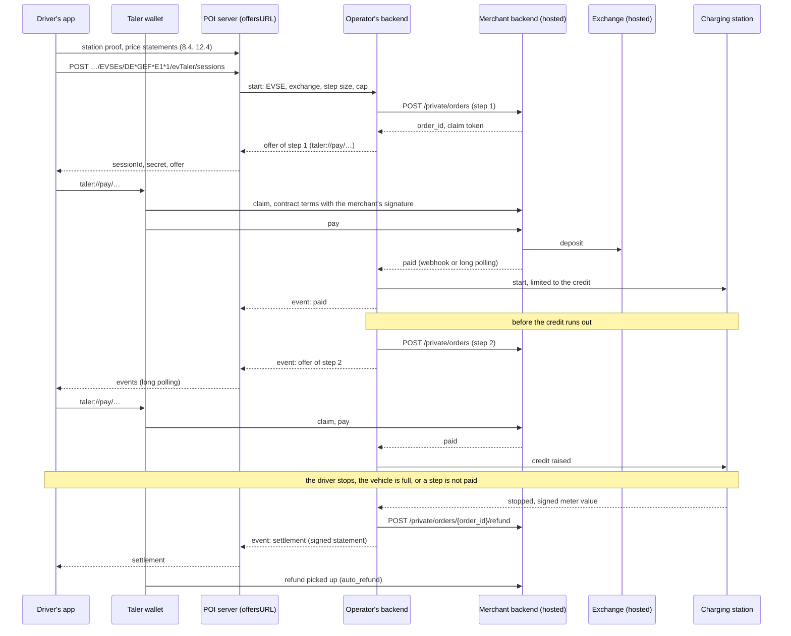

# GNU EV Taler: paying for charging with GNU Taler, step by step

*Concept paper, draft of 2026-10-28. It proposes what WWCP_POI would carry and check when charging is paid with
[GNU Taler](https://taler.net). Phase 1, the content of section 4, is implemented since 2026-10-29, with the
decisions D1 to D3 taken; the rest is not built yet. The choices still open are listed in
[section 10](#10-decisions-needed).*

**In short.** A charging station operator that accepts GNU Taler says so in its WWCP_POI data, signed like
everything else it owns: `EVTaler` among the payment options of its charging pools, and, once for the operator,
its merchant at a hosted GNU Taler merchant backend and the exchanges it accepts. On request, a driver's app
gets real GNU Taler offers for an EVSE: one order per **step**, e.g. "the next 5 kWh at 0.65 €/kWh". Each step
is paid before it is delivered, the next one is offered before the credit runs out, and at the end the session
costs what the operator's tariff says: whatever was paid beyond that is refunded. Every order names the EVSE, the
tariff and the signed price statement it is priced by, so that the app can check it against the station proof
and keep the evidence. WWCP_POI runs no exchange, no merchant backend and no wallet: GNU Taler provides those as
services.


## 1. GNU Taler in brief

GNU Taler is a payment system for existing currencies with digital coins. Payers stay anonymous; payees are known
and their income is taxable.

| Part | What it does | Who runs it in this concept |
|---|---|---|
| **Wallet** | Withdraws coins from an exchange, pays merchants with them, receives refunds. Before it pays, it checks the merchant's signature over the contract terms. | The driver: a GNU Taler wallet (Android, iOS, browser), or an app embedding its core. |
| **Exchange** | Issues coins for money paid into its escrow account (with blind signatures, so that it can not tell later which coin it gave to whom), takes the coins merchants deposit, and wires them the money, aggregated. | A regulated payment service provider, as a service. |
| **Merchant backend** | Makes orders, signs their contract terms, takes payments, grants refunds, talks to the exchanges. One backend hosts many merchants, one **instance** each. | A hosting provider, as a service. The charging station operator has an instance there. |
| **Auditor** | Checks that the exchange holds what it issued. | Part of the exchange's regulation. |

**An exchange is not a central bank.** It creates no money and has no monetary policy: it issues e-money for a
currency that exists, such as EUR or CHF, against what was paid into its escrow account, and it needs a licence for
that (an e-money licence in the EU). It is closer to the issuer of electronic vouchers for that currency, which
merchants redeem at par. What matters here: coins of one exchange can only be spent where the merchant accepts that
exchange, and a merchant names the exchanges it accepts in every contract. An exchange is identified by its **master
public key**; its base URL may change. So "EV Taler" alone does not tell drivers whether their coins are good at a
station. Which exchanges the station's operator accepts does (section 4).

What this paper takes from the [merchant API](https://docs.taler.net/core/api-merchant.html):

- `POST /private/orders` at an instance makes an order and returns its `order_id` and, unless `create_token` is
  false, a claim `token`. `refund_delay` sets the refund deadline after the payment deadline.
- The wallet claims the order with the token and a nonce of its own, `POST /orders/{order_id}/claim`, and gets the
  contract terms with the merchant's signature. Another wallet claiming the same order is refused (409).
- The contract terms have, among others, `summary`, `products`, `amount`, `max_fee` (the deposit fees the merchant
  bears), `pay_deadline`, `refund_deadline`, `wire_transfer_deadline`, `merchant_pub`, `merchant_base_url`,
  `exchanges` (each with its master public key), `auto_refund`, `fulfillment_url`, and `extra`: an object of the
  merchant's own, which the merchant's signature covers as every other field.
- `GET /private/orders/{order_id}?timeout_ms=…` waits for the payment (long polling) and tells `unpaid`, `claimed`
  or `paid`. Webhooks tell `order_created`, `pay`, `refund` and `order_settled`.
- `POST /private/orders/{order_id}/refund` grants a refund, never more than was paid, until the refund deadline,
  and never for an order made without a refund delay. With `auto_refund` the wallet looks for refunds by itself
  for that long.
- An instance's access tokens carry permissions, e.g. `orders-write` and `orders-refund`, so that a backend making
  offers needs no administrative access.

**Hosted today.** Taler Operations AG (Biel) runs an exchange for the Swiss franc, and lets merchants set up their
own instance at `my.taler-ops.ch` without running a server. For the euro, a subsidiary of Taler Systems SA in Bochum
is to run an exchange once BaFin grants it an e-money licence (announced on 2026-10-22, after GLS Bank withdrew from
the earlier plan in January 2026). Check both before relying on them.

**Not available yet:** a wallet paying without asking. As far as published, the wallet asks its user to confirm
every payment; an "auto-pay" flag has only been proposed in a Taler design document. This decides how small a step
can be in practice (5.1).


## 2. Why

- **Ad hoc, without an account.** The driver pays from a wallet they already have: no registration, no app per
  operator, no contract with an e-mobility provider, no card terminal at the charger.
- **Nothing personal.** The operator learns no name, no card number, no account: there is nothing personal to
  protect, keep or erase. Payments of one session belong together, those of different sessions do not.
- **Piece by piece.** The driver pays for what is delivered, step by step, instead of a card blocking a large
  amount for hours or days. Either side risks at most one step (5.1).
- **Evidence.** Signed contracts meet signed data: the operator's merchant key, its prices (SPECIFICATION.md,
  section 12) and the measurement keys of its meters are signed in WWCP_POI. A driver can show what was offered,
  paid, delivered and refunded without the operator's word, as [example A10](../examples/exampleA10.md) does for
  the price.
- **No fake QR codes.** A sticker over the charger's QR code, sending payments to someone else, is caught: the app
  checks the merchant of every offer against the operator's signed data (section 7).

It adds a means of payment; it replaces none. Whether it counts as one of the means the AFIR requires for ad hoc
charging (Regulation (EU) 2023/1804, Article 5) is a legal question this paper does not answer.


## 3. Scope

| Concern | Who |
|---|---|
| Coins, escrow, auditing, wiring money to operators | GNU Taler: an exchange, as a service |
| Orders, contract terms, payments, refunds | GNU Taler: the operator's instance at a hosted merchant backend |
| Paying | GNU Taler: the driver's wallet |
| Where EV Taler is accepted, by which merchant, with which exchanges | **WWCP_POI**: content (section 4) |
| The price of a step | **WWCP_POI** holds the tariffs and price statements; the operator's backend makes the orders; the app checks them (section 5) |
| Asking for offers, getting the next one, the settlement | **WWCP_POI**: POI_API, relaying to the operator's backend (section 6) |
| Evidence | **WWCP_POI**: station proofs, price statements, settlement statements; the wallet: contracts and payments (section 7) |
| Starting, limiting and stopping charging, meter values | The operator's charging station management system (OCPP), outside WWCP_POI |

WWCP_POI keeps its rule: it describes tariffs, it does not calculate prices. The operator's backend makes the
orders; WWCP_POI says what they must agree with, and lets everybody check that they do.


## 4. In the content

### 4.1 The payment option `EVTaler`

`paymentOptions` of charging pools and their templates is an enumeration (`PaymentOptions` of WWCP_POI2, today
`Free`, `Contract`, `Direct`, `Cash`, `CreditCard`, `DebitCard`, `PrepaidCard`, `SMS`), of which only the names are
read. A new name **`EVTaler`** says: the EVSEs of the pool can be paid for with EV Taler, step by step, with the
exchanges its operator names in `evTaler` (4.2). A pool naming it while its operator has no `evTaler` is invalid,
and a change set making it so is refused. Templates give it as they give every payment option (they are united).

**"EV Taler (provider)".** Drivers should see which exchange a station takes, e.g.
`EV Taler (Example Exchange, EUR)`. Apps write that line from the data, one per exchange the operator accepts in
the currency of the EVSE's tariff. It is not a name in `paymentOptions` itself:

- a text per exchange would turn the enumeration into an open set nobody can check;
- names of exchanges are neither unique nor stable, while a wallet knows its exchanges by their master public keys,
  as the contract terms name them;
- which exchanges are accepted is decided by the merchant, i.e. the operator: once in `evTaler`, not again at each of
  thousands of pools, which could then disagree.

**Compatibility.** As only the names of the enumeration were read, a server that does not know `EVTaler` refuses
every version naming it. All servers of a network therefore take the new name before an operator uses it. Since
2026-10-29 `paymentOptions` is an open set, as `facilities` is (the predefined names, others read as given, compared
without case), which spares the next payment option this (decision D1).

### 4.2 The operator's merchant: `evTaler`

A new property of the charging station operator, `evTaler` (C# `EVTaler`, an `EVTalerMerchant?`), changed by its
change sets as a whole (update/remove):

| JSON key | Type | Description |
|---|---|---|
| `merchantBaseURL` | URL | The base URL of its instance at the merchant backend, HTTPS, ending in `/`: the `merchant_base_url` of its contract terms. |
| `merchantPublicKey` | text | The public key of that instance, as Taler writes it: the `merchant_pub` every contract of a step is signed with. |
| `exchanges` | array | 1..n exchanges it accepts, ordered by `masterPublicKey`, each once, see below. |
| `offersURL` | URL | Where drivers ask for offers: the POI_API base of the server that makes them for the operator (section 6). Not in phase 1: what it means depends on the offers API (D4), and it can be added without breaking anything. |

An exchange:

| JSON key | Type | Description |
|---|---|---|
| `masterPublicKey` | text | Its master public key, as Taler writes it. |
| `baseURL` | URL | Its base URL, HTTPS, ending in `/`. |
| `currency` | text | The ISO 4217 code of its coins, as a tariff's `currency`: e.g. `EUR`, `CHF`. |
| `name` | I18N text | Its name, as drivers see it: the "provider" of "EV Taler (provider)". |

```json
"evTaler": {
  "merchantBaseURL":   "https://taler.gef.example/instances/de-gef/",
  "merchantPublicKey": "<the instance's public key, as Taler writes it>",
  "exchanges": [
    { "masterPublicKey": "<the exchange's master public key>",
      "baseURL":         "https://exchange.example.eu/",
      "currency":        "EUR",
      "name":            { "en": "Example Exchange" } }
  ],
  "offersURL": "https://poi.gef.example/RNs/QA/"
}
```

`evTaler` is one of the operator's own properties, not a child array (SPECIFICATION.md, 8.2): every proof of a
charging station gives it completely, with the operator's keys. An app holding a station proof (8.4) therefore
knows, offline and checked against the trust anchor it pinned, which merchant may take money for that station.

The operator names only exchanges whose know-your-customer checks it has passed (the merchant backend tells this
per exchange, `GET /private/kyc`): coins of another exchange would be refused when deposited. WWCP_POI does not
check it.

### 4.3 The tariff a step is priced by

The **EV Taler tariff** of an EVSE is its effective charging tariff (`chargingTariffIds`, SPECIFICATION.md, 9.2) of
the type `AD_HOC_PAYMENT`, or else the one without `tariffType`, with the elements of the current price statement of
the EVSE where there is one (12.4); that one, when it names no `paymentMeans` or **`EV_TALER`** among them, a new
predefined name (the set is open: others are read as given). A tariff of another type is never the EV Taler tariff:
where the ad hoc tariff takes only cards, the EVSE offers no EV Taler. Nor does an EVSE without an EV Taler tariff,
whatever its pool says. Its steps are paid with the exchanges of the tariff's currency (`TryGetEVTalerTariff`,
`EVTalerExchangesAt`).

### 4.4 Signing: the usage `payments`

Whoever changes `merchantPublicKey` redirects the payments of every station of the operator. A new signing-key usage
(SPECIFICATION.md, 4.1) **`payments`** signs `evTaler` and the operator's settlement statements (5.4), so that an
operator can keep that key apart, e.g. offline, as it may keep its `priceStatements` key apart. A reader refuses
usages it does not know, so this comes with a version of the specification (decision D3).

### 4.5 Publishers

OCPI 2.3.0 and DATEX II 3.7 know no GNU Taler: `EVTaler` and `evTaler` are not published to them (the DATEX II
publisher writes only cash, credit and debit cards today). Drivers learn of EV Taler from POI_API.


## 5. Steps: paying piece by piece

### 5.1 Prepaid steps, settled per session

A session paid with EV Taler is a chain of orders at the operator's instance, its **steps**, each paid before what
it covers is delivered:

- **Step 1** when charging is to begin. **Step n + 1** is offered when the credit of the steps paid is about to run
  out, e.g. at 80 % of it. Charging never goes beyond the credit paid: the operator's backend limits the session to
  it, e.g. by OCPP 2.1's transaction limits (`maxEnergy`, `maxCost`), set when the transaction starts and raised with
  every step paid, and it ends the session when a step is not paid by its deadline.
- **A step covers** a quantity of the dimension the tariff is priced in: kWh in the usual case ("the next 5 kWh"),
  minutes for a tariff priced by time. Its amount is that quantity at the tariff's price; step 1 also carries the
  flat fee and the reserve (5.5).
- **Steps are advance payments.** The session costs what the tariff says for the whole session, by the meter values
  at its start and end: one price per session from calibrated measurements, as metrology law expects, with its
  minimum and maximum price and its time components. The settlement (5.4) refunds what was paid beyond that. A
  step's amount therefore need not be exact where the tariff prices more than one dimension: it is an estimate on
  the safe side.
- **All steps of a session are priced alike:** by the tariff and the price statement valid when the session began,
  which every step names (5.2).

The driver chooses the step size, within what the operator allows, and may set a cap for the whole session. The
choice is a trade-off:

| Step size | Confirmations today | Deposit fees | What the driver risks |
|---|---|---|---|
| 1 kWh | one per kWh | one deposit per step | at most 1 kWh paid and not delivered, until refunded |
| 5 kWh | a few per session | fewer | at most 5 kWh |
| the whole session, e.g. 40 kWh | one | one | the whole amount, until refunded |

One large step with a refund at the end is what today's wallets handle well, with a single confirmation. Small steps
keep both sides' risk small: an operator that delivers nothing gets one step, a driver who stops paying gets no more
than paid for. They need a wallet that pays the steps of a session the driver accepted without asking again, which is
for the Taler developers (open point 1).

### 5.2 What an order carries

The operator's backend makes every step with `POST /private/orders` at its instance. The order:

- `summary`: e.g. `Charging at DE*GEF*E1*1, step 3: 5 kWh`, also in the languages of the pool.
- `products`: the step as one line, its quantity and unit (e.g. 5 kWh) and its unit price, VAT as the line's tax;
  in step 1 the flat fee and the reserve as lines of their own.
- `amount`: their sum, in the currency of the EV Taler tariff.
- `exchanges`: those of `evTaler` in that currency. The backend writes them from its configuration, which therefore
  must agree with `evTaler`; the app checks that it does.
- `pay_deadline`: for step 1 short, e.g. 2 minutes, as the driver stands at the charger; for a later step when the
  credit runs out, plus a grace of e.g. 60 seconds.
- `refund_delay`: never 0, so that the refund deadline is after the latest end of the session plus the time the
  settlement takes; `auto_refund` as long, so that the wallet picks the refund up by itself.
- `extra`: `{"wwcp": …}`, the step in WWCP terms, signed by the merchant with the rest of the contract:

```json
"extra": {
  "wwcp": {
    "@context":         "https://open.charging.cloud/contexts/wwcp/roamingNetwork/evTalerStep/v1",
    "roamingNetworkId": "QA",
    "EVSEId":           "DE*GEF*E1*1",
    "sessionId":        "kq3Vd0sY0f9hJ2bW8Qm1tA",
    "step":             3,
    "previousOrderId":  "2026.301-03ABCDEF1",
    "chargingTariffId": "DE*GEF*T_DC",
    "priceStatement":   "<digest of the price statement, SPECIFICATION.md 12.1>",
    "covers":           { "from": "10", "to": "15", "unit": "kWh" }
  }
}
```

| JSON key | Description |
|---|---|
| `@context` | The context of a step, versioned as every WWCP context. |
| `roamingNetworkId`, `EVSEId` | Where, as the roaming network writes them. |
| `sessionId` | The session at the offers server (section 6): 128 random bits, base64url. Not Taler's `session_id` of an order. |
| `step` | 1, 2, … |
| `previousOrderId` | The `order_id` of the step before; absent in step 1. The steps of a session are a chain. |
| `chargingTariffId` | The EV Taler tariff (4.3). |
| `priceStatement` | The digest of the price statement whose elements price the session; absent when the tariff's own elements do. |
| `covers` | What the step pays for, counted from the start of the session: from, to, unit. |

### 5.3 The flow



### 5.4 Settlement

When a session ends, the operator's backend calculates its price by the EV Taler tariff and the price statement the
steps name, from the meter values at its start and end. It refunds what was paid beyond it, from the last step back,
as a refund never exceeds what its order took. Then it signs a **settlement statement** with a `payments` key:

```json
{ "@context": "https://open.charging.cloud/contexts/wwcp/roamingNetwork/evTalerSettlement/v1",
  "roamingNetworkId": "QA", "EVSEId": "DE*GEF*E1*1", "sessionId": "kq3Vd0sY0f9hJ2bW8Qm1tA",
  "merchantPublicKey": "<as in evTaler>",
  "chargingTariffId": "DE*GEF*T_DC", "priceStatement": "<digest>",
  "start": "2026-10-28T09:12:04.000Z", "end": "2026-10-28T09:41:37.000Z",
  "meterValues": [ "<the signed meter value at the start, as the meter gives it>", "<at the end>" ],
  "energy": "13.412", "currency": "EUR",
  "orders": [ { "orderId": "2026.301-01ABCDEF1", "amount": "3.25" }, … ],
  "price": "8.72", "paid": "9.75", "refunded": "1.03",
  "role": "chargingStationOperator", "signer": "DE*GEF", "signedAt": "2026-10-28T09:41:40.000Z",
  "algorithm": "ES256", "keyId": "<key @id>", "value": "<Base64>" }
```

Its signature input is its canonical JSON without `value`, `@context`, `algorithm` and `keyId` included, as of a
price statement (12.1); the key is a signing key of the operator that may sign `payments`, valid at `signedAt`. The
meter values are as the meter signed them, e.g. OCMF, and checked with the measurement keys the station proof gives
for the meter or the station. Settlement statements are no content: no history and no checkpoint takes them. The app
gets one as the last event of its session and keeps it (decision D5).

### 5.5 What GNU Taler can not do: collect afterwards

Taler payments are pushed by the payer; nothing can be debited later. What may come after the last step, such as
parking time after charging or a minimum price, is therefore paid beforehand: a **reserve** in step 1, e.g. 30 minutes
of parking time, refunded at the settlement as far as it is not used. A tariff whose cost can not be bounded
beforehand, such as parking time without a limit, can not be paid in full with EV Taler: the operator ends the
session when the credit, the reserve included, is used, and what accrues beyond that is not collected this way
(open point 2).


## 6. Asking for offers over POI_API

A POI server makes offers for the operators it has an **EV Taler backend** for: an interface the application hosting
it provides, as it provides `AuthorizeStatusUpdate`, which talks to the operator's instance and to its charging
station management system. The RoamingHub can be that server for the operators it hosts. Elsewhere the endpoints
answer 404, and the app goes to the `offersURL` of the operator.

```
POST ~/RNs/{RN_Id}/EVSEs/{EVSE_Id}/evTaler/sessions
     { "exchange": "<masterPublicKey>", "step": { "quantity": "5", "unit": "kWh" }, "cap": "30.00" }
     → 201 { "sessionId", "secret", "events": "<URL>", "offer": { … } }
     → 409 when the EVSE takes no session now (no vehicle plugged in, one charging already)
     → 422 when the step or the exchange is not accepted, with the step sizes that are

GET  ~/RNs/{RN_Id}/evTaler/sessions/{sessionId}/events?after={seq}&timeout_ms={ms}
     Authorization: Bearer <secret>
     → { "events": [ { "seq": 4, "type": "offer", … }, … ] }   waits for the next one (long polling)

POST ~/RNs/{RN_Id}/evTaler/sessions/{sessionId}/stop
     Authorization: Bearer <secret>
```

| Event | Content |
|---|---|
| `offer` | `step`, `orderId`, `talerPayURI` (as the merchant backend gave it), `amount`, `covers`, `payDeadline`, and the order as the backend posted it |
| `paid` | `step`, `orderId`: the credit is raised |
| `unpaid` | `step`: its deadline passed; charging ends when the credit is used |
| `meterValue` | a signed meter value as the meter gives it, at least at the start and the end |
| `stopped` | `reason`: by the driver, the vehicle, the cap, an unpaid step, the operator |
| `settlement` | the settlement statement (5.4) and the refunds, each `orderId`, `amount` and `talerRefundURI` |

- **Events stay** until the settlement and the `auto_refund` time after it, numbered per session, and are read again
  from any number: a phone loses its connection while its driver is having a coffee. Long polling, as Taler's own API
  uses it, comes first; a WebSocket topic can follow (decision D4).
- **The secret** is 256 random bits, given once, kept by the server only as its hash (as API keys are). It names no
  driver; nothing else does either.
- **The server checks before it relays** what the backend gives it, against the version it holds: the merchant base
  URL of the `taler://pay` URI and the order's merchant are those of `evTaler`, its exchanges are among those of
  `evTaler` in the tariff's currency, `extra.wwcp` names this EVSE, this session, the step after the last one, the
  EV Taler tariff and the price statement the session began with, and the amount is the quantity at that price (plus
  flat fee and reserve in step 1). An offer failing a check is not relayed, and the session ends.
- **Limits:** sessions only where the backend accepts one (409 otherwise), one at an EVSE at a time, and per client
  as many as for the reads that cost the most.
- **The backend's access** to the operator's instance is a token with only the permissions offers need
  (`orders-write`, reading orders, `orders-refund`), kept owner-only as the server keeps its keys.


## 7. Evidence: what the app checks and keeps

**Before the driver pays:**

1. The proof of the charging station (8.4), against the identity keys of the roaming network operator the app pinned
   (8.6): the EVSE belongs to the operator, and the operator's `evTaler` is as the proof gives it.
2. The current price statement of the EVSE (12.4) and the EV Taler tariff (4.3).
3. The offer: its `taler://pay` URI names `merchantBaseURL` of `evTaler`; its amount is the step at the price of 2;
   `extra.wwcp` names the EVSE, the session, the step, the tariff and the statement. An app embedding the wallet's
   core sees the contract terms after claiming and also checks `merchant_pub` against `merchantPublicKey` and the
   exchanges against `evTaler`. An app handing the URI to a separate wallet checks at least the merchant base URL:
   the wallet then gets the contract from that merchant, signed by its instance.

**Afterwards, kept in one file**, as in example A10: the station proof, the price statement and later its proof in a
checkpoint (12.3), the contract terms of every step with the merchant's signature, the wallet's record of each
payment, the signed meter values, the settlement statement and the refunds. From it alone a dispute is decided:

| Question | Answered by |
|---|---|
| Was this the operator's price when the session began? | price statement, its checkpoint proof, the station proof |
| Did I pay the operator, and not someone else? | contract terms signed by `merchant_pub`, which the station proof gives |
| Did I get what I paid for? | the meter values, signed by a key the station proof gives |
| Was the rest refunded? | the settlement statement signed by the operator, and the refunds |


## 8. Security and privacy

- **Redirected payments** (fake QR codes, a rogue relay, a changed backend configuration): caught by the merchant
  check against the signed `evTaler` (sections 6 and 7). A stolen `payments` key could change `evTaler`; the change is
  in the history for everyone to see, and the key can be kept offline (4.4).
- **Taken orders:** an order is claimed with its claim token, which only the session gets, and is then bound to
  one wallet's nonce: another wallet is refused.
- **The wrong vehicle:** the app shows the EVSE as it is labelled; the backend starts a session only where a vehicle
  is plugged in and not charging, and step 1 must be paid within minutes.
- **Spam:** see the limits of section 6; an order costs the merchant backend little, and an unpaid one expires at its
  payment deadline.
- **Refunds** follow the settlement only and never exceed what was paid.
- **Privacy:** contracts, events and statements name the EVSE and the session, never the driver; vehicle identifiers
  (e.g. those of ISO 15118) go into none of them. The operator learns amounts, times and the EVSE, as with cash.
  The offers server sees the client's address and keeps it no longer than its limits need.


## 9. Implementation in WWCP_POI

**Phase 1, content** (WWCP_POI2 and WWCP_POI3), done 2026-10-29:

- `PaymentOptions.EVTaler`, and `paymentOptions` an open set of names (D1).
- `EVTalerMerchant` and `EVTalerExchange`, the operator's property `evTaler`, without `offersURL` for now: JSON and
  CBOR, strict parsing (HTTPS base URLs ending in `/`, keys in GNU Taler's canonical form, ISO 4217 codes, exchanges
  ordered and each once, each with a name), change sets, the check that a pool or pool template naming `EVTaler` has an
  operator with `evTaler`, after the last change of a change set; `TryGetEVTalerTariff`, `EVTalerExchangesAt` and
  `PaymentOptionName` for "EV Taler (provider)".
- The usage `payments` (D3); `EV_TALER` predefined in `paymentMeans`.
- docs (`ChargingStationOperator.md`, `ChargingPool.md`, `ChargingPoolTemplate.md`, `ChargingTariff.md`), the usage in
  SPECIFICATION.md 4.1 (8.2 stays as it is: `evTaler` is no child array), `EVTalerTests`; example A15: `DE*GEF` accepts
  EV Taler and a station proof gives it.
- OCPI and DATEX II publishers leave it out: they publish only the payment options they know, unchanged.
- Left for later: the hub's frontend showing "EV Taler (…)" at pools and editing `evTaler` on the operator's card.

**Phase 2, steps and evidence**, needing no Taler service:

- `EVTalerStep`, the object of `extra.wwcp`, and the checks of section 7 on an order, on contract terms and on a
  `taler://pay` URI, against a station proof and a price statement.
- `EVTalerSettlement`: signing and checking as of price statements.
- Example A16: the evidence of a session paid in steps, from recorded contract terms.

The merchant's signature over contract terms is checked by the wallet, with Taler's own hashing of contract terms;
WWCP_POI checks only that the merchant is the operator's. Doing it as well would mean implementing that hashing.

**Phase 3, offers**, in an assembly of its own (e.g. `WWCP_POI3_EVTaler`), so that WWCP_POI3 does not depend on Taler:

- The endpoints and events of section 6, the interface of an EV Taler backend, the checks before relaying.
- A small client of the merchant API: orders, long polling, refunds, webhooks.
- In the RoamingHub: a backend for the operators it hosts, their access tokens kept owner-only, the limits.
- Outside WWCP_POI: starting, limiting and stopping charging at the operator's charging station management system,
  e.g. with OCPP 2.1's transaction limits.

**Phase 4, later:** wallets paying the steps of an accepted session alone; Taler's token families (contract terms of
version 1, e.g. discount tokens) for charging tariff offers (9.4), so that `maxSessionsPerContract` applies without
knowing the driver; e-mobility providers as merchants of their own offers; wallets in vehicles.


## 10. Decisions needed

| | Question | Options | Recommended |
|---|---|---|---|
| D1, decided 2026-10-29: (a) and an open set | How does "EV Taler (provider)" appear in the data? | (a) `EVTaler` in `paymentOptions`, the exchanges with names in the operator's `evTaler`; (b) a name per exchange in `paymentOptions`, e.g. `EVTaler (Example Exchange)` | (a), and `paymentOptions` an open set like `facilities`, so that the next option does not lock out older servers |
| D2, decided 2026-10-29: (a) | Where does the merchant live? | (a) the operator; (b) each pool; (c) each tariff | (a): one merchant per operator, in every station proof |
| D3, decided 2026-10-29: (a) | Which key signs `evTaler`? | (a) a new usage `payments`; (b) `party`, as the operator's other properties | (a): it redirects money |
| D4 | How do offers reach the app? | (a) HTTP with long polling; (b) a topic of the history's WebSocket | (a) first: it survives a phone losing its connection; (b) later |
| D5 | Does the operator sign settlement statements? | (a) yes, not in checkpoints; (b) yes, and checkpoints name them, as price statements; (c) no | (a): evidence for the driver, no load on histories |
| D6 | The name | "GNU EV Taler"; "EV Taler" | "EV Taler" in the data (`EVTaler`, `evTaler`, `EV_TALER`) either way; "GNU" in the name of what is built here only if the GNU Taler maintainers agree, as "GNU" names GNU packages |


## 11. Open points

1. **Paying steps without asking:** a wallet that pays the further steps of a session its driver accepted, up to the
   cap, without asking again. To be discussed with the Taler developers; until then steps are as large as drivers
   want to confirm.
2. **Fees after the credit:** parking and idle fees beyond the reserve (5.5).
3. **Rounding:** step amounts to the currency's minor unit and up, the session's price as the tariff rounds it; Taler
   amounts have more fractional digits than tariffs, coins have smallest denominations.
4. **Deposit fees** for small steps, and how much of them an operator bears (`max_fee`).
5. **Long sessions:** an AC session overnight keeps its first orders' refund deadlines and the wire transfers of the
   operator waiting; refund deadlines per step or an upper bound of the session's length.
6. **Currencies without an ISO 4217 code**, such as regional currencies on GNU Taler: tariffs take only ISO 4217 codes.
7. **A list of exchanges kept by the roaming network operator**, with names and master public keys, which operators
   would name instead of repeating them.
8. **Outages:** an exchange or merchant backend not reachable lets no step be paid; the session ends with its credit.
9. **AFIR:** whether EV Taler counts as a means of ad hoc payment the regulation requires (section 2).


## References

- GNU Taler, merchant backend API: https://docs.taler.net/core/api-merchant.html
- The `taler` URI scheme, Internet-Draft: https://datatracker.ietf.org/doc/html/draft-grothoff-taler-00
- Taler Operations AG, merchant backend service at `my.taler-ops.ch`, terms of service:
  https://git.gnunet.org/taler/merchant/file/contrib/merchant-tos-tops-v0.en.rst.html
- GNU Taler forms a new company to bring its payments to Germany (2026-10-22): https://zeli.app/story/50197404
- WWCP_POI: [SPECIFICATION.md](../SPECIFICATION.md), sections 4.1 (keys and usages), 8.4 (proofs), 9.2 (effective
  members), 9.4 (charging tariff offers), 12 (prices at runtime); [ChargingPool](../docs/ChargingPool.md),
  [ChargingTariff](../docs/ChargingTariff.md), [ChargingStationOperator](../docs/ChargingStationOperator.md);
  [example A10](../examples/exampleA10.md)
