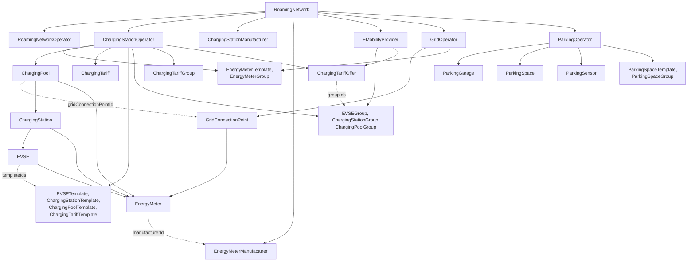

# WWCP POI 3: entities

This directory documents the entities of POI 3: every type deriving from `AImmutableEMobilityEntity`, and
the templates, which have no runtime status; with all the properties a change set can manage, and the large
substructures they embed. What is common to all of them, the base class, is explained below.

For the model as a whole - change sets, owners, history, sync - see the [README](../README.md);
for the bytes that are hashed and signed, the [specification](../SPECIFICATION.md).


## Overview



| Entity | Embedded in, as | Owner | What it is |
|---|---|---|---|
| [RoamingNetwork](RoamingNetwork.md) | — (root) | roaming network operator (RNO) | One version of a roaming network with everything it embeds; carries the ETags. |
| [RoamingNetworkOperator](RoamingNetworkOperator.md) | roaming network, `roamingNetworkOperator` | itself; neither added nor removed | The RNO, with the keys of the network: owns it, its registries, and who is a member. One may operate many networks. |
| [ChargingStationOperator](ChargingStationOperator.md) | roaming network, `chargingStationOperators` | the operator; added and removed by the RNO | A CPO with its charging pools, tariffs, templates, groups and offers. |
| [ChargingPool](ChargingPool.md) | operator, `chargingPools` | its operator | A charging location: address, opening times, facilities, grid connection, stations. |
| [ChargingStation](ChargingStation.md) | charging pool, `chargingStations` | its operator | A charger with its EVSEs, manufacturer and model, energy status. |
| [EVSE](EVSE.md) | charging station, `EVSEs` | its operator | One charging point: power, voltage, current, connectors, tariffs, energy status. |
| [ChargingTariff](ChargingTariff.md) | operator, `chargingTariffs` | its operator | A price, as in OCPI: currency, elements, price components, restrictions. |
| [EVSETemplate](EVSETemplate.md) | operator, `EVSETemplates` | its operator | What EVSEs naming it share, e.g. connectors and power, and a tariff for them. |
| [ChargingStationTemplate](ChargingStationTemplate.md) | operator, `chargingStationTemplates` | its operator | What charging stations naming it share, e.g. model and hotline, and a tariff for their EVSEs. |
| [ChargingPoolTemplate](ChargingPoolTemplate.md) | operator, `chargingPoolTemplates` | its operator | What charging pools naming it share, e.g. hotline and facilities, and a tariff for their EVSEs. |
| [ChargingTariffTemplate](ChargingTariffTemplate.md) | operator, `chargingTariffTemplates` | its operator | What charging tariffs naming it share, e.g. currency, payment means and energy mix. |
| [EVSEGroup](EVSEGroup.md) | operator or e-mobility provider, `EVSEGroups` | the party embedding it | EVSEs: of the operator, or of any operator; a collection, giving them nothing. |
| [ChargingStationGroup](ChargingStationGroup.md) | operator or e-mobility provider, `chargingStationGroups` | the party embedding it | Charging stations: of the operator, or of any operator; a collection. |
| [ChargingPoolGroup](ChargingPoolGroup.md) | operator or e-mobility provider, `chargingPoolGroups` | the party embedding it | Charging pools: of the operator, or of any operator; a collection. |
| [ChargingTariffGroup](ChargingTariffGroup.md) | operator, `chargingTariffGroups` | its operator | Charging tariffs of the operator; a collection. |
| [ChargingTariffOffer](ChargingTariffOffer.md) | operator or e-mobility provider, `chargingTariffOffers` | the party embedding it | Another price for a time at the EVSEs of groups or of operators, e.g. a promotion. |
| [EnergyMeter](EnergyMeter.md) | pool, grid connection point, station, EVSE | whoever owns or maintains what embeds it | A meter with its role, manufacturer, model, versions and transparency software. |
| [EnergyMeterTemplate](EnergyMeterTemplate.md) | operator or grid operator, `energyMeterTemplates` | its operator or grid operator | What a series of energy meters naming it shares, e.g. manufacturer, model and firmware. |
| [EnergyMeterGroup](EnergyMeterGroup.md) | operator or grid operator, `energyMeterGroups` | its operator or grid operator | Energy meters of the operator's pools, stations and EVSEs, or of the grid operator's grid connection points; a collection. |
| [ChargingStationManufacturer](ChargingStationManufacturer.md) | roaming network, `chargingStationManufacturers` | RNO | A maker of charging stations, named by stations' `manufacturerId`. |
| [EnergyMeterManufacturer](EnergyMeterManufacturer.md) | roaming network, `energyMeterManufacturers` | RNO | A maker of energy meters, named by meters and their templates (`manufacturerId`). |
| [TransparencySoftwareManufacturer](TransparencySoftwareManufacturer.md) | roaming network, `transparencySoftwareManufacturers` | the manufacturer; added and removed by the RNO | A maker of transparency software with its releases, and what the EU Cyber Resilience Act asks of it. |
| [ConformityAssessmentBody](ConformityAssessmentBody.md) | roaming network, `conformityAssessmentBodies` | the body, or the RNO while it has no keys; added and removed by the RNO | E.g. a metrology institute, notified for legislations such as MID or CRA, with the transparency software certificates it issued. |
| [EMobilityProvider](EMobilityProvider.md) | roaming network, `eMobilityProviders` | the provider; added and removed by the RNO | An EMSP, with its keys, groups and offers. |
| [GridOperator](GridOperator.md) | roaming network, `gridOperators` | the grid operator, or the RNO while it has no keys; added and removed by the RNO | A DSO with its grid connection points, each signed by its maintainer. |
| [ParkingOperator](ParkingOperator.md) | roaming network, `parkingOperators` | the parking operator; added and removed by the RNO | Runs garages, spaces and sensors and offers parking products. |
| [ParkingGarage](ParkingGarage.md) | parking operator, `parkingGarages` | its parking operator | A car park with opening times, images and products. |
| [ParkingSpace](ParkingSpace.md) | parking operator, `parkingSpaces` | its parking operator | One parking space, possibly in a garage, with sensors and charging stations. |
| [ParkingSensor](ParkingSensor.md) | parking operator, `parkingSensors` | its parking operator | A sensor detecting whether a space is occupied. |
| [ParkingSpaceTemplate](ParkingSpaceTemplate.md) | parking operator, `parkingSpaceTemplates` | its parking operator | What parking spaces naming it share, e.g. garage, dimensions and roof. |
| [ParkingSpaceGroup](ParkingSpaceGroup.md) | parking operator, `parkingSpaceGroups` | its parking operator | Parking spaces of the operator, e.g. one level or zone; a collection. |

The documents for these entities also cover what they embed that is no entity of its own, i.e. that has no
status; brands, embedded on several levels, have a file of their own:

| Substructure | Documented in |
|---|---|
| Brands, of operators, pools, stations, EVSEs and RFID authentication modes | [Brand](Brand.md) |
| Transparency software certificates | [ConformityAssessmentBody](ConformityAssessmentBody.md) |
| Transparency software releases | [TransparencySoftwareManufacturer](TransparencySoftwareManufacturer.md) |
| Signing and identity keys | [RoamingNetworkOperator](RoamingNetworkOperator.md#keys), and each party: [ChargingStationOperator](ChargingStationOperator.md), [EMobilityProvider](EMobilityProvider.md), [GridOperator](GridOperator.md), [ParkingOperator](ParkingOperator.md), [TransparencySoftwareManufacturer](TransparencySoftwareManufacturer.md), [ConformityAssessmentBody](ConformityAssessmentBody.md) |
| Data licenses | [RoamingNetwork](RoamingNetwork.md), [ChargingStationOperator](ChargingStationOperator.md), [ChargingPool](ChargingPool.md) |
| Logos, contact data | [ChargingStationOperator](ChargingStationOperator.md) |
| Grid connection points and their maintainers | [GridOperator](GridOperator.md) |
| Authentication modes, opening times, energy mix, images, related locations | [ChargingPool](ChargingPool.md) |
| Charging connectors | [EVSE](EVSE.md) |
| Tariff elements, price components, restrictions | [ChargingTariff](ChargingTariff.md) |
| Transparency software status | [EnergyMeter](EnergyMeter.md) |
| Parking products | [ParkingOperator](ParkingOperator.md) |


## AImmutableEMobilityEntity

```csharp
public abstract class AImmutableEMobilityEntity<TId, TAdminStatus, TStatus> : AImmutableInternalData,
                                                                              IImmutableEntity<TId>,
                                                                              IHasId<TId>,
                                                                              IAdminStatus<TAdminStatus>,
                                                                              IStatus<TStatus>
    where TId          : IId
    where TAdminStatus : IComparable
    where TStatus      : IComparable
```

Source: [AImmutableEMobilityEntity.cs](../WWCP_POI3/DataStructures/AImmutableEMobilityEntity.cs),
[AImmutableInternalData.cs](../WWCP_POI3/DataStructures/AImmutableInternalData.cs).

Every entity of POI 3 is a sealed subclass naming three types: its identification (`ChargingPool_Id`),
its admin status (`ChargingPoolAdminStatusType`) and its status (`ChargingPoolStatusType`). The base
class gives all of them the same frame:

- **Immutable content.** An entity is one version. Nothing of its content changes in place: a change
  set makes a new roaming network with new entities wherever something changed, and the old version stays
  as it was. All properties of the content are get-only, the collections immutable.
- **Identity by its identification.** Two versions of an entity are the same entity: subclasses compare,
  order and hash by `Id` only (`Equals`, `CompareTo`, `GetHashCode`, `ToString`). Whether two versions
  have the same content, their ETags tell.
- **Three kinds of data**, kept strictly apart:

  | Kind | What | In the ETags | Changed by |
  |---|---|---|---|
  | Content | identification, name, description, data source, timestamps, custom data, and every property of the subclass | yes | change sets, signed by the owner |
  | Runtime status | admin status, status (and the energy status of stations and EVSEs) | no | `SetAdminStatus`/`SetStatus`, the history's `RuntimeStatus`, status updates of peers |
  | Internal data | a local dictionary for whoever runs the entity | no | the local process only; never serialized |

  Runtime status and internal data belong to the entity, not to a version: every version of an
  entity shares them with the one before.


### Common properties

These are the properties every entity has; the files of the entities list them only briefly.

| JSON key | C# property | Type | Description |
|---|---|---|---|
| `@id` | `Id` | `TId` | The identification, mandatory, never empty. It can not be changed: a different identification is a different entity. Where it must be unique, and which operator it names, the subclass decides. |
| `name` | `Name` | `ImmutableI18NString` | Optional multi-language name, `{"en": "…", "de": "…"}`; empty when absent, and then not written. |
| `description` | `Description` | `ImmutableI18NString` | Optional multi-language description, as `name`. |
| `dataSource` | `DataSource` | `String?` | Optional source of the information, e.g. the importer used. A change set sets it to a nonempty text or removes it. |
| `created` | `Created` | `DateTimeOffset` | When the entity was created. Always written, UTC to the millisecond; mandatory when JSON or CBOR is read, see below. |
| `lastChange` | `LastChangeDate` | `DateTimeOffset` | When its content was changed last. Always written as `created`; a change set sets it to its `createdAt`, so that everyone applying it gets the same ETags. A change of an embedded entity is a change of everything embedding it, up to the roaming network: they all get the `createdAt` as well. |
| `customData` | `CustomData` | `CustomDataNew` | Optional JSON object for vendor-specific extensions; part of the content and of the ETags, written only when it has values. The getter returns a copy. |
| `eTags` | `ETags` | `ImmutableArray<ETag>` | Digests of the canonical JSON and deterministic CBOR representations, see [ETags](#etags). Only the roaming network writes them into its representation. |
| — | `InternalData` | `UserDefinedDictionary` | Local runtime context, never serialized, not part of the content; `IsDefined`, `GetInternalData(As)`, `TryGetInternalData(As)`, `IfDefined(As)` read it. |
| — | `AdminStatus`, `Status` | `Timestamped<TAdminStatus>`, `Timestamped<TStatus>` | The current runtime status, see [Runtime status](#runtime-status). |

Defaults when creating an entity in C#: `created` is the given creation, else the given last change, else now;
`lastChange` the given last change, else the creation, else now. Both are cut to the millisecond, as their
representations keep them.

Reading JSON or CBOR, `created` is mandatory and `lastChange` is the creation unless given. Otherwise an entity
read without its creation would be created *now*, and everyone reading the same representation, e.g. of a change
set, would get another version with other ETags. The one exception is the entity a change set adds: unless given,
its creation is the `createdAt` of the change set. Its embedded children, e.g. the EVSEs of an added charging
station, need their own. Objects without timestamps (brands, grid connection points, parking products) refuse
them.

A change set names the property by its JSON key: `name`, `description`, `dataSource` and `customData`
can be updated and removed for every entity type, `@id`, `created` and `lastChange` for none. Which further
properties a type allows is listed in its file, in the column *Change set*.


### Runtime status

Every entity has an **admin status** (what its operator declares, e.g. `Operational`, `OutOfService`) and
a **status** (what it is, e.g. `Available`, `Charging`), each kept as a `RuntimeStatusSchedule<T>`:
timestamped values, newest first, with past entries as history and future entries as planned status.

| Member | Description |
|---|---|
| `AdminStatus`, `Status` | The current entry: the latest one not in the future. Setting them inserts an entry. |
| `AdminStatusSchedule(…)`, `StatusSchedule(…)` | All entries, newest first, filtered by timestamp and value, with `Skip` and `Take`. |
| `SetAdminStatus(value)`, `SetStatus(value)` | Insert a value now. |
| `SetAdminStatus(value, timestamp)`, `SetStatus(value, timestamp)` | Insert a value at the given time; a future timestamp plans it. |
| `SetAdminStatus(timestamped)`, `SetStatus(timestamped)` | Insert a `Timestamped<T>`. |
| `SetAdminStatus(list, ChangeMethods)`, `SetStatus(list, ChangeMethods)` | `Replace` (default) the whole schedule by the list, or `Insert` the list into it. |
| `DefaultMaxAdminStatusScheduleSize`, `DefaultMaxStatusScheduleSize` | 50 entries each, unless the constructor is given another size; older entries are dropped. |

Every `Set…` takes an optional `Context` as the data source of the update, passed to the events: every
`On…StatusChanged` event has it as its last parameter, and a history names it as the `dataSource` of its status
update, e.g. `calculated` for the status of a group its delegate calculates.

- **Inserting** a value equal to the one in effect right before its timestamp changes nothing, unless it
  replaces an entry with the same timestamp. An entry with the same timestamp is replaced.
- **Initial status:** every subclass gives a new entity an admin status and a status as of its creation,
  usually `Operational` and `Available`, unless told otherwise; the files of the entities name them.
- **Shared by all versions:** when a change set makes a new version of an entity, the new version takes the
  schedules of the one before (`ShareRuntimeOf`), and its internal data. So all versions show the same,
  current status, and a status set at an old version is seen at the new one. Subclasses take further runtime
  data the same way (`ShareFurtherRuntimeOf`), e.g. the energy status of charging stations and EVSEs.
- **Events:** subclasses offer `OnAdminStatusChanged` and `OnStatusChanged`, raised with the old and the
  new timestamped status when the *current* value changes. A version
  listens to its schedules only while its events have handlers (`ListenToAdminStatus`,
  `ListenToStatus`), so that versions nobody looks at any more are not kept alive by the schedules they share.
- **Not content:** the runtime status has no ETags and needs no change set. In a history it is read and set
  by entity type and id through `history.RuntimeStatus`, kept in the history's store, sent to peers, and
  part of a snapshot unless `runtimeStatus=false`; see [History and sync](../README.md#history-and-sync).


### Calculated status of groups

The status of an EVSE, charging station, charging pool, charging tariff, parking space or energy meter group is set manually,
or calculated by a delegate from the status of its members. The delegate is local configuration of a history,
not content:

```csharp
history.RuntimeStatus.CalculateStatus(EVSEGroup_Id.Parse("DE*GEF*EG1"), POIGroupStatus.OfEVSEs);   // one group
history.RuntimeStatus.CalculateStatusOfAllEVSEGroups(POIGroupStatus.OfEVSEs);                       // every other one
history.RuntimeStatus.SetStatusManually(EVSEGroup_Id.Parse("DE*GEF*EG2"));                           // except this one
```

A delegate gets the group and the current status of its members, with since when they have it, and returns the
status of the group. The same exists for every kind of group; `CalculateStatusOfAll…Groups(null)` sets them all
manually again, `IsCalculated(groupType, groupId)` tells.

- **When:** whenever the status of a member changes, since that status; whenever a new head version may have
  changed the members, since its last change; and when a delegate is set. Never since before the current status
  of the group.
- **A status like every other one:** the calculated status is kept, told of by `OnStatusUpdate`, after the status
  that caused it, and sent to peers.
- **The delegate has the say:** every other status of a calculated group is refused, also one of another server,
  as *"calculated by a delegate, which has the say here"*; a snapshot leaves it out. The admin status of a group
  is always set manually.
- **Outside of locks:** a calculation runs once the status that caused it is set, outside of the status schedule
  lock of the member; set at the member itself rather than through `history.RuntimeStatus`, on another thread.

`POIGroupStatus` has the default delegates. For EVSE, charging station and charging pool groups, members are
*free* (`available`, `waitingForPlugin`, and `partialAvailable` of stations and pools), *busy* (`charging`,
`pluggedIn`, `occupied`), *reserved*, *down* (`offline`, `error`, `unavailable`, `inoperative`, `outOfService`,
`outOfOrder`, `blocked`, `doorNotClosed`) or *not yet there* (`planned`, `inDeployment`); `removed`, `unknown`,
`unspecified` and values not known yet are left out. The first rule that holds decides:

| Members | Group |
|---|---|
| none left | `unknown` |
| all free | `available` |
| one free | `partialAvailable` |
| one busy | `charging` |
| one reserved | `reserved` |
| all `offline` | `offline` |
| all `outOfService` | `outOfService` |
| all down | `error` |
| all `planned` | `planned` |
| all not yet there | `inDeployment` |
| else | `unknown` |

Charging tariff groups are `active` when one tariff is, else `planned` when one is, else `expired` when all are.
Parking space groups are `available` when one space is, else `inUse`, else `reserved` when one is, else `blocked`,
`planned` or `inDeployment` when all are. Energy meter groups are `available` when all meters are, `partialAvailable`
when one is, else `offline` when all are, `error` when all are `offline` or `error`, `inDeployment` when all are.


### Templates and effective members

EVSEs, charging stations, charging pools, charging tariffs, parking spaces and energy meters name their templates in
`templateIds`: [EVSE templates](EVSETemplate.md), [charging station templates](ChargingStationTemplate.md),
[charging pool templates](ChargingPoolTemplate.md), [charging tariff templates](ChargingTariffTemplate.md),
[parking space templates](ParkingSpaceTemplate.md) and [energy meter templates](EnergyMeterTemplate.md). A template
gives its members any property but their identification, name, description, data source, custom data, `templateIds`,
what they embed (stations, EVSEs) and their energy meters; neither the `chargingTariffIds` of an EVSE, in whose place
EVSE, charging station and charging pool templates name a `chargingTariffId` of their own, nor the APDS reference of a
parking space, nor the serial number and the public keys of an energy meter. The network keeps the properties in the
template, so that e.g. the connectors and the power of a thousand EVSEs of a type, or the model and the hotline of a
thousand stations, are given once; the members take them at runtime, as the effective members of their owner
(`EffectiveChargingPools`, `EffectiveChargingStations`, `EffectiveEVSEs`, `EffectiveChargingTariffs`,
`TryGetEffectiveChargingPool`, `TryGetEffectiveChargingStation`, `TryGetEffectiveEVSE`, `TryGetEffectiveChargingTariff`;
of a parking operator `EffectiveParkingSpaces`, `TryGetEffectiveParkingSpace`, of the roaming network
`EffectiveParkingSpaces` and `TryGetEffectiveParkingSpaceById`; of a grid operator `EffectiveGridConnectionPoints` and
`TryGetEffectiveGridConnectionPoint`).

`templateIds` holds each template at most once, **in the order the member gives**: the one array of identifications
whose order is content. It is not sorted, and a merge takes it as a whole: two versions changing it differently
conflict. `AddElement` puts a template at its end, the lowest place; another place needs `UpdateProperty`. A member
names templates of its owner, an energy meter of a grid connection point those of the grid operator; a template that
does not exist is refused, and a template a member names can not be removed.

```csharp
RoamingNetworkChange.AddElement    ("EVSE", "DE*GEF*E1*1", [ new ("templateIds", "DE*GEF*ETHYC300") ], "DE*GEF*ETHYC300");  // at its end
RoamingNetworkChange.UpdateProperty(evse,   "templateIds", oldValue, new JArray("DE*GEF*ETA9", "DE*GEF*ETHYC300"));      // in this order
```

What a member takes, by the [specification](../SPECIFICATION.md#92-effective-members):

- A single value is its own, else the one of the first of its templates giving one.
- An array is its own united with those of all its templates; of brands, charging connectors and data licenses of the
  same identification, authentication modes of the same type and images of the same URL its own, else the one of the
  first template giving it. The current types and charging modes of an EVSE are taken as single values.
- The `elements` of a charging tariff are its own, else those of the first of its templates giving them, as a whole.
  A tariff must have a `currency` and `elements` as it is at runtime, not necessarily as it is given.
- The charging tariffs of an EVSE are its own; without any, the `chargingTariffId` of the first of its templates
  naming one, else of the first template of its charging station naming one, else of the first template of its
  charging pool naming one.
- An effective charging station has the effective EVSEs, an effective charging pool the effective charging stations,
  and each is checked with them: a station must not have a `maxPower` above the one of its effective EVSEs together.
- The effective EVSEs, charging stations and charging pools embed the effective energy meters, and so do the effective
  grid connection points of a grid operator; a member whose energy meter takes something of its templates is effective
  as well. An effective member keeps its `templateIds`.

Two EVSE templates of `DE*GEF` (timestamps left out), and an EVSE naming both, as its station embeds it and as it is at
runtime:

```json
"EVSETemplates": [
  { "@id": "DE*GEF*ETA9",     "name": { "en": "Motorway A9" },
    "maxPower": 150000, "chargingTariffId": "DE*GEF*T3" },
  { "@id": "DE*GEF*ETHYC300", "name": { "en": "Alpitronic HYC300" },
    "currentTypes": [ "DC" ], "chargingModes": [ "Mode_4" ], "maxPower": 300000, "maxVoltage": 1000 }
]
```

```json
{ "@id": "DE*GEF*E1*1", "templateIds": [ "DE*GEF*ETA9", "DE*GEF*ETHYC300" ], "physicalReference": "1" }
```

```json
{ "@id": "DE*GEF*E1*1", "templateIds": [ "DE*GEF*ETA9", "DE*GEF*ETHYC300" ], "physicalReference": "1",
  "currentTypes": [ "DC" ], "chargingModes": [ "Mode_4" ], "maxPower": 150000, "maxVoltage": 1000,
  "chargingTariffIds": [ "DE*GEF*T3" ] }
```

Without a `maxPower` of its own, it takes the 150 kW of `DE*GEF*ETA9`, the first in its list; named the other way
round, it would take the 300 kW of the HYC300 template.

Templates never disagree: their order decides. An owner whose templates make a member invalid is refused, and so is a
change set, already by `CreateChangeSet`. An effective member shares the runtime status of the member, and its energy
meters; it is calculated once per version of its owner. Its `lastChange` is the latest of the member, the templates it
names and what it embeds, so that a publisher sees a template's change in every member naming it; where it is other
than in the version before, at least the last change of the operator, and it never goes back.

These floors are part of a version as its history calculated it, though not content: a snapshot keeps them as
`effectiveLastChanges`, `[{entityType, entityId, lastChange}]` (the base of a store as well), so that a history loaded
again after its log was compacted, or started from a snapshot, tells the same last changes as one that replayed all of
it. A change set is compared with the version before it as a whole, too: a charging station it moves to another
charging pool, removed and added again, keeps its runtime status and those of its EVSEs and energy meters, and an EVSE
taking other tariffs of the templates there changed then. A merge compares with both of its parents, also when its
version is calculated again.

POI_API serves a charging pool, a charging station, an EVSE, a charging tariff, a parking space and a grid connection
point as they are at runtime, and searches the charging pools so; `?view=stored` serves them as their owner embeds
them, with the ETag a precondition names, also in the links to other pages of a list. Each of them, in either view,
tells that ETag as `X-Stored-ETag` as well, exposed to scripts of other origins: a client reading an entity as it is
at runtime makes a precondition with it without a second request. The templates of a member are listed below it, in
its order (`…/CPs/{CP_Id}/CPTs`, `…/CSs/{CS_Id}/CSTs`, `…/EVSEs/{EVSE_Id}/EVSETs`, `…/CTs/{CT_Id}/CTTs`,
`…/POs/{PO_Id}/PSs/{PS_Id}/PSTs`): with them and `?view=stored` a client tells which of its values come from which
template, and calculates the effective member itself. Its groups are listed below it as well (`…/CPGs`, `…/CSGs`,
`…/EVSEGs`, `…/PSGs`), and the [charging tariff offers](ChargingTariffOffer.md) covering it (`…/CTOs`;
`?applicable=true` those that apply). The owner and
the roaming network embed the properties where they are given; so do their ETags, change sets and merges. The OCPI and
DATEX II publishers publish the effective members; their importers keep in the templates what they give
(`KeepWhatTemplatesGive`, by the same rules: of an array it unites, a member takes as its own only the elements whose
keys its templates do not give it; an array it takes whole, the charging tariffs, current types and charging modes of
an EVSE, it takes whole), and keep the `templateIds` of a member as they are. `~/RNs/{RN_Id}/CPs` searches the charging
pools only as they are at runtime and refuses `?view=stored`; a list that is as it is given, e.g. of templates, groups
or offers, has no view and takes none.

Groups name members and give them nothing; they are for sets that do not follow from properties, e.g. for a
[calculated status](#calculated-status-of-groups) or the EVSEs of an offer. See [EVSEGroup](EVSEGroup.md),
[ChargingStationGroup](ChargingStationGroup.md), [ChargingPoolGroup](ChargingPoolGroup.md),
[ChargingTariffGroup](ChargingTariffGroup.md), [ParkingSpaceGroup](ParkingSpaceGroup.md) and
[EnergyMeterGroup](EnergyMeterGroup.md).


### ETags

An ETag names a version of an entity by the digest of its content: SHA-256 (or SHA-384, SHA-512) over its
canonical JSON or its deterministic CBOR, as the [specification](../SPECIFICATION.md#3-etags) defines them.
`ETags` holds them ordered by format, JSON before CBOR.

| Method | Description |
|---|---|
| `CalcETags(JObject JSON, Boolean Replace = true)` | The ETag of the canonical JSON; replaces all ETags, or only that of the JSON format when `Replace` is false. |
| `CalcETags(CBORValue CBOR, Boolean Replace = true)` | The same for the deterministic CBOR. |
| `CalcETags(JObject JSON, CBORValue CBOR)` | Both ETags at once. |
| `ValidateETags(JObject JSON, out ErrorResponse)` | Checks the `eTags` declared in a JSON representation, see below. |
| `ValidateETags(CBORValue CBOR, out ErrorResponse)` | The same for a CBOR representation. |

The representation given to `CalcETags` must not contain the ETags. `ValidateETags` takes a representation
*with* its `eTags` and checks that

- it declares ETags at all, each format at most once, and one of its own format;
- the ETag of its own format is the digest of the representation without `eTags`;
- every ETag of another format equals the one stored in this entity, if one is stored.

The representation must be the one the ETags were calculated over: an embedded representation of a child
differs from its own. The roaming network calculates and writes its ETags (see
[RoamingNetwork](RoamingNetwork.md)); POI_API serves every embedded entity with the ETag of the part of the
roaming network that embeds it, as its HTTP `ETag`.

`RoamingNetwork.TryParse` checks declared `eTags` itself: they must be the ETags of the network read, else it is
refused; without `eTags` it is read as before. A representation that is changed before it is read again is
therefore written without them, `ToJSON(IncludeETags: false)`.

`roamingNetwork.TryGetEntityETag(entityType, entityId, out eTag, format)` gives the ETag of any entity of a version
this way, found in every spelling its identification type considers equal. A change set may name such ETags as
preconditions, `CreateChangeSet(…, Preconditions: [ version.Precondition(entityType, entityId) ])`: it applies, and
is rebased, only while the entities still have them, e.g. while a charging pool is as the client read it, though
the changes name only one of its EVSEs. They hold in merges as well: `history.Commit` refuses a change set made for
an older version when a tip it would be merged with changed or removed such an entity since ("prepare it again for
the head"), and tips whose change sets name entities the other tip changed conflict (`Precondition`) instead of
being merged, e.g. when a peer's commit arrives.


### Element changes

A property holding an array, or an object, is changed as a whole by `UpdateProperty` and `RemoveProperty`, or one
element at a time by an element change ([POIElements](../WWCP_POI3/ChangeSet/POIElements.cs)):

| Kind | Element path names | Value | Old value |
|---|---|---|---|
| `AddElement` | the new element, by its identification, or an absent property | the element | none |
| `RemoveElement` | an element, or a property | — | the element |
| `ReplaceElement` | an element, or a property | the element, with the same identification | the element |
| `UpdateElementProperty` | an object; `propertyName` its property | the property's value | the property's value |
| `RemoveElementProperty` | an object; `propertyName` its property | — | the property's value |

```csharp
RoamingNetworkChange.AddElement           ("EVSEGroup", "DE*GEF*EG1",  [ new ("EVSEIds", "DE*GEF*E1*2") ], "DE*GEF*E1*2");
RoamingNetworkChange.UpdateElementProperty("EVSE",      "DE*GEF*E1*1", [ new ("chargingConnectors", "1") ], "lockable", null, true);
```

- **Path:** its first segment names a property of the entity itself, every further one a property of what the
  segment before names. A segment on an array names an element by its identification (`elementId`): the `@id` of an
  object, a text itself, compared as the identification type of the property compares them (`POIElements.KeyOf`),
  e.g. `DE*GEF*E11` names the member `DE*GEF*E1*1` of `EVSEIds`; any other text, e.g. of `facilities`, exactly.
  Every element of such an array must have one, and no two the same:
  otherwise, e.g. the `elements` of a tariff, the array is changed as a whole. A segment on any other value may name
  its `@id`, which it must then have. `@id` itself is not changed: another element is removed and added.
- **Order:** an added element goes where the ordinal order of the identifications puts it, when the array is in that
  order, otherwise at its end. An array left without elements is removed.
- **Checks:** an element change amounts to an `UpdateProperty`, or a `RemoveProperty`, of the property of the entity
  its path starts with, and is checked as that change: by its owners, as a property a change set can change, and by
  reading the changed entity again. Children that are entities of their own (pools, stations, EVSEs, …) are not
  elements: they are added and removed as entities. The `signingKeys` and `identityKeys` of a party are changed as a
  whole.
- **Old values:** the old value is the element, or the property of the element, the change names; JSON `null` means
  absent. Concurrent changes of other elements of the same property therefore do not conflict, and a change set of
  element changes can be rebased onto them.
- **Merges** compare a property both versions changed element by element, when it is an array of identified
  elements, and write the changes leading to the merge element by element: `POIElements.Diff` gives the removed
  elements, then the added and changed ones, a changed object property by property, unless there are more changes
  than elements, or they would not give the same order; then the property is changed as a whole. The importers
  commit the difference to what they read this way, see [SPECIFICATION §5.3](../SPECIFICATION.md#53-merges).


### Collections

The children of an entity, and the parties and registries of a roaming network, are `POICollection<TId, TEntity>`
([source](../WWCP_POI3/DataStructures/POICollection.cs)): immutable, in the ordinal order of the texts of their
identifications (the order of JSON and CBOR), looked up by identification with `TryGet`, `Contains` and `Get`.
Identifications are equal as their type compares them, e.g. most without case, parking products with case; a
collection refuses null entries and an identification given twice. It enumerates its children, so it reads like
any other sequence; `Items`, `Ids` and `Index` give them as an array, their identifications, and a dictionary.

A collection also keeps its representations: `Representation(view, format, json)` calculates the canonical JSON or
CBOR of a view, e.g. the list of its children in short, and its ETag once, and returns the same afterwards.
POI_API serves the lists of a roaming network, e.g. `~/RNs/{RN_Id}/CSOs`, from there.


### Errors and logging

`LogEvent(...)` calls all handlers of an event of a subclass concurrently and passes an exception of any of
them to `HandleErrors(module, caller, exception)`; `HandleErrors(module, caller, errorResponse)` is the
same for an error text. Both do nothing unless a subclass overrides them.


### Writing a subclass

What every entity of POI 3 does, and a new one must do as well:

- **Sealed**, deriving from `AImmutableEMobilityEntity<TId, TAdminStatus, TStatus>` and implementing
  `IEquatable<T>` and `IComparable<T>` by its identification; the base class requires `CompareTo(Object?)`.
- **Constructor:** the identification, then the properties of the subclass, then `InitialAdminStatus`,
  `InitialStatus`, `MaxAdminStatusScheduleSize`, `MaxStatusScheduleSize`, `DataSource`, `Created`,
  `LastChange`, `CustomData` and `InternalData`, passed on to the base class; initial status as of
  `Created ?? now`. It validates: no null entries, nothing given twice, children belonging to the operator
  its identification names; and it orders collections as their representation does, mostly ordinally by
  identification, so that equal content has equal bytes.
- **Status events** `OnAdminStatusChanged`/`OnStatusChanged` with add/remove calling `ListenToAdminStatus`/
  `ListenToStatus`, raised from `OnAdminStatusScheduleChanged`/`OnStatusScheduleChanged`.
- **`ToJSON()` and `TryParse(JSON, out entity, out error)`**: `@id` first, absent values left out, the common
  metadata through `POIEntityMetadata.AddTo` and `POIEntityMetadata.TryParse`. CBOR uses the keys and values
  of JSON.
- **Change sets:** the properties a change set may update or remove, and how children are added and removed,
  are part of the roaming network (`RoamingNetwork.*Changes.cs`, `RoamingNetwork.Merge.cs`); ownership, i.e. who
  must sign them, of `RoamingNetwork.Ownership.cs`.
