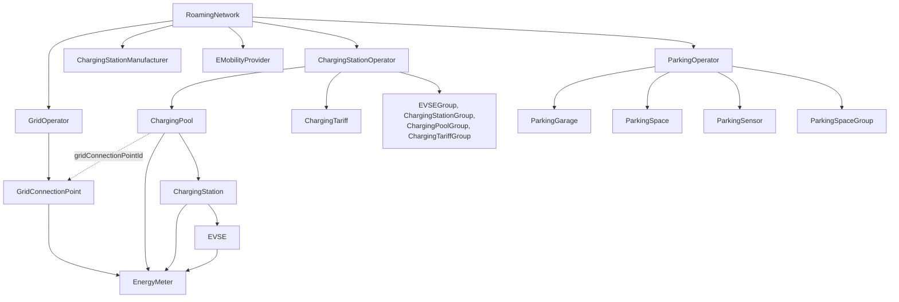

# WWCP POI 3: entities

This directory documents the entities of POI 3: every type deriving from
`AImmutableEMobilityEntity`, with all the properties a change set can manage, and the
large substructures they embed. What is common to all of them, the base class, is explained below.

For the model as a whole - change sets, owners, history, sync - see the [README](../README.md);
for the bytes that are hashed and signed, the [specification](../SPECIFICATION.md).


## Overview



| Entity | Embedded in, as | Owner | What it is |
|---|---|---|---|
| [RoamingNetwork](RoamingNetwork.md) | — (root) | roaming network operator (RNO) | One version of a roaming network with everything it embeds; carries the ETags. |
| [ChargingStationOperator](ChargingStationOperator.md) | roaming network, `chargingStationOperators` | the operator; added and removed by the RNO | A CPO with its charging pools, tariffs and groups. |
| [ChargingPool](ChargingPool.md) | operator, `chargingPools` | its operator | A charging location: address, opening times, facilities, grid connection, stations. |
| [ChargingStation](ChargingStation.md) | charging pool, `chargingStations` | its operator | A charger with its EVSEs, manufacturer and model, energy status. |
| [EVSE](EVSE.md) | charging station, `EVSEs` | its operator | One charging point: power, voltage, current, connectors, tariffs, energy status. |
| [ChargingTariff](ChargingTariff.md) | operator, `chargingTariffs` | its operator | A price, as in OCPI: currency, elements, price components, restrictions. |
| [EVSEGroup](EVSEGroup.md) | operator, `EVSEGroups` | its operator | EVSEs of the operator, optionally with a common tariff. |
| [ChargingStationGroup](ChargingStationGroup.md) | operator, `chargingStationGroups` | its operator | Charging stations of the operator, optionally with a common tariff. |
| [ChargingPoolGroup](ChargingPoolGroup.md) | operator, `chargingPoolGroups` | its operator | Charging pools of the operator, optionally with a common tariff. |
| [ChargingTariffGroup](ChargingTariffGroup.md) | operator, `chargingTariffGroups` | its operator | Charging tariffs of the operator. |
| [EnergyMeter](EnergyMeter.md) | pool, grid connection point, station, EVSE | whoever owns or maintains what embeds it | A meter with its role, manufacturer, model, versions and transparency software. |
| [ChargingStationManufacturer](ChargingStationManufacturer.md) | roaming network, `chargingStationManufacturers` | RNO | A maker of charging stations, named by stations' `manufacturerId`. |
| [EMobilityProvider](EMobilityProvider.md) | roaming network, `eMobilityProviders` | the provider; added and removed by the RNO | An EMSP, with its keys. |
| [GridOperator](GridOperator.md) | roaming network, `gridOperators` | the grid operator, or the RNO while it has no keys; added and removed by the RNO | A DSO with its grid connection points, each signed by its maintainer. |
| [ParkingOperator](ParkingOperator.md) | roaming network, `parkingOperators` | the parking operator; added and removed by the RNO | Runs garages, spaces and sensors and offers parking products. |
| [ParkingGarage](ParkingGarage.md) | parking operator, `parkingGarages` | its parking operator | A car park with opening times, images and products. |
| [ParkingSpace](ParkingSpace.md) | parking operator, `parkingSpaces` | its parking operator | One parking space, possibly in a garage, with sensors and charging stations. |
| [ParkingSensor](ParkingSensor.md) | parking operator, `parkingSensors` | its parking operator | A sensor detecting whether a space is occupied. |
| [ParkingSpaceGroup](ParkingSpaceGroup.md) | parking operator, `parkingSpaceGroups` | its parking operator | Parking spaces of the operator, e.g. one level or zone. |

The documents for these entities also cover what they embed that is no entity of its own, i.e. that has no
status and no file here:

| Substructure | Documented in |
|---|---|
| Brands, energy meter manufacturers, transparency software and certificates | [RoamingNetwork](RoamingNetwork.md) |
| Signing and identity keys | [RoamingNetwork](RoamingNetwork.md), and each party: [ChargingStationOperator](ChargingStationOperator.md), [EMobilityProvider](EMobilityProvider.md), [GridOperator](GridOperator.md), [ParkingOperator](ParkingOperator.md) |
| Data licenses | [RoamingNetwork](RoamingNetwork.md), [ChargingStationOperator](ChargingStationOperator.md), [ChargingPool](ChargingPool.md) |
| Logos, contact data | [ChargingStationOperator](ChargingStationOperator.md) |
| Grid connection points and their maintainers | [GridOperator](GridOperator.md) |
| Authentication modes, opening times, energy mix, images, related locations | [ChargingPool](ChargingPool.md) |
| Charging connectors | [EVSE](EVSE.md) |
| Tariff elements, price components, restrictions | [ChargingTariff](ChargingTariff.md) |
| Transparency software status | [EnergyMeter](EnergyMeter.md) |
| Parking products | [ParkingOperator](ParkingOperator.md) |


## AImmutableEMobilityEntity

```csharp
public abstract class AImmutableEMobilityEntity<TId, TAdminStatus, TStatus> : AImmutableInternalData,
                                                                              IImmutableEntity<TId>,
                                                                              IHasId<TId>,
                                                                              IAdminStatus<TAdminStatus>,
                                                                              IStatus<TStatus>
    where TId          : IId
    where TAdminStatus : IComparable
    where TStatus      : IComparable
```

Source: [AImmutableEMobilityEntity.cs](../WWCP_POI3/DataStructures/AImmutableEMobilityEntity.cs),
[AImmutableInternalData.cs](../WWCP_POI3/DataStructures/AImmutableInternalData.cs).

Every entity of POI 3 is a sealed subclass naming three types: its identification (`ChargingPool_Id`),
its admin status (`ChargingPoolAdminStatusType`) and its status (`ChargingPoolStatusType`). The base
class gives all of them the same frame:

- **Immutable content.** An entity is one version. Nothing of its content changes in place: a change
  set makes a new roaming network with new entities wherever something changed, and the old version stays
  as it was. All properties of the content are get-only, the collections immutable.
- **Identity by its identification.** Two versions of an entity are the same entity: subclasses compare,
  order and hash by `Id` only (`Equals`, `CompareTo`, `GetHashCode`, `ToString`). Whether two versions
  have the same content, their ETags tell.
- **Three kinds of data**, kept strictly apart:

  | Kind | What | In the ETags | Changed by |
  |---|---|---|---|
  | Content | identification, name, description, data source, timestamps, custom data, and every property of the subclass | yes | change sets, signed by the owner |
  | Runtime status | admin status, status (and the energy status of stations and EVSEs) | no | `SetAdminStatus`/`SetStatus`, the history's `RuntimeStatus`, status updates of peers |
  | Internal data | a local dictionary for whoever runs the entity | no | the local process only; never serialized |

  Runtime status and internal data belong to the entity, not to a version: every version of an
  entity shares them with the one before.


### Common properties

These are the properties every entity has; the files of the entities list them only briefly.

| JSON key | C# property | Type | Description |
|---|---|---|---|
| `@id` | `Id` | `TId` | The identification, mandatory, never empty. It can not be changed: a different identification is a different entity. Where it must be unique, and which operator it names, the subclass decides. |
| `name` | `Name` | `ImmutableI18NString` | Optional multi-language name, `{"en": "…", "de": "…"}`; empty when absent, and then not written. |
| `description` | `Description` | `ImmutableI18NString` | Optional multi-language description, as `name`. |
| `dataSource` | `DataSource` | `String?` | Optional source of the information, e.g. the importer used. A change set sets it to a nonempty text or removes it. |
| `created` | `Created` | `DateTimeOffset` | When the entity was created. Always written, UTC to the millisecond; mandatory when JSON or CBOR is read, see below. |
| `lastChange` | `LastChangeDate` | `DateTimeOffset` | When its content was changed last. Always written as `created`; a change set sets it to its `createdAt`, so that everyone applying it gets the same ETags. A change of an embedded entity is a change of everything embedding it, up to the roaming network: they all get the `createdAt` as well. |
| `customData` | `CustomData` | `CustomDataNew` | Optional JSON object for vendor-specific extensions; part of the content and of the ETags, written only when it has values. The getter returns a copy. |
| `eTags` | `ETags` | `ImmutableArray<ETag>` | Digests of the canonical JSON and deterministic CBOR representations, see [ETags](#etags). Only the roaming network writes them into its representation. |
| — | `InternalData` | `UserDefinedDictionary` | Local runtime context, never serialized, not part of the content; `IsDefined`, `GetInternalData(As)`, `TryGetInternalData(As)`, `IfDefined(As)` read it. |
| — | `AdminStatus`, `Status` | `Timestamped<TAdminStatus>`, `Timestamped<TStatus>` | The current runtime status, see [Runtime status](#runtime-status). |

Defaults when creating an entity in C#: `created` is the given creation, else the given last change, else now;
`lastChange` the given last change, else the creation, else now. Both are cut to the millisecond, as their
representations keep them.

Reading JSON or CBOR, `created` is mandatory and `lastChange` is the creation unless given. Otherwise an entity
read without its creation would be created *now*, and everyone reading the same representation, e.g. of a change
set, would get another version with other ETags. The one exception is the entity a change set adds: unless given,
its creation is the `createdAt` of the change set. Its embedded children, e.g. the EVSEs of an added charging
station, need their own. Objects without timestamps (brands, grid connection points, parking products) refuse
them.

A change set names the property by its JSON key: `name`, `description`, `dataSource` and `customData`
can be updated and removed for every entity type, `@id`, `created` and `lastChange` for none. Which further
properties a type allows is listed in its file, in the column *Change set*.


### Runtime status

Every entity has an **admin status** (what its operator declares, e.g. `Operational`, `OutOfService`) and
a **status** (what it is, e.g. `Available`, `Charging`), each kept as a `RuntimeStatusSchedule<T>`:
timestamped values, newest first, with past entries as history and future entries as planned status.

| Member | Description |
|---|---|
| `AdminStatus`, `Status` | The current entry: the latest one not in the future. Setting them inserts an entry. |
| `AdminStatusSchedule(…)`, `StatusSchedule(…)` | All entries, newest first, filtered by timestamp and value, with `Skip` and `Take`. |
| `SetAdminStatus(value)`, `SetStatus(value)` | Insert a value now. |
| `SetAdminStatus(value, timestamp)`, `SetStatus(value, timestamp)` | Insert a value at the given time; a future timestamp plans it. |
| `SetAdminStatus(timestamped)`, `SetStatus(timestamped)` | Insert a `Timestamped<T>`. |
| `SetAdminStatus(list, ChangeMethods)`, `SetStatus(list, ChangeMethods)` | `Replace` (default) the whole schedule by the list, or `Insert` the list into it. |
| `DefaultMaxAdminStatusScheduleSize`, `DefaultMaxStatusScheduleSize` | 50 entries each, unless the constructor is given another size; older entries are dropped. |

Every `Set…` takes an optional `Context` as the data source of the update, passed to the events.

- **Inserting** a value equal to the one in effect right before its timestamp changes nothing, unless it
  replaces an entry with the same timestamp. An entry with the same timestamp is replaced.
- **Initial status:** every subclass gives a new entity an admin status and a status as of its creation,
  usually `Operational` and `Available`, unless told otherwise; the files of the entities name them.
- **Shared by all versions:** when a change set makes a new version of an entity, the new version takes the
  schedules of the one before (`ShareRuntimeOf`), and its internal data. So all versions show the same,
  current status, and a status set at an old version is seen at the new one. Subclasses take further runtime
  data the same way (`ShareFurtherRuntimeOf`), e.g. the energy status of charging stations and EVSEs.
- **Events:** subclasses offer `OnAdminStatusChanged` and `OnStatusChanged`, raised with the old and the
  new timestamped status when the *current* value changes. A version
  listens to its schedules only while its events have handlers (`ListenToAdminStatus`,
  `ListenToStatus`), so that versions nobody looks at any more are not kept alive by the schedules they share.
- **Not content:** the runtime status has no ETags and needs no change set. In a history it is read and set
  by entity type and id through `history.RuntimeStatus`, kept in the history's store, sent to peers, and
  part of a snapshot unless `runtimeStatus=false`; see [History and sync](../README.md#history-and-sync).


### ETags

An ETag names a version of an entity by the digest of its content: SHA-256 (or SHA-384, SHA-512) over its
canonical JSON or its deterministic CBOR, as the [specification](../SPECIFICATION.md#3-etags) defines them.
`ETags` holds them ordered by format, JSON before CBOR.

| Method | Description |
|---|---|
| `CalcETags(JObject JSON, Boolean Replace = true)` | The ETag of the canonical JSON; replaces all ETags, or only that of the JSON format when `Replace` is false. |
| `CalcETags(CBORValue CBOR, Boolean Replace = true)` | The same for the deterministic CBOR. |
| `CalcETags(JObject JSON, CBORValue CBOR)` | Both ETags at once. |
| `ValidateETags(JObject JSON, out ErrorResponse)` | Checks the `eTags` declared in a JSON representation, see below. |
| `ValidateETags(CBORValue CBOR, out ErrorResponse)` | The same for a CBOR representation. |

The representation given to `CalcETags` must not contain the ETags. `ValidateETags` takes a representation
*with* its `eTags` and checks that

- it declares ETags at all, each format at most once, and one of its own format;
- the ETag of its own format is the digest of the representation without `eTags`;
- every ETag of another format equals the one stored in this entity, if one is stored.

The representation must be the one the ETags were calculated over: an embedded representation of a child
differs from its own. The roaming network calculates and writes its ETags (see
[RoamingNetwork](RoamingNetwork.md)); POI_API serves every embedded entity with the ETag of the part of the
roaming network that embeds it, as its HTTP `ETag`.


### Collections

The children of an entity, and the parties and registries of a roaming network, are `POICollection<TId, TEntity>`
([source](../WWCP_POI3/DataStructures/POICollection.cs)): immutable, in the ordinal order of the texts of their
identifications (the order of JSON and CBOR), looked up by identification with `TryGet`, `Contains` and `Get`.
Identifications are equal as their type compares them, e.g. most without case, parking products with case; a
collection refuses null entries and an identification given twice. It enumerates its children, so it reads like
any other sequence; `Items`, `Ids` and `Index` give them as an array, their identifications, and a dictionary.

A collection also keeps its representations: `Representation(view, format, json)` calculates the canonical JSON or
CBOR of a view, e.g. the list of its children in short, and its ETag once, and returns the same afterwards.
POI_API serves the lists of a roaming network, e.g. `~/RNs/{RN_Id}/CSOs`, from there.


### Errors and logging

`LogEvent(...)` calls all handlers of an event of a subclass concurrently and passes an exception of any of
them to `HandleErrors(module, caller, exception)`; `HandleErrors(module, caller, errorResponse)` is the
same for an error text. Both do nothing unless a subclass overrides them.


### Writing a subclass

What every entity of POI 3 does, and a new one must do as well:

- **Sealed**, deriving from `AImmutableEMobilityEntity<TId, TAdminStatus, TStatus>` and implementing
  `IEquatable<T>` and `IComparable<T>` by its identification; the base class requires `CompareTo(Object?)`.
- **Constructor:** the identification, then the properties of the subclass, then `InitialAdminStatus`,
  `InitialStatus`, `MaxAdminStatusScheduleSize`, `MaxStatusScheduleSize`, `DataSource`, `Created`,
  `LastChange`, `CustomData` and `InternalData`, passed on to the base class; initial status as of
  `Created ?? now`. It validates: no null entries, nothing given twice, children belonging to the operator
  its identification names; and it orders collections as their representation does, mostly ordinally by
  identification, so that equal content has equal bytes.
- **Status events** `OnAdminStatusChanged`/`OnStatusChanged` with add/remove calling `ListenToAdminStatus`/
  `ListenToStatus`, raised from `OnAdminStatusScheduleChanged`/`OnStatusScheduleChanged`.
- **`ToJSON()` and `TryParse(JSON, out entity, out error)`**: `@id` first, absent values left out, the common
  metadata through `POIEntityMetadata.AddTo` and `POIEntityMetadata.TryParse`. CBOR uses the keys and values
  of JSON.
- **Change sets:** the properties a change set may update or remove, and how children are added and removed,
  are part of the roaming network (`RoamingNetwork.*Changes.cs`, `RoamingNetwork.Merge.cs`); ownership, i.e. who
  must sign them, of `RoamingNetwork.Ownership.cs`.
