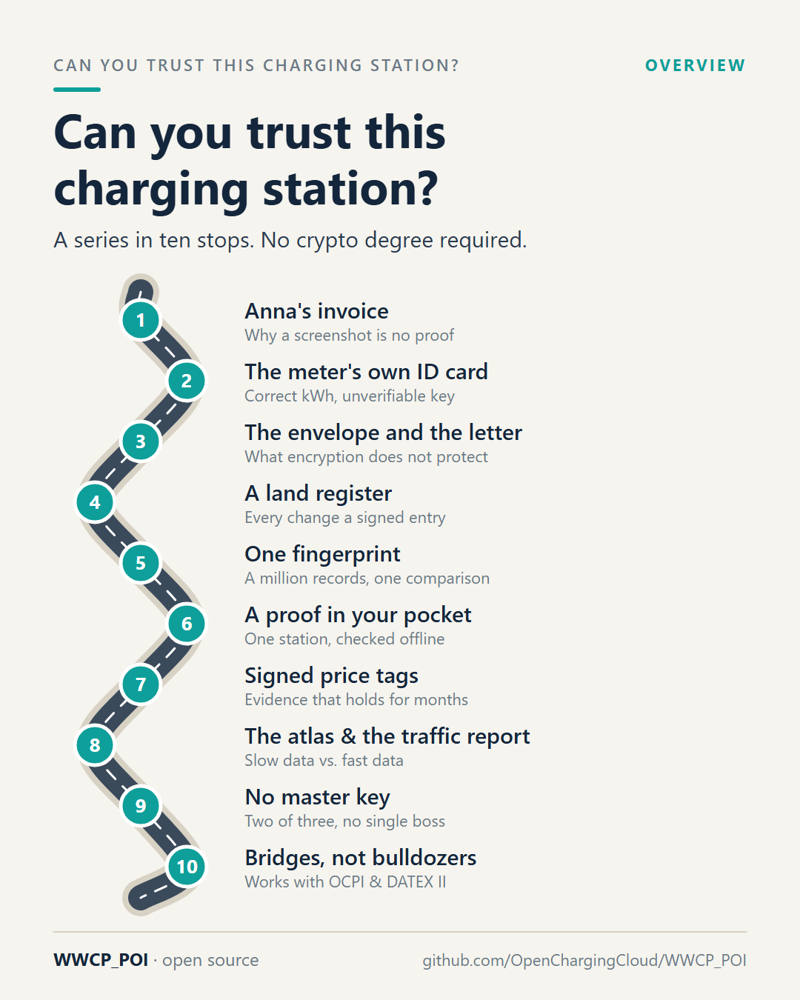

# Part 0 – Can you trust this charging station?

[Series](../README.md) · next: [Part 1 – Anna's invoice](../01-annas-invoice/README.md) →

**Idea:** the kick-off. Metrology makes the kWh and the time right, but nothing around them is authentic. The post
lays out the route of the series; every later part takes one stop of it.

## Post

Your charging session was measured by a calibrated meter. The timestamp is correct. And still, nobody can prove where you charged, at which charging station, or at what price.

That gap is what this little series is about.

Metrology law – the EU's Measuring Instruments Directive (MID) and national rules like the German Eichrecht – makes sure the kilowatt-hours are right and the time is right. That's good and important. But a correct measurement from an unknown place, checked with a meter key nobody can vouch for, at a price nobody can prove, is worth surprisingly little. Worse: it is an open door for anyone who wants to manipulate it.

The data that would close the gap is the most boring data in e-mobility: the "points of interest", or POI. Where is the charging station? Who operates it? Which meter is inside, with which key? Which tariff applies right now? Today this data travels through OICP, OCHP, OCPI and DATEX II. Reliably – but as messages you have to trust, not as evidence you can check.

With WWCP_POI we are building an open source way to change that: charging infrastructure data signed by the party it belongs to, kept like a register, and checkable by anyone. Including the driver's phone. Offline. Months later.

Here is the route, one stop per post:

1. Anna's invoice – why a screenshot is no proof
2. The meter that brings its own ID card
3. The envelope and the letter
4. A land register for charging stations
5. One fingerprint for a million charging points
6. A proof that fits in your pocket
7. The signed price tag and the notary's stamp
8. The atlas and the traffic report
9. No master key, no single boss
10. Bridges, not bulldozers

No crypto degree required. I promise analogies, not equations.

Which stop are you most curious about? 👇

#emobility #EVcharging #Eichrecht #MID #AFIR #OCPI #OpenSource #WWCP_POI

## First comment

The specification, the code and examples you can run on a laptop: https://github.com/OpenChargingCloud/WWCP_POI

WWCP_POI is open source (AGPL-3.0) and partly funded by NLnet's NGI Zero Commons Fund as part of the EVQI project.

## Visuals

`route.png` (source `route.svg`), 1080 × 1350.

Alt text: *A motorway drawn as a winding road with ten numbered charging stops, one for each part of the series:
Anna's invoice, the meter's own ID card, the envelope and the letter, a land register, one fingerprint, a proof in
your pocket, signed price tags, the atlas and the traffic report, no master key, bridges not bulldozers.*

## For the experts

What the series explains, in the terms of the [specification](../../SPECIFICATION.md) and the
[README](../../README.md):

| Part | Analogy | In WWCP_POI |
|---|---|---|
| 1, 2 | invoice, self-made ID card | why POI must be evidence: meter keys (`energyMeters[].publicKeys`), tariffs, operators |
| 3 | envelope and letter | TLS per hop vs. change sets signed by their owners (section 4) |
| 4 | land register | change sets, commits, the history as a graph (sections 4, 5) |
| 5 | fingerprint, family tree | ETags over canonical JSON/CBOR, the effective tree (sections 3, 8.2) |
| 6 | sealed book, one page | charging station proofs, attestations, trust anchors (sections 8.4 to 8.6) |
| 7 | price tag, notary's stamp | price statements, checkpoints, witnesses (sections 10, 12) |
| 8 | atlas, traffic report | content vs. runtime status, the WebSocket API |
| 9 | vault with two of three keys | no leader, RNO quorum (`minConsensus`), key usages, epochs (section 11) |
| 10 | bridges | OCPI 2.3 and DATEX II 3.7 importers and publishers |

## Check before posting

- The MID covers meters for alternating current (MI-003); direct current is regulated nationally, e.g. by the German
  Eichrecht. The post names both together as "metrology law" and claims nothing of the MID beyond correct
  measurement – keep it that way if the wording changes.
- The numbering of the route must match the titles of the parts that are actually posted.
