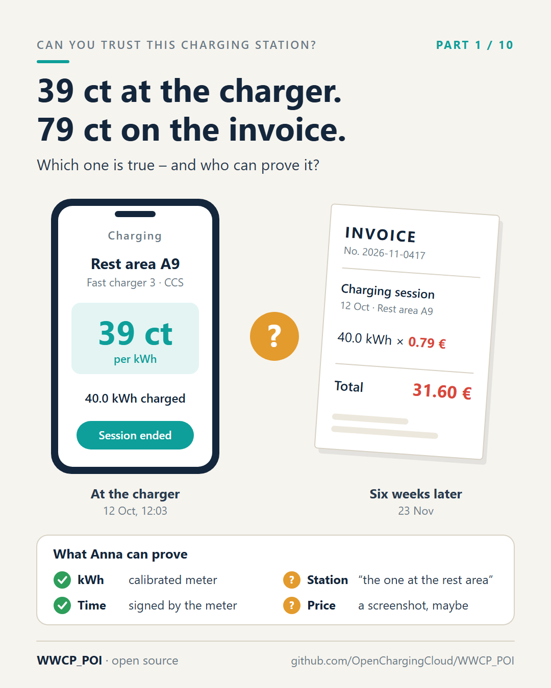

# Part 1 – Anna's invoice

[Series](../README.md) · ← [Part 0 – Overview](../00-overview/README.md) ·
[Part 2 – The meter that brings its own ID card](../02-the-meters-own-id-card/README.md) →

**Idea:** a story anyone can follow. The measurement is perfect, and still nothing can be proved, because the price
and the charging station are not evidence. Anna comes back in parts 6 and 7, where her story gets a better ending.

## Post

Anna paid 39 cents per kWh. Six weeks later, her invoice says 79.

She had stopped at a fast charger on the motorway. Her charging app showed 39 ct/kWh. She charged 40 kWh, didn't pay anything at the station, and drove on. Then the invoice arrived: 31.60 € instead of 15.60 €.

Who is right?

Anna has quite a lot of evidence – just not the right kind:

- The kilowatt-hours: measured by a calibrated meter. ✅
- The time: signed by that meter. ✅
- The charging station: "the one at the rest area, I think". ❓
- The price: a screenshot. If she thought of taking one. ❓

A screenshot proves that something was on a screen. It doesn't prove who put it there, or that it was the price of this charging station at that moment. Her charging provider will say the app showed an outdated tariff. The app will say it got the data from a roaming platform. The platform will say it forwarded what the operator sent. Everybody may be honest – and nobody can prove anything.

This is not an exotic edge case. Charging station data passes through several companies before it reaches a phone: the operator, one or more roaming platforms, aggregators, map services, the app. Each one stores it, converts it and passes it on. None of them can show where a particular price originally came from.

What Anna needs is easy to describe:

- the price, signed by whoever set it – the operator of the station, or her charging provider,
- proof that this charging station really is the one its operator registered,
- and a way to show both months later, without having to trust anyone in between.

That is what "authentic POI data" means. Making it possible is what WWCP_POI is about – and what the rest of this series explains.

Have you ever had to dispute a charging invoice? How did it end?

#emobility #EVcharging #ConsumerProtection #AFIR #WWCP_POI

## First comment

How we approach it, in the open: https://github.com/OpenChargingCloud/WWCP_POI – and the whole series:
[part 0](../00-overview/README.md).

## Visuals

`invoice.png` (source `invoice.svg`), 1080 × 1350.

Alt text: *Left, a phone at the charger showing 39 ct per kWh for 40 kWh at a fast charger on the A9. Right, an
invoice six weeks later: 40 kWh at 0.79 € makes 31.60 €. Between them a question mark. Below, what Anna can
prove: the kWh and the time, yes; the charging station and the price, no.*

## For the experts

- Who sets Anna's price decides who signs it. An ad hoc price at runtime is the **price status** of an EVSE with a
  **price statement** signed by the charging station operator ([SPECIFICATION.md](../../SPECIFICATION.md),
  section 12). A tariff is content, signed by the operator in its change set. A contract price of her e-mobility
  provider is a **charging tariff offer** of that provider, signed by the provider
  ([docs/ChargingTariffOffer.md](../../docs/ChargingTariffOffer.md)).
- "This charging station really is the one its operator registered" is a **charging station proof** against an
  **attestation** of the roaming network operator (section 8); "months later" is the proof of its commit in a
  **checkpoint** (section 10).
- The story is made up; the numbers add up (40 kWh × 0.39 € = 15.60 €, × 0.79 € = 31.60 €).

## Check before posting

- Anna is fictional. If someone asks: say so, and that the pattern is not.
