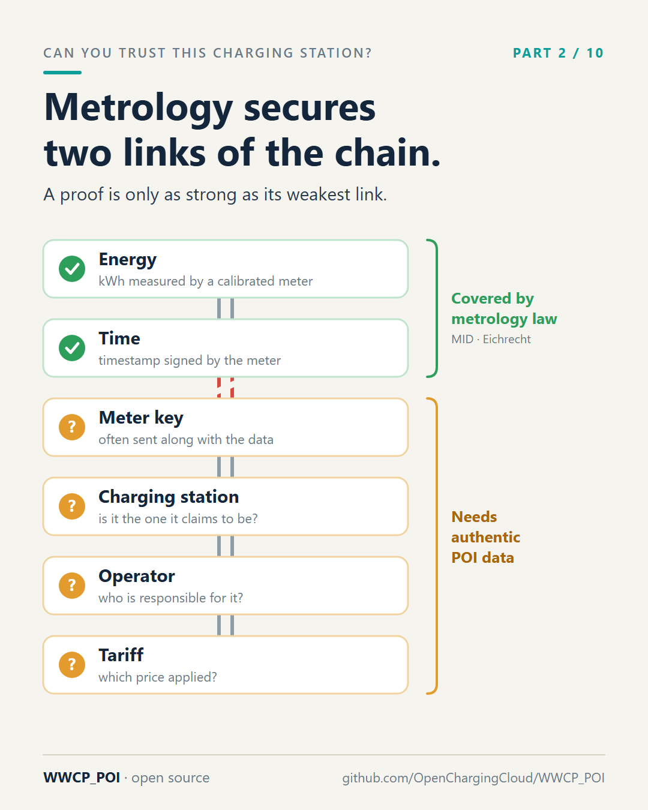
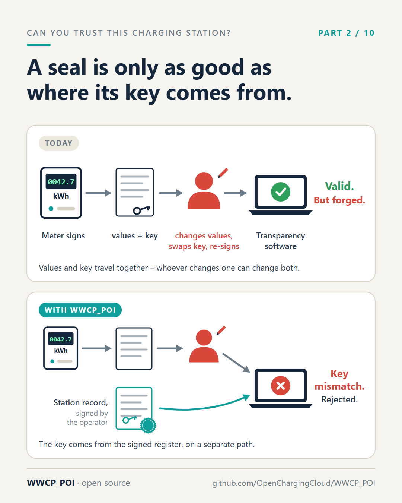

# Part 2 – The meter that brings its own ID card

[Series](../README.md) · ← [Part 1 – Anna's invoice](../01-annas-invoice/README.md) ·
[Part 3 – The envelope and the letter](../03-the-envelope-and-the-letter/README.md) →

**Idea:** the metrology part. Signed measurements are good, but a signature checked with a key that travels along
with the data proves nothing, and the measurement says nothing about the station, the operator and the tariff.
Correct kWh and correct time without authentic POI data are a weak proof and an attack vector.

## Post

Imagine someone at your door shows you an ID card. The photo matches, the stamp looks official. Then you notice: they printed the card themselves. And the stamp.

That's roughly how we check charging measurements today.

Metrology law cares about two things here: the energy is measured correctly, and the time is right. The German Eichrecht went one step further and brought something genuinely good: the energy meter in a charging station signs its measurements digitally. Kilowatt-hours and time, sealed by the meter. With transparency software, a driver can check that nothing was changed afterwards.

But to check a seal, you need the meter's public key – the counterpart of its seal. And where does that key come from? Often it travels in the same roaming message, right next to the values it is supposed to verify.

So whoever can change the values on the way can also replace the key, sign again with their own, and the check says: ✅ valid.

The fallback: the key is also shown on the charging station itself. Honestly – who compares 128 hexadecimal characters at 10 pm in the rain?

And the key is only one gap. A perfectly signed measurement says nothing reliable about:

- which charging station the meter actually sits in,
- which operator is responsible for it,
- which tariff applied at that moment.

Correct kWh + correct time + unverifiable context = a weak proof. And an attack vector: swap a key, relabel a station, change a tariff after the fact, slip fake stations or fake payment links into an app – none of it can be detected as long as the context data itself is not authentic.

In WWCP_POI, the public keys of a meter are part of the charging station's record. That record is signed by the operator it belongs to, confirmed by the roaming network, and reaches the driver on a path that has nothing to do with the measurement. The key a measurement brings along must match the key the register knows. If it doesn't: ❌.

Metrology secures the measurement. Authentic POI data secures everything around it. We need both.

#Eichrecht #MID #Metrology #EVcharging #emobility #CyberSecurity #WWCP_POI

## First comment

Where the keys of a meter live in WWCP_POI: https://github.com/OpenChargingCloud/WWCP_POI/blob/master/docs/EnergyMeter.md

## Visuals

Two images; the first one carries the post, the second one is the attack in one picture.

`evidence-chain.png` (source `evidence-chain.svg`), 1080 × 1350.

Alt text: *A chain of six links. Energy in kWh and the time are green, covered by metrology law such as the MID and
the Eichrecht. The link to the meter key is broken; the meter key, the charging station, the operator and the tariff
are marked with question marks: they need authentic POI data.*

`key-swap.png` (source `key-swap.svg`), 1080 × 1350.

Alt text: *Two rows. Today: the meter signs, values and key travel together, an attacker changes the values, swaps
the key and signs again, and the transparency software says valid. With WWCP_POI: the values travel as before, but
the key comes from the station record signed by the operator, on a separate path; the transparency software finds
that the keys do not match and rejects the measurement.*

## For the experts

- An energy meter names its `signatureMethods` (e.g. `OCMF`, `EDL40`) and its `publicKeys`: the DER encoded
  SubjectPublicKeyInfo, identified by its SHA-256, optionally with its certificate chain
  ([README](../../README.md), "Energy meter"; [docs/EnergyMeter.md](../../docs/EnergyMeter.md)). A meter belongs to a
  pool, a station, an EVSE or a grid connection point; its transparency software releases and their certificates are
  in the network as well.
- The station record reaches the app as a **charging station proof** (section 8), so the key is checked against data
  signed by the operator and attested by the roaming network operator – not against what came with the measurement.
- The OCPI CDR's `signed_data` and the OICP CDR's calibration law data carry the public key next to the signed
  values; that's the "often" in the post.

## Check before posting

- "128 hexadecimal characters": an uncompressed secp256r1 key without its prefix byte. Other curves give other
  lengths; the point stands either way.
- Where exactly the Eichrecht requires the key to be shown (display, label, both) depends on the type examination;
  the post only says "also shown on the charging station itself".
- The OCPI/OICP remark above is for answering comments; check against the version under discussion (OCPI 2.2.1 /
  2.3.0 CDR `signed_data`, OICP 2.3 `CalibrationLawVerificationInfo`).
