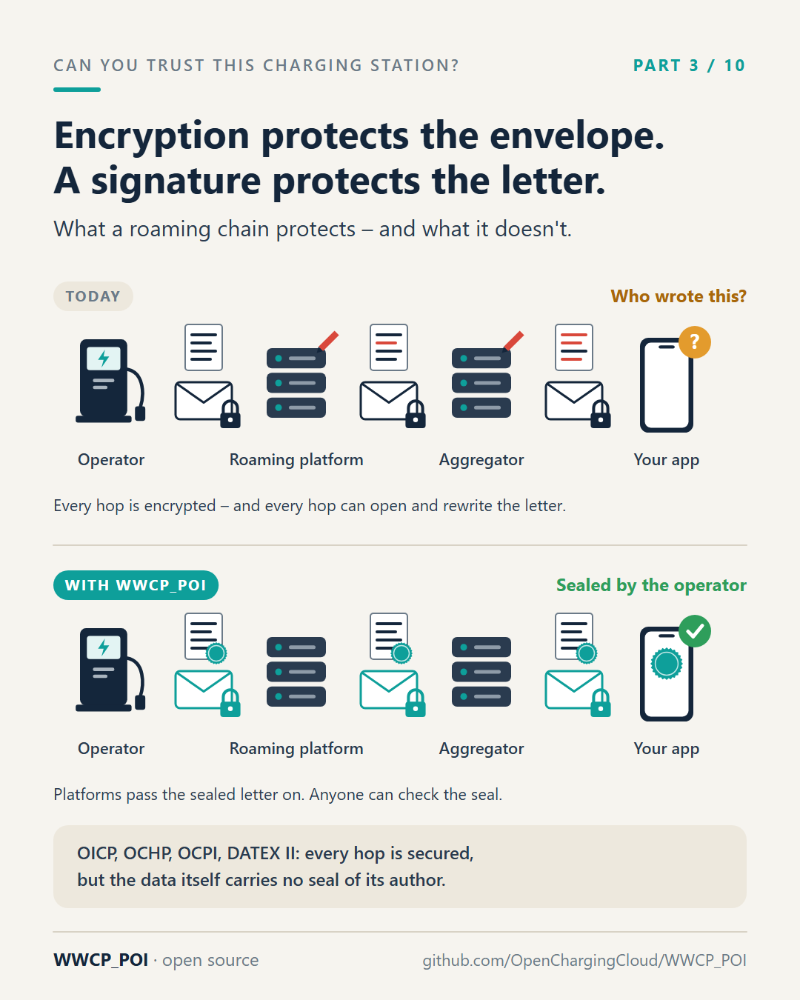

# Part 3 – The envelope and the letter

[Series](../README.md) · ← [Part 2 – The meter that brings its own ID card](../02-the-meters-own-id-card/README.md) ·
[Part 4 – A land register for charging stations](../04-a-land-register/README.md) →

**Idea:** how OICP, OCHP, OCPI and DATEX II differ from WWCP_POI, without bashing them. Encryption per hop protects
the transport; nothing protects the data itself. Plus the two consequences: nobody knows whether two copies are the
same, and the latest message wins.

## Post

"But our roaming connections are encrypted!" True. Let's look at what that actually protects.

Think of charging station data as a letter. The operator writes it and sends it to a roaming platform over an encrypted connection – a sealed envelope. The platform opens the envelope, reads the letter, maybe converts it into another format, and puts it into a new envelope for the next partner. And again. And again. Until it reaches the app on your phone.

Every envelope was sealed. Every hop was secure. But when the letter arrives, nobody can say whether it is still the letter the operator wrote.

Encryption protects the envelope. It says nothing about who wrote the letter.

That's how OICP, OCHP, OCPI and DATEX II work today. They are good protocols, and they do what they were built for: moving data between partners who trust each other. They were not built to produce evidence for someone at the end of the chain who has no contract with the operator at all. Like a driver.

Two more consequences of this design:

- Nobody knows whether two copies are the same. A platform and an app both hold "the" data of 50,000 charging points. Identical? You'd have to compare them record by record. In practice, everyone syncs and hopes.
- The latest message wins. If a record is changed somewhere along the chain – by mistake or on purpose – the change simply becomes the truth for everyone downstream. There's no history to ask who changed what, and when.

WWCP_POI turns this around: the operator seals the letter itself, with a digital signature. Any number of platforms can store it and pass it on. They can still read it – but they can't change it unnoticed. And anyone, anywhere along the way, can check the seal.

Next: what it looks like when every change carries such a seal – a land register for charging stations.

#OCPI #OICP #OCHP #DATEXII #EVroaming #emobility #WWCP_POI

## First comment

Not a replacement overnight – WWCP_POI imports from and publishes to OCPI and DATEX II (more in part 10):
https://github.com/OpenChargingCloud/WWCP_POI

## Visuals

`envelope-and-letter.png` (source `envelope-and-letter.svg`), 1080 × 1350.

Alt text: *Two rows, each from the operator via a roaming platform and an aggregator to the app. Today: every hop is a
locked envelope, but the platforms open and rewrite the letter, and the app asks who wrote it. With WWCP_POI: the
same envelopes, but the letter carries the operator's seal all the way, and the app confirms it was sealed by the
operator.*

## For the experts

- "Seals the letter itself": a **change set** signed by the owners of everything it changes, over canonical JSON,
  with COSE algorithms; the signature names the versioned JSON-LD context of what it signs
  ([SPECIFICATION.md](../../SPECIFICATION.md), sections 1 and 4). Keys are in the network data itself, not in a
  bilateral configuration.
- "Nobody knows whether two copies are the same": the answer is part 5 (ETags, the effective tree).
- "The latest message wins": OCPI's `last_updated` and PUT/PATCH, OICP's full and differential pushes. In WWCP_POI a
  change set names the version it was made for (its before ETags), conflicting changes stay visible as conflicts
  until the owner resolves them (section 5.3).

## Check before posting

- Keep it respectful: the protocols work for what they were made for. Expect comments from people who wrote them.
- If someone mentions OCPI's signed CDR data: that is about meter values, not about locations, tariffs or keys –
  and it carries its own key (part 2).
