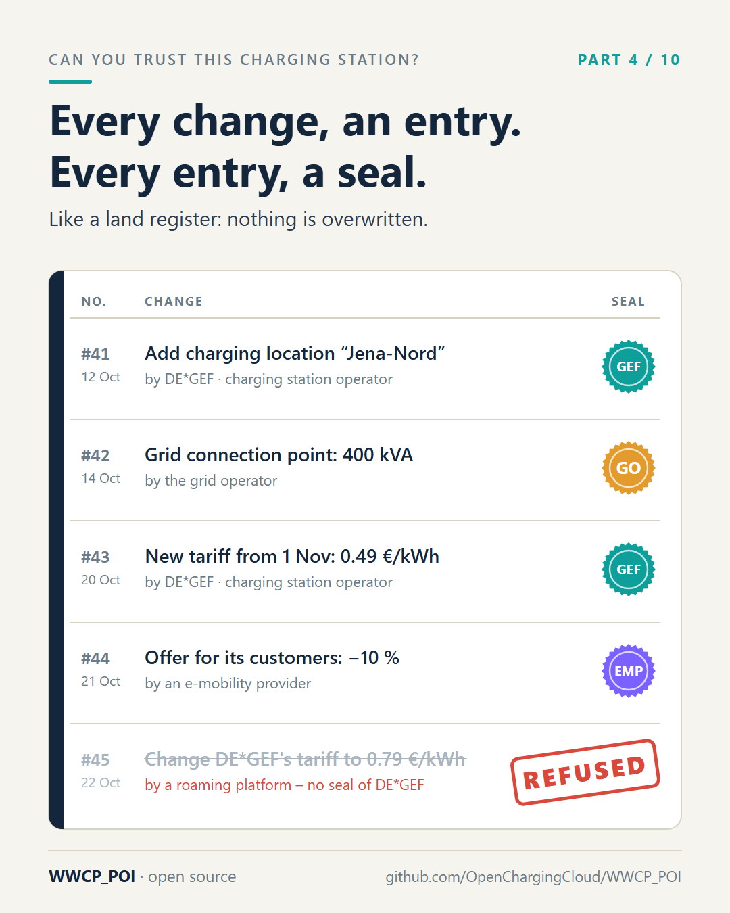
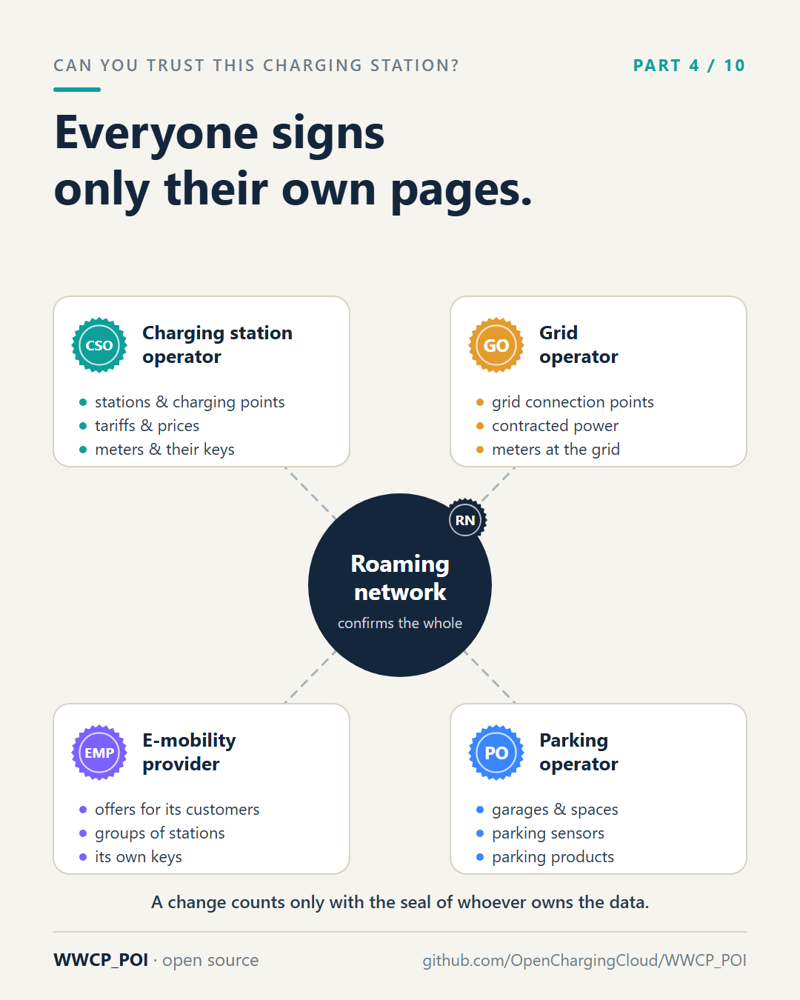

# Part 4 – A land register for charging stations

[Series](../README.md) · ← [Part 3 – The envelope and the letter](../03-the-envelope-and-the-letter/README.md) ·
[Part 5 – One fingerprint for a million charging points](../05-one-fingerprint/README.md) →

**Idea:** what WWCP_POI is. Not a new message format, but a register: every change an entry, every entry signed by
the owner of the data, every copy checkable by anyone. "The Git of EV charging information", told without Git.

## Post

If you want to know who owns a piece of land, you look it up in the land register. You don't just find today's owner – you find every entry since the beginning: who sold, who bought, when. Nothing is overwritten. A mistake is corrected by a new entry, not by erasing the old one.

Now compare that with charging station data. A record says a station delivers 150 kW. Who said so? Since when? What did it say last month? Usually nobody knows. The record was simply overwritten.

WWCP_POI keeps charging infrastructure data like a register:

- Every change is an entry. "Add charging location Jena-Nord." "Replace the connector at charging point 2." "New tariff from 1 November." Each entry names the state it builds on, so together they form a complete, unbroken history.
- Every entry is signed by the owner of the data. A charging station operator signs changes to its own stations and tariffs. A grid operator signs its grid connection points. A charging provider signs its own offers. Nobody can sign for somebody else.
- Everybody can keep a copy, and anybody can check it. A roaming platform, an app, an authority: each can replay the entries and arrive at exactly the same state. An entry with a wrong or missing signature is refused – by everyone.

So when a platform tries to "fix" the price of an operator it doesn't own? Refused. When a record was changed on the way? Detected. When someone asks next year what this station looked like today? Answered.

Software developers will recognise the idea: it's how Git manages source code. We like to call WWCP_POI "the Git of EV charging information". But you don't need to know Git to get it – the land register is picture enough. Or the edit history of a Wikipedia page, with every edit signed.

And because every entry is signed by the party it belongs to, the register doesn't need one central authority that everyone has to trust. More on that in part 9.

#emobility #EVcharging #DataQuality #OpenData #WWCP_POI

## First comment

What an entry looks like, with examples you can run: https://github.com/OpenChargingCloud/WWCP_POI/tree/master/examples

## Visuals

Two images: the register itself, and who signs what.

`register.png` (source `register.svg`), 1080 × 1350.

Alt text: *A ledger with five entries. Entry 41: DE\*GEF adds the charging location Jena-Nord, sealed by DE\*GEF.
Entry 42: a grid operator records a grid connection point of 400 kVA, sealed by the grid operator. Entry 43: DE\*GEF
sets a new tariff from 1 November, sealed. Entry 44: an e-mobility provider offers 10 % off to its customers,
sealed. Entry 45: a roaming platform tries to change DE\*GEF's tariff to 0.79 € per kWh without DE\*GEF's seal; it
is stamped "refused".*

`owners.png` (source `owners.svg`), 1080 × 1350.

Alt text: *The roaming network in the middle, which confirms the whole. Around it four parties, each with its own
seal: the charging station operator signs its stations, charging points, tariffs, prices and meter keys; the grid
operator its grid connection points; the e-mobility provider its offers and groups; the parking operator its
garages, spaces and sensors.*

## For the experts

- An entry is a **change set** in a **commit**: the change set, its `parentIds`, its revision and the ETags of the
  result; the commit id is the SHA-256 of its canonical JSON ([README](../../README.md), "History and sync";
  [SPECIFICATION.md](../../SPECIFICATION.md), section 5).
- "Signed by the owner": a change set is valid only when signed by the owner of everything it changes, with the
  owners' keys in the network data itself (decision of 2026-10-13 in the README). A charging station operator
  signs with its `infrastructure`, `tariffs` or `priceStatements` keys; signed with the wrong one, a pool is refused
  (example A3).
- "Each entry names the state it builds on": the before ETags of the change set; the history is a graph, not a line
  (part 9).
- The pictures use `DE*GEF` from the [examples](../../examples/README.md); "Jena-Nord" is made up.

## Check before posting

- "Land register" works in most countries; in German it's the Grundbuch, which fits even better (changes go
  through a notary). Adjust if posting in German.
