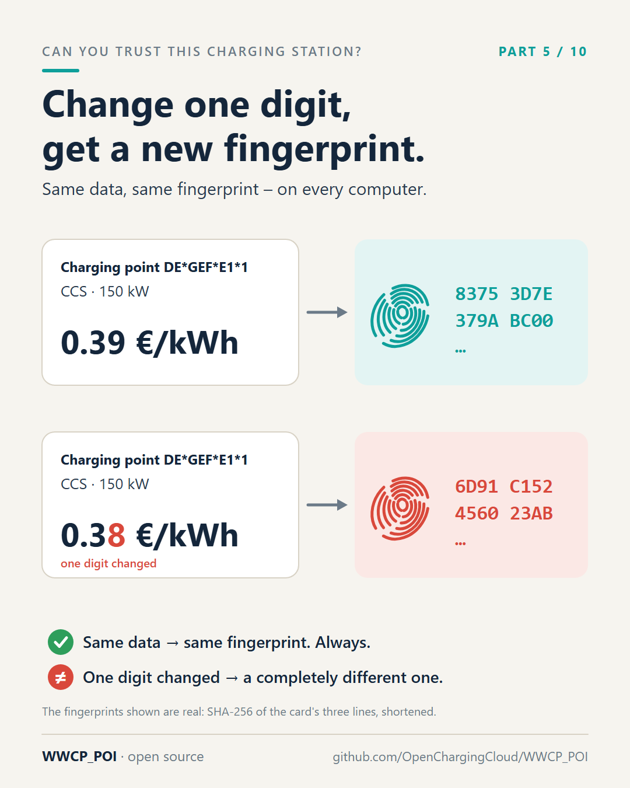
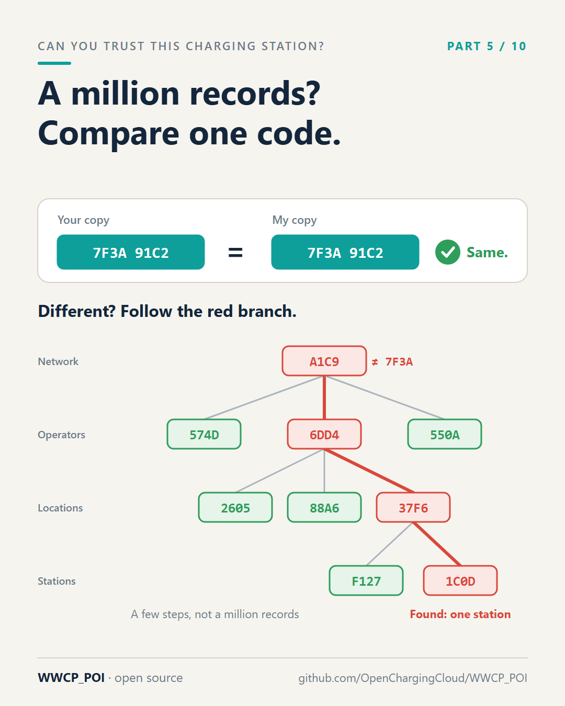

# Part 5 – One fingerprint for a million charging points

[Series](../README.md) · ← [Part 4 – A land register for charging stations](../04-a-land-register/README.md) ·
[Part 6 – A proof that fits in your pocket](../06-a-proof-in-your-pocket/README.md) →

**Idea:** hashes without the word "hash" doing the work. A fingerprint of data, a family tree of fingerprints, and
three superpowers: compare everything with one code, find the difference in a few steps, exchange only that. It
prepares part 6.

## Post

A question that sounds trivial: "Does your database contain the same charging stations as mine?"

With today's roaming protocols, the honest answer is: we don't know. To find out, you would compare every record, field by field. For around a million public charging points – roughly where Europe stands – that's a project, not a check. So everyone exchanges updates and hopes the copies stay in sync. When they don't, an app shows the wrong connector, a removed station lives on, a price is outdated – and nobody notices until a driver does.

WWCP_POI answers the question with a fingerprint.

A digital fingerprint – a "hash", for the technically minded – is a short code calculated from data. Change one character, a single digit of a price, one letter of an address, and the fingerprint changes completely. Same data, same fingerprint: always, on every computer.

Now arrange the fingerprints like a family tree. Every charging point has one. A charging station's fingerprint is calculated from its own data and the fingerprints of its charging points. A location's from its stations. An operator's from its locations. And at the very top: one fingerprint for the whole roaming network.

That gives you three superpowers:

1. Compare a million charging points by comparing one short code. Same code: same data.
2. Different code? Walk down the tree, following only the branches whose fingerprints differ. A few steps later you are at the one location that's different – instead of searching a million records.
3. Exchange only that. No more resending the entire network "just to be sure".

This top fingerprint is also what the roaming network signs. One signature then covers everything below it – which leads to the most useful trick of all: proving one single charging station without all the others. That's part 6.

#emobility #EVcharging #DataQuality #AFIR #WWCP_POI

## First comment

The fingerprints in detail (sections 3 and 8 of the specification):
https://github.com/OpenChargingCloud/WWCP_POI/blob/master/SPECIFICATION.md

## Visuals

Two images: what a fingerprint is, and what the tree of fingerprints is good for.

`fingerprint.png` (source `fingerprint.svg`), 1080 × 1350.

Alt text: *A charging point, CCS, 150 kW, at 0.39 € per kWh, and its fingerprint, a short code. Below, the same
charging point at 0.38 € per kWh: one digit changed, and the fingerprint is completely different. Same data, same
fingerprint, always; one digit changed, a completely different one.*

`fingerprint-tree.png` (source `fingerprint-tree.svg`), 1080 × 1350.

Alt text: *Top: your copy and my copy have the same code, so they are the same. Below: when the codes differ, a tree
of fingerprints from the network over operators and locations down to stations; only the branches whose codes
differ are followed, in red, and after a few steps the one station that differs is found.*

## For the experts

- The fingerprints of the first image are real: SHA-256 over the card's three lines, joined by line breaks, in
  UTF-8, shortened to 16 hexadecimal digits. Real ETags are SHA-256, SHA-384 or SHA-512 over canonical JSON or deterministic CBOR
  ([SPECIFICATION.md](../../SPECIFICATION.md), sections 1 to 3).
- The tree is the **effective tree** (section 8.2): every child array an RFC 9162 Merkle tree of its children; its
  root is the `effectiveTree` ETag of a version and of its commit. The codes in the second image are illustrations.
- Sync itself exchanges commits: `HaveIds()` names the tips and a sample of older commits,
  `TryGetMissingCommits(have)` returns what is missing ([README](../../README.md), "History and sync"). The tree
  locates differences between two versions and makes the proofs of part 6 possible.
- Cost: a version hashes only what is new in it and the paths to the root, e.g. one changed EVSE of one operator of
  50,000 EVSEs in some tens of milliseconds (section 8.7). Load tests go up to 1,000,000 charging stations
  ([WWCP_POI3_LoadTests](../../WWCP_POI3_LoadTests/README.md)).

## Check before posting

- "Around a million public charging points – roughly where Europe stands": check the current figure (e.g. EAFO,
  ACEA) on the day of posting, and whether you mean the EU or Europe.
