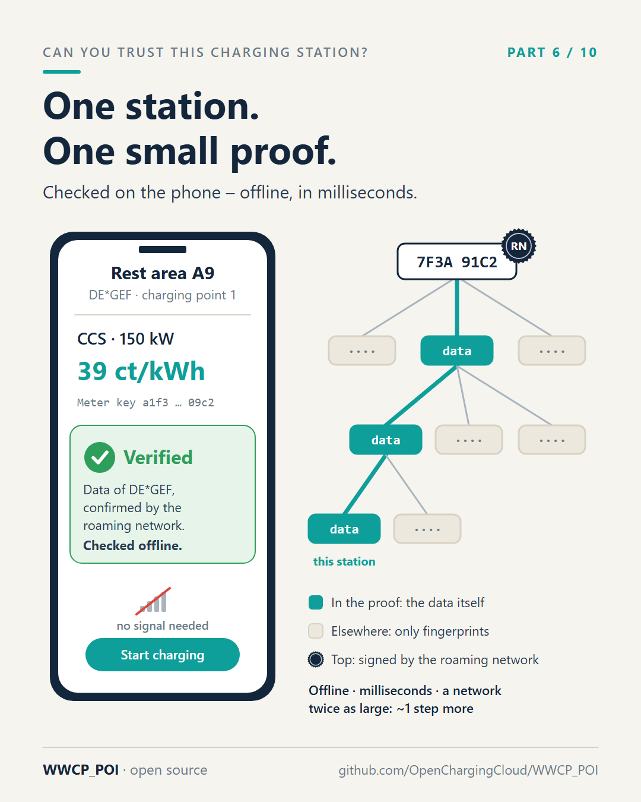
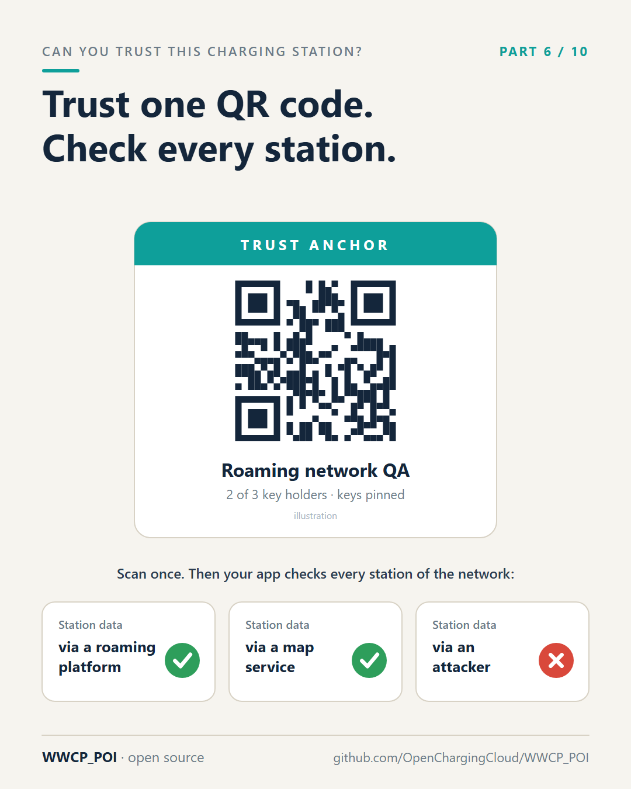

# Part 6 – A proof that fits in your pocket

[Series](../README.md) · ← [Part 5 – One fingerprint for a million charging points](../05-one-fingerprint/README.md) ·
[Part 7 – The signed price tag and the notary's stamp](../07-signed-price-tags/README.md) →

**Idea:** the driver's view. The phone gets one small proof for one station and checks it offline against the
signed top fingerprint; the only thing it must trust is the trust anchor of the roaming network, a QR code.

## Post

Your phone doesn't need a million charging stations to trust one.

Back to Anna at the motorway charger. Her app wants to answer four questions: Is this the right station? Will it work with my car? What will it cost? And can I trust what I'm being shown?

The naive way to make station data checkable would be to give her phone the entire roaming network. Nobody wants that.

WWCP_POI does it differently. Anna's app receives one small document – a proof – for exactly this charging station:

- the station with its charging points, connectors and meters, including the meters' public keys from part 2,
- its operator and the tariffs that apply,
- and a handful of fingerprints from the family tree of part 5: only those on the way from this station up to the top.

The app recalculates that path, from the station data up to the top fingerprint. If it arrives at the fingerprint the roaming network has signed – and recently confirmed again – the data is genuine. If a single digit was changed anywhere along the way, by a platform, a map service or an attacker, the path no longer ends at the signed top.

Think of a sealed book: to know that a page belongs to it, you don't have to read the whole book. The page, plus the index entries linking it to the sealed cover, are enough.

Three details that matter in practice:

- It works offline. Underground car park, no signal? The check is a few dozen calculations on the phone – milliseconds.
- It stays small. A network twice as large makes the proof only about one step longer.
- It needs exactly one thing to trust: the roaming network's "trust anchor", which fits in a QR code. Scan it once, and the app can check every station of that network, no matter which company delivered the data.

"Can I trust what I'm being shown?" finally gets an answer other than "probably".

#emobility #EVcharging #ConsumerProtection #DigitalTrust #WWCP_POI

## First comment

Proofs, attestations and trust anchors in detail (section 8):
https://github.com/OpenChargingCloud/WWCP_POI/blob/master/SPECIFICATION.md

## Visuals

Two images: the proof on the phone, and the trust anchor.

`phone-proof.png` (source `phone-proof.svg`), 1080 × 1350.

Alt text: *Left, a phone showing the fast charger at a rest area on the A9, CCS, 150 kW, 39 ct per kWh, and a green
box: verified, data of DE\*GEF, confirmed by the roaming network, checked offline. Right, a tree of fingerprints:
only the path from this station up to the top is in the proof with its data; the other branches are just their
fingerprints; the top is signed by the roaming network.*

`trust-anchor.png` (source `trust-anchor.svg`), 1080 × 1350.

Alt text: *A card titled trust anchor with a QR code for the roaming network QA, two of three key holders, keys
pinned. Below, station data from a roaming platform and from a map service is accepted, station data from an
attacker is rejected.*

## For the experts

- A **charging station proof** gives the station with its EVSEs completely, the skeletons of its pool and operator,
  the tariffs its EVSEs take, the manufacturers, transparency software and certificates it names, its parking spaces
  and the grid connection point of its pool; every child array complete, pruned to its root, or partial with audit
  paths ([SPECIFICATION.md](../../SPECIFICATION.md), section 8.4).
- "Signed and recently confirmed again": an **attestation** of the roaming network operator
  `{roamingNetworkId, commitId, revision, eTag, role, signer, signedAt, validUntil}`, valid 15 minutes, renewed every
  5 minutes by default (section 8.5).
- "A few dozen calculations": some 50 to 100 hash calculations and one signature verification per attestation
  (section 8.7). "One step longer": the audit paths are RFC 9162 Merkle paths, logarithmic in the size of each
  child array.
- The **trust anchor** is `WWCP/TA-2:` and the Base45 of its CBOR: the network, the thumbprints of the identity keys
  of the roaming network operator and its `minConsensus`, at one or more URLs (section 8.6). The QR code in the
  image is an illustration, not a real anchor.

## Check before posting

- Proof sizes and check times depend on the network; the post makes no number claims beyond "milliseconds". If
  you want to quote a number, measure it with a real proof first (`GET ~/RNs/{id}/…/proof`).
