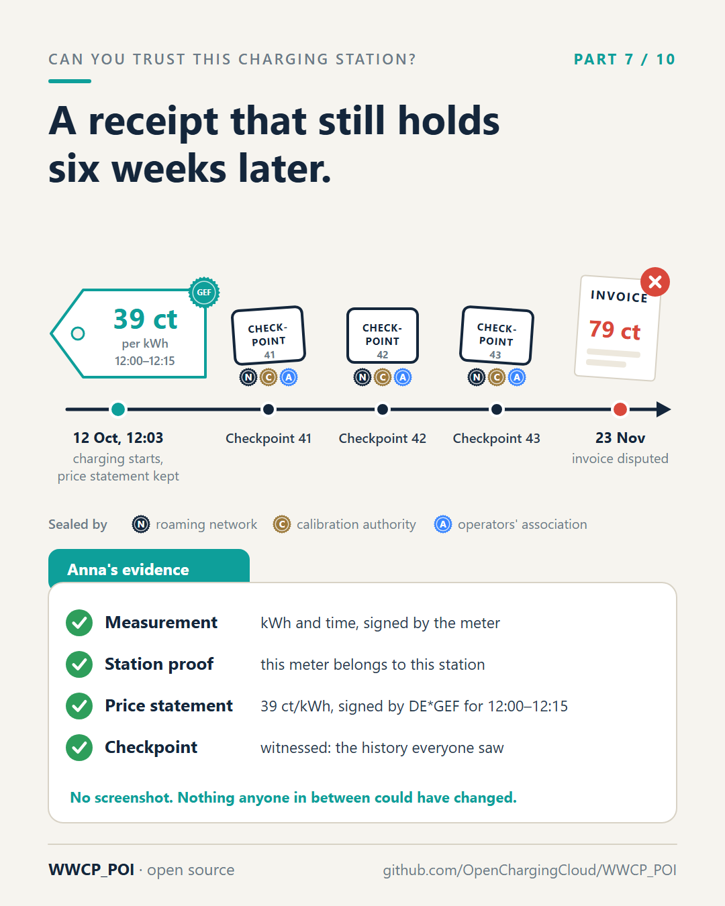

# Part 7 – The signed price tag and the notary's stamp

[Series](../README.md) · ← [Part 6 – A proof that fits in your pocket](../06-a-proof-in-your-pocket/README.md) ·
[Part 8 – The atlas and the traffic report](../08-the-atlas-and-the-traffic-report/README.md) →

**Idea:** Anna's story gets its better ending. Prices are signed statements in a chain, the app keeps them as a
receipt, and checkpoints countersigned by independent witnesses keep the history from being told differently
later.

## Post

Same charging stop, same wrong invoice. But this time, Anna can prove it.

Prices change more often than charging stations. Ad hoc prices can follow the electricity market during the day. So in WWCP_POI, a price is not just a number in some database. Whenever an operator sets the price of a charging point, it issues a price statement – "At charging point DE*GEF*E1*1, from 12:00 to 12:15, energy costs 39 ct/kWh" – signed by the operator. Every statement names the one before it, so no alternative version can be slipped in between later. (If a charging provider sets the price for its own customers, its offer is signed and registered the same way.)

Anna's app keeps the statement that applied when she started charging, together with the proof of the station from part 6. A small file. Her receipt.

Six weeks later the invoice says 79 ct/kWh. Now Anna – or her consumer advice centre – has:

- the calibrated measurement: kWh and time, signed by the meter,
- proof that this meter belongs to this station of this operator,
- the price, signed by the operator itself, for this charging point and this time.

No screenshot. Nothing that anyone in between could have changed.

"But couldn't someone claim the whole register looked different back then?" This is where the notary's stamp comes in.

At regular intervals, the roaming network seals the state of the register in a checkpoint: "Up to here, this is the history." Checkpoints form a chain, each naming the one before. And they are countersigned by independent witnesses – a calibration authority, say, or an association of operators – who sign only after checking the history against their own copy. That makes it practically impossible to show Anna one version of history and a court another.

Evidence that still holds months later – even when the server that produced it is long gone and the price has changed twenty times since. That's what digital consumer protection should look like.

#ConsumerProtection #Eichrecht #EVcharging #emobility #AFIR #WWCP_POI

## First comment

Checkpoints and witnesses, step by step with code (examples A4 to A6):
https://github.com/OpenChargingCloud/WWCP_POI/tree/master/examples

## Visuals

`timeline-evidence.png` (source `timeline-evidence.svg`), 1080 × 1350.

Alt text: *A timeline. On 12 October at 12:03 charging starts, with a price tag of 39 ct per kWh sealed by DE\*GEF.
Then three checkpoints, each countersigned by the roaming network, a calibration authority and an association of
operators. On 23 November the invoice says 79 ct and is disputed. Below, Anna's evidence: the measurement, the
station proof, the price statement and the checkpoint, all checked.*

## For the experts

- A **price statement** `{roamingNetworkId, entityType, entityId, priceStatus, validFrom, validUntil, sequence,
  previous, after, role, signer, signedAt, …}` is signed by a signing key of the charging station operator; each
  entity has its own chain (`sequence`, `previous` = digest of the one before, `after` = the latest checkpoint the
  operator knew); a second statement of the same sequence is refused as a split view
  ([SPECIFICATION.md](../../SPECIFICATION.md), section 12).
- A **checkpoint** names `epoch`, `sequence`, `previousId`, its commit, and the RFC 9162 Merkle root of the commits
  since the one before, and of the price statements taken since (`priceStatements: {@merkleRoot, @size}`). The
  roaming network operator signs first, **witnesses** later, each only for a checkpoint it checked against its own
  copy, one per sequence (sections 10, 12.3; example A6).
- Evidence months later: the station proof embeds `commitId` and `revision`, `TryGetCommitProof` proves the commit
  in a checkpoint, `TryGetPriceStatementProof` the statement (section 10.4, 12.3).
- Contract prices of an e-mobility provider are **charging tariff offers**: content in its signed change sets,
  proved by checkpoints like every other content.

## Check before posting

- The witnesses (a calibration authority, an association of operators) are examples from example A6, not
  organisations that have agreed to anything. Keep "say".
- Whether such a bundle holds up in a dispute is a legal question; the post says "evidence", not "proof in court".
