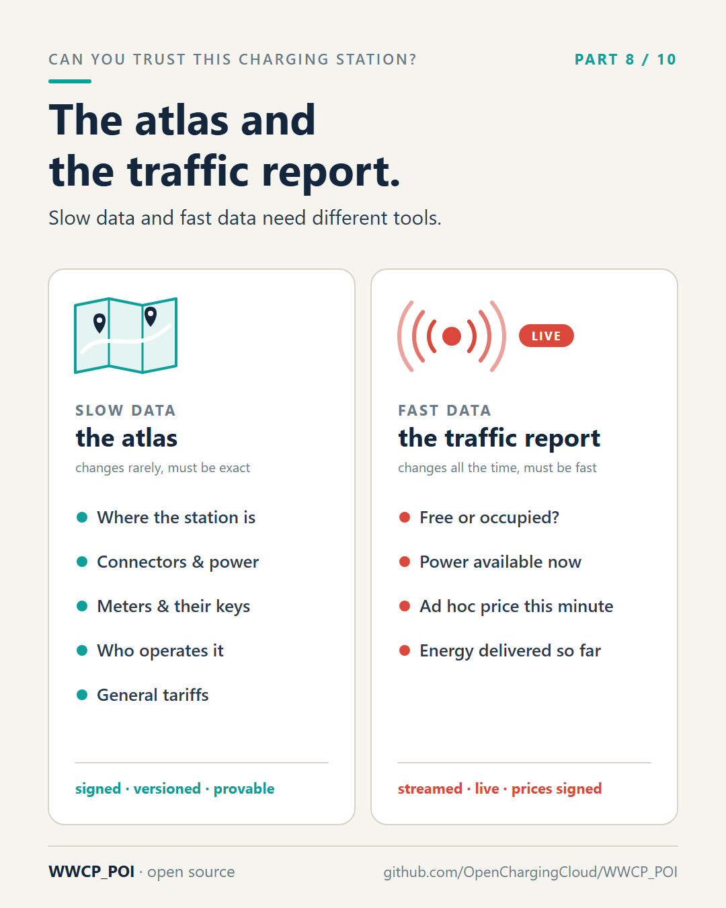

# Part 8 – The atlas and the traffic report

[Series](../README.md) · ← [Part 7 – The signed price tag and the notary's stamp](../07-signed-price-tags/README.md) ·
[Part 9 – No master key, no single boss](../09-no-master-key/README.md) →

**Idea:** slowly changing data and fast changing data need different tools. Today both go through the same kinds
of interfaces, and neither gets what it needs; WWCP_POI keeps a signed register for the one and a live stream for
the other.

## Post

A road atlas changes once a year. The traffic report changes every minute. Both are about the same roads – but nobody prints traffic jams into the atlas, or reads the whole atlas out on the radio every five minutes.

Charging data has the same two sides.

Slow data – the atlas: where a station is, its connectors and power, the hardware and meters inside, who operates it, the general tariffs, the keys. It changes rarely, but it has to be exact, the same everywhere, and provable later.

Fast data – the traffic report: is the charging point free right now? How much power is available? What's the ad hoc price this minute? It changes constantly, and it has to be fast. A "free" that is five minutes old is often wrong.

Today's roaming protocols mostly treat both the same way: as records pushed or pulled through the same kinds of interfaces. The result is a compromise that suits neither. The slow data has no history and no proofs. The fast data is often much older than drivers – and AFIR's requirements for dynamic data – would expect.

WWCP_POI separates them on purpose:

- The atlas is the signed, versioned register from parts 4 to 7: every change an entry, every version with its fingerprint, provable months later.
- The traffic report is a live stream: status changes, energy information and new prices are pushed to everyone who subscribed, over one open connection (a WebSocket, for the developers), the moment they happen. No polling, no waiting for the next sync. And where it matters most – prices – even the fast data carries the operator's signature.

Different data, different needs, different tools. Sounds obvious. It just hasn't been how our industry exchanges data.

#AFIR #EVcharging #emobility #RealTimeData #DATEXII #WWCP_POI

## First comment

The WebSocket API of WWCP_POI, with subscriptions to status changes and commits:
https://github.com/OpenChargingCloud/WWCP_POI#websocket

## Visuals

`atlas-and-traffic.png` (source `atlas-and-traffic.svg`), 1080 × 1350.

Alt text: *Two cards. Left, slow data, the atlas, with a folded map: where the station is, connectors and power,
meters and their keys, who operates it, general tariffs; signed, versioned, provable. Right, fast data, the traffic
report, with a live signal: free or occupied, power available now, the ad hoc price this minute, energy delivered
so far; streamed live, prices signed.*

## For the experts

- Slow data is **content**: everything in the JSON and CBOR representations, versioned, with ETags, in commits
  ([README](../../README.md), "The Domain Model").
- Fast data is **runtime status**: admin status, status, energy status and price status, kept typed in status
  schedules, not content and without ETags; `OnStatusUpdate` and the WebSocket subscriptions (`statusChanges`,
  `commits`) push them ([README](../../README.md), "Runtime", "WebSocket"). The WebSocket uses OCPP-J style frames.
- Signed fast data: **price statements** (section 12 of the [specification](../../SPECIFICATION.md)). Status values
  are not signed.

## Check before posting

- AFIR (Regulation (EU) 2023/1804) requires dynamic data such as availability and the ad hoc price to be made
  available; check the exact wording and the delegated regulation on data before quoting any update interval. The
  post deliberately quotes none.
- The anchor `#websocket` in the first comment must match the README heading on GitHub.
