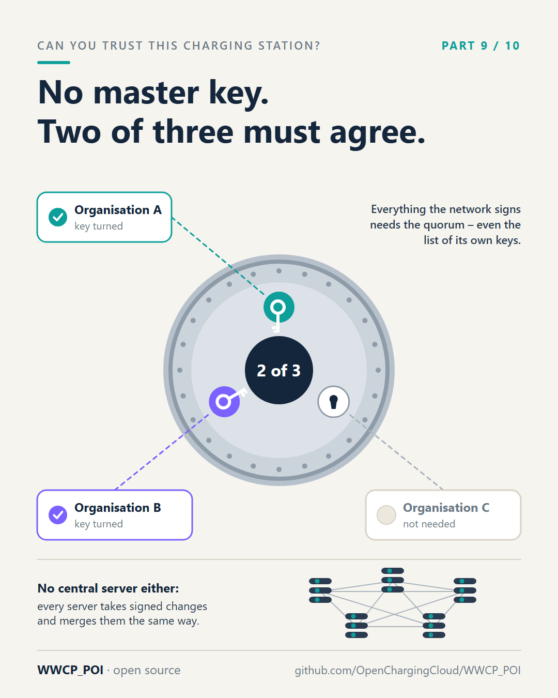
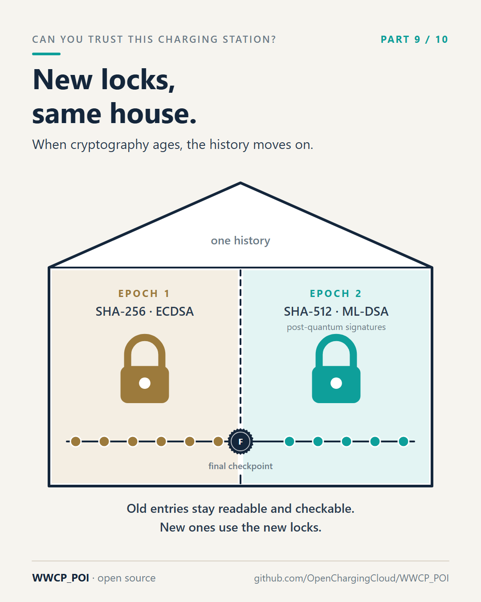

# Part 9 – No master key, no single boss

[Series](../README.md) · ← [Part 8 – The atlas and the traffic report](../08-the-atlas-and-the-traffic-report/README.md) ·
[Part 10 – Bridges, not bulldozers](../10-bridges-not-bulldozers/README.md) →

**Idea:** governance and longevity. No central server, no single key, keys for jobs, and epochs for when
cryptography ages – so that no single company, and no single algorithm, decides for a whole roaming network.

## Post

Whenever I explain WWCP_POI, the same question comes within five minutes: "So who's in charge? Who holds the master key?"

Nobody alone. On purpose.

No central server. Every participating server – a roaming platform, a large operator, an authority – can accept signed changes. The servers exchange them with each other. When two servers accepted different changes at the same time, every server combines them in exactly the same way, so all of them arrive at the same result and the same fingerprint. If two changes truly contradict each other, nothing is silently overwritten: the conflict stays visible until the owner of the data resolves it.

No master key. Every operator signs its own data with its own keys. Even the roaming network operator – the party that confirms the network as a whole – need not be a single company. It can be a group, for example three organisations of which any two must agree: like a bank vault that only opens with two of three keys. Everything the network signs, including the list of its own keys, needs that quorum.

Keys for jobs. An operator can use one key for its infrastructure and another one for its prices. A stolen price key can't change a charging station.

New locks, same house. Cryptography ages. Algorithms that are fine today may not be in ten or twenty years – think of quantum computers. WWCP_POI can move a register into a new "epoch" with stronger algorithms, post-quantum signatures for example, without throwing its history away. The old entries stay readable and checkable; the new ones use the new locks.

Decentralised doesn't mean chaotic. It means no single point of failure – technical, commercial or political.

#emobility #EVcharging #Decentralisation #CyberSecurity #PostQuantum #WWCP_POI

## First comment

Founding a roaming network whose keys three organisations hold, two of them deciding (example A1):
https://github.com/OpenChargingCloud/WWCP_POI/blob/master/examples/exampleA1.md

## Visuals

Two images: the quorum, and the epochs.

`vault.png` (source `vault.svg`), 1080 × 1350.

Alt text: *A round vault door marked "2 of 3" with three keyholes. Organisation A and organisation B have turned their
keys, organisation C is not needed. Below: everything the roaming network signs needs the quorum, including the
list of its own keys; and five servers connected with each other, none in the middle.*

`epochs.png` (source `epochs.svg`), 1080 × 1350.

Alt text: *A house holding one history. In the left room epoch 1, locked with SHA-256 and ECDSA; in the right room
epoch 2, locked with SHA-512 and the post-quantum ML-DSA. A timeline of entries runs through both rooms, with a
final checkpoint at the door between them. Old entries stay readable and checkable, new ones use the new locks.*

## For the experts

- **No leader:** every server commits; the history is a graph of commits; the first two tips that do not conflict
  are merged by a deterministic three-way merge, so all servers make the same merge commits; conflicts stay with
  their `Conflicts` until the owner resolves them ([README](../../README.md), "History and sync";
  [SPECIFICATION.md](../../SPECIFICATION.md), section 5.3).
- **Quorum:** the roaming network operator states its identity keys and its `minConsensus` in a key statement,
  signed by `minConsensus` holders; each holder certifies its own signing keys (section 8.6, example A1).
- **Keys for jobs:** signing keys may name `usages` (`infrastructure`, `tariffs`, `priceStatements`, `party`); a pool
  signed with the tariffs key is refused (example A3).
- **Epochs:** profiles name the hash (`sha256`, `sha384`, `sha512`) and the signature algorithms an epoch accepts;
  the final checkpoint names the next epoch, whose genesis is the version of that checkpoint (section 11).

## Check before posting

- The epoch profile with ML-DSA-65 is the example of the README. Before claiming post-quantum signatures *work*
  today, check which algorithms the COSE layer of Styx verifies in the release you point to; the post says "can
  move … with stronger algorithms, post-quantum signatures for example", which describes the design.
