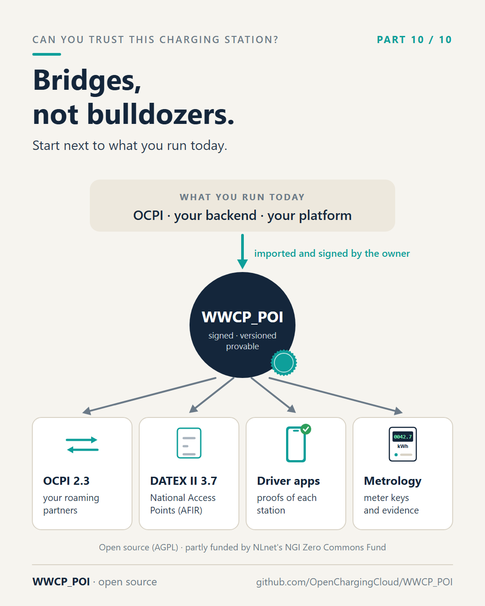
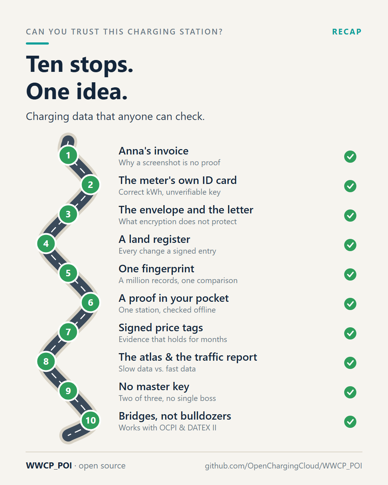

# Part 10 – Bridges, not bulldozers

[Series](../README.md) · ← [Part 9 – No master key, no single boss](../09-no-master-key/README.md)

**Idea:** the practical close. WWCP_POI works next to OCPI and DATEX II, not instead of them; you can start small;
it is open source, publicly funded, and looking for people to try it and to poke holes in it.

## Post

"Nice. But we just finished our OCPI rollout. Do we have to start over?"

No. WWCP_POI is not meant to replace OICP, OCHP, OCPI or DATEX II overnight. It is meant to sit next to them and underneath them – as the place where charging infrastructure data is kept authentic.

- Feed it from what you have: an operator can import its existing data, from OCPI for example, and sign it as its own.
- Feed what you have from it: the same data goes out again as OCPI 2.3, or as DATEX II 3.7 for the National Access Points that AFIR relies on.
- Do what the classic protocols can't: AFIR open data that anyone can verify, audits of what the infrastructure looked like on a given day, sync diagnostics between partners, tariff transparency for drivers.

So you can start small. Publish your own stations signed. Run a node next to your existing platform. Let an app check proofs. Nothing else in your stack has to change on day one.

WWCP_POI is open source (AGPL), developed in the open, and partly funded by NLnet's NGI Zero Commons Fund as part of the EVQI project. The specification is public, and the examples run on a laptop – from founding a roaming network with a 2-of-3 quorum to checkpoints countersigned by witnesses.

Who we are looking for now:

- operators and charging providers who want to try it with real data,
- metrology and consumer protection people who want to poke holes in it,
- roaming platforms who want to build the bridges with us.

If you missed a part: the first post of this series links all ten.

Measured right. Timed right. Now let's make sure everything around it is right, too.

Link in the first comment. 👇

#emobility #EVcharging #OpenSource #OCPI #DATEXII #AFIR #NGI0 #WWCP_POI

## First comment

Code, specification and examples: https://github.com/OpenChargingCloud/WWCP_POI – issues and pull requests welcome.
Funded in part by NLnet's NGI Zero Commons Fund (EVQI): https://nlnet.nl/project/EVQI/

## Visuals

Two images: the bridges, and the whole route once more, every stop done.

`bridges.png` (source `bridges.svg`), 1080 × 1350.

Alt text: *At the top, what you run today: OCPI, your backend, your platform. An arrow down, imported and signed by
the owner, into the WWCP_POI register: signed, versioned, provable. From there four arrows: OCPI 2.3 to your roaming
partners, DATEX II 3.7 to the National Access Points under AFIR, proofs of each station to driver apps, and meter keys
and evidence to metrology.*

`recap.png` (source `recap.svg`), 1080 × 1350.

Alt text: *The winding road of the series once more, all ten stops checked: Anna's invoice, the meter's own ID card,
the envelope and the letter, a land register, one fingerprint, a proof in your pocket, signed price tags, the atlas
and the traffic report, no master key, bridges not bulldozers.*

## For the experts

- Importers and publishers for OCPI 2.3.0 and DATEX II 3.7, tested in both directions; the publishers publish the
  effective members, the importers keep in the templates what they give ([README](../../README.md), "Templates",
  "Use of generative AI"). DATEX II 3.7 because AFIR requires DATEX II from 2026-04-14 and the German NAP takes the
  Mobilithek profile 01-00-00 as JSON (decision of 2026-10-14).
- "Run a node next to your existing platform": the [RoamingHubCLI](https://github.com/OpenChargingCloud/RoamingHubCLI)
  serves a roaming network over HTTP and the WebSocket API; examples A2 and A3 show it.
- "Sign it as its own": only the owner holds its keys, so an operator imports and signs its own data; a platform
  importing someone else's data cannot sign for it.

## Check before posting

- OICP and OCHP have no importer in WWCP_POI; the post only says WWCP_POI is not meant to replace them. Keep it that
  way unless importers exist by then.
- The NLnet project page link must resolve.
